<p align="center">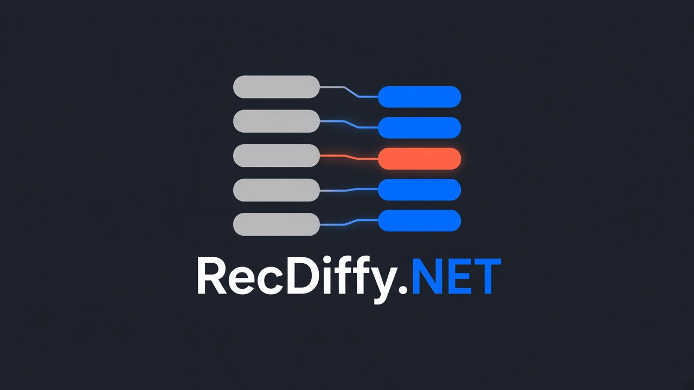</p>

[](https://www.nuget.org/packages/RecDiffy) [](https://github.com/m-vaysman/recdiffy.net/actions/workflows/ci.yml)
[](https://sonar.cobblerhill.net/dashboard?id=m-vaysman_recdiffy.net) [](https://sonar.cobblerhill.net/dashboard?id=m-vaysman_recdiffy.net) [](https://sonar.cobblerhill.net/dashboard?id=m-vaysman_recdiffy.net) [](https://sonar.cobblerhill.net/dashboard?id=m-vaysman_recdiffy.net) [](https://sonar.cobblerhill.net/dashboard?id=m-vaysman_recdiffy.net) [](https://sonar.cobblerhill.net/dashboard?id=m-vaysman_recdiffy.net) [](https://sonar.cobblerhill.net/dashboard?id=m-vaysman_recdiffy.net)
[](https://bench.cobblerhill.net/perf/recdiffy)
[](https://recdiffytests.cobblerhill.net/allure-docker-service/projects/recdiffy/reports/latest/index.html) [](https://m-vaysman.github.io/recdiffy.net/mutation/)

**RecDiffy.NET** is a reconciliation engine for .NET, for the developers behind fund and bank operations. Give it two lists, such as your blotter and the broker's confirms, and it matches every record, compares every field at the tolerance you set, and explains every row left over.

Matching determines which records belong together. Comparison determines whether their field values agree.

A reconciliation runs through **Normalize → Consolidate → Match → Compare → Explain**.

It is the engine inside your own tools, not a workflow or audit platform. Don't write C#? The [Excel add-in](RecDiffy.ExcelAddIn/docs/USER-GUIDE.md) runs the same engine inside Excel.

---

## See it live

[RecDiffy.NET, reconciling public data](https://m-vaysman.github.io/recdiffy.net/) runs the engine on public datasets every business day:

- **FINRA short volume:** each trade facility's daily short-sale file, summed per symbol, against FINRA's consolidated file. About 12,300 symbols a day.
- **US Treasury debt:** each day's change in total public debt against that day's issues minus redemptions. The total ties within rounding, and the split by holder breaks.
- **Tolerance:** the same Treasury data at six tolerances. Too tight and rounding breaks; too loose and real breaks disappear.

---

## 1. Trade match in 60 seconds: our blotter vs broker confirms

```shell
dotnet new console -n TradeMatch && cd TradeMatch
dotnet add package RecDiffy --prerelease
dotnet add package RecDiffy.Extensions --prerelease
```

```csharp
// Program.cs
using System.Data;
using RecDiffy;
using RecDiffy.Extensions;

Order[] orders =
[
    new("OMS-1042", "AAPL", 10_000, 189.2100m),
    new("OMS-1043", "MSFT",  5_000, 411.2500m),
    new("OMS-1044", "NVDA",  2_500, 131.4000m),
    new("OMS-1045", "TSLA",    800, 248.1000m),
    new("OMS-1046", "AMZN",  1_200, 201.4000m),
    new("OMS-1047", "GOOGL",   900, 171.5500m),
    new("OMS-1048", "JPM",   3_000, 214.3000m),
];
Confirm[] confirms =
[
    new("X9917", "AAPL",  10_000, 189.2100m),
    new("X9918", "MSFT",   5_000, 411.2501m),
    new("X9920", "NVDA",   2_000, 131.4000m),
    new("X9921", "AMZN",   1_200, 201.4000m),
    new("X9922", "GOOGL",    900, 171.5500m),
    new("X9923", "JPM",    3_000, 214.3000m),
    new("X9925", "F",        300,  11.0200m),
];

var trades = RecBuilder.Between(orders, confirms)
    .MatchOn(o => o.Sec, c => c.Sec)
    .Compare(o => o.Qty, c => c.Qty)
    .Compare(o => o.Price, c => c.Price, tolerance: 0.0001m)
    .Run();

DataTable table = trades.ToMatchTable();
File.WriteAllText("match.html", $"<style>{DataGrid.Css}</style>{table.ToDataGridHtml()}");   // dotnet run, then open match.html

record Order(string OurRef, string Sec, int Qty, decimal Price);
record Confirm(string BrokerRef, string Sec, int Qty, decimal Price);
```

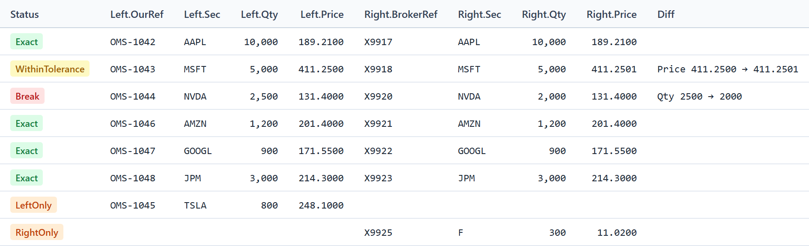

Every grid in this README is the `DataTable` its code returns, drawn with `ToDataGridHtml()`. The examples below add their records and code to the same `Program.cs`.

---

## 2. Position break report: fund books vs custodian

```csharp
Book[] books =
[
    new("Fund A", "US0378331005", 120_000, 189.21m),
    new("Fund A", "US5949181045",  45_000, 411.25m),
    new("Fund B", "US67066G1040",  30_000, 131.40m),
    new("Fund C", "US0231351067",  12_400, 201.40m),
    new("Fund C", "US02079K3059",   8_000, 171.55m),
    new("Fund D", "US30303M1027",   4_200, 590.10m),
    new("Fund D", "US92826C8394",   6_500, 280.00m),
    new("Fund E", "US1912161007",  18_000,  62.40m),
    new("Fund F", "US7427181091",   9_000, 166.80m),
    new("Fund G", "US30231G1022",  15_000, 112.40m),
];
Custody[] custody =
[
    new("Fund A", "US0378331005", 120_000, 189.21m),
    new("Fund A", "US5949181045",  44_500, 411.25m),
    new("Fund B", "US67066G1040",  30_000, 131.40m),
    new("Fund B", "US88160R1014",     800, 248.10m),
    new("Fund C", "US0231351067",  12_400, 201.40m),
    new("Fund C", "US02079K3059",   8_000, 171.55m),
    new("Fund D", "US30303M1027",   4_200, 590.00m),
    new("Fund E", "US1912161007",  18_000,  62.40m),
    new("Fund F", "US7427181091",   9_000, 166.80m),
    new("Fund G", "US30231G1022",  15_000, 112.40m),
];

var positions = RecBuilder.Between(books, custody)
    .MatchOn(b => b.Fund, c => c.Fund)
        .And(b => b.Isin, c => c.Isin)
    .Compare(b => b.Qty, c => c.Qty)
    .Compare(b => b.Value, c => c.Value)
    .Run();

DataTable breaks = positions.ToBreakTable(["Fund", "Isin"], "Qty", "Value");

record Book(string Fund, string Isin, int Qty, decimal Price)    { public decimal Value => Qty * Price; }
record Custody(string Fund, string Isin, int Qty, decimal Price) { public decimal Value => Qty * Price; }
```

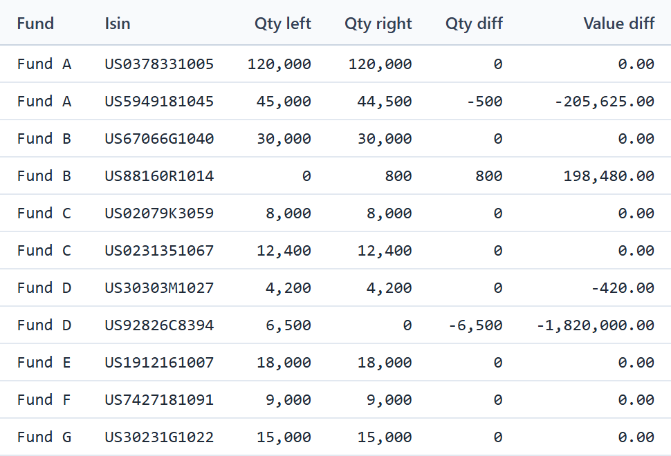

---

## 3. Control totals: where the gap comes from

```csharp
DataTable totals = positions.ToControlTotalsTable(["Fund"], "Value");
```

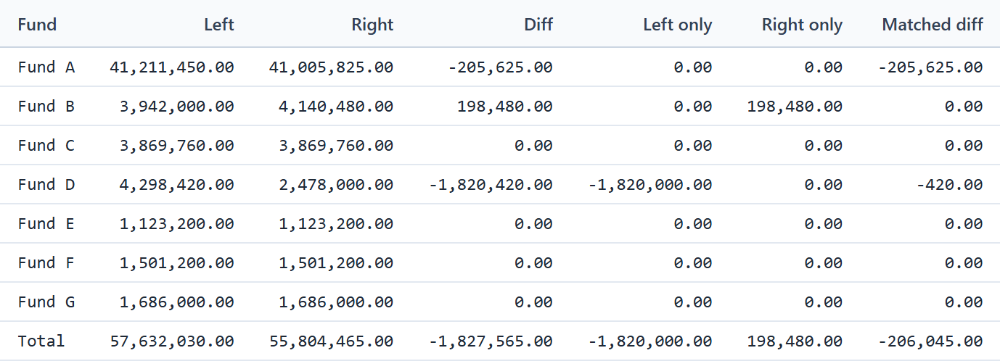

---

## 4. Allocations: OMS block vs accounting (one block to many funds)

```csharp
BlockOrder[] blocks =
[
    new("BLK-771", "AAPL",  10_000),
    new("BLK-772", "MSFT",   5_000),
    new("BLK-773", "NVDA",   2_000),
    new("BLK-774", "AMZN",   8_000),
    new("BLK-775", "JPM",    3_000),
    new("BLK-776", "META",   4_500),
    new("BLK-777", "GOOGL",  6_000),
];
Allocation[] allocations =
[
    new("BLK-771", "Fund A", 6_000), new("BLK-771", "Fund B", 4_000),
    new("BLK-772", "Fund A", 3_000), new("BLK-772", "Fund B", 1_800),
    new("BLK-774", "Fund A", 5_000), new("BLK-774", "Fund B", 2_000), new("BLK-774", "Fund C", 1_000),
    new("BLK-775", "Fund A", 3_000),
    new("BLK-776", "Fund B", 2_500), new("BLK-776", "Fund C", 2_000),
    new("BLK-777", "Fund A", 4_000), new("BLK-777", "Fund C", 2_000),
    new("BLK-779", "Fund C",   700),
];

var alloc = RecBuilder.Between(blocks, allocations)
    .MatchOn(b => b.Block, a => a.Block)
    .Sum(b => b.Qty, a => a.Qty)
    .Run();

DataTable summary = alloc.ToSummaryTable(b => $"{b.Block} {b.Sec} {b.Qty:N0}", a => $"{a.Fund} {a.Qty:N0}");

record BlockOrder(string Block, string Sec, int Qty);
record Allocation(string Block, string Fund, int Qty);
```

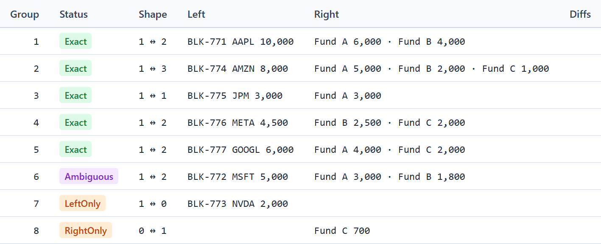

---

## 5. Cross trades: Fund A's sell vs Fund B's buy

```csharp
FundATrade[] fundA =
[
    new("AAPL",  "Sell", 1_000, 189.2100m),
    new("MSFT",  "Sell",   500, 411.2500m),
    new("TSLA",  "Sell",   300, 248.1000m),
    new("AMZN",  "Sell", 2_000, 201.4000m),
    new("NVDA",  "Sell", 1_500, 131.4000m),
    new("JPM",   "Sell",   800, 214.3000m),
    new("META",  "Sell",   600, 590.0000m),
    new("GOOGL", "Sell", 1_200, 171.5500m),
];
FundBTrade[] fundB =
[
    new("AAPL",  "Buy", 1_000, 189.2100m),
    new("MSFT",  "Buy",   500, 411.2000m),
    new("AMZN",  "Buy", 2_000, 201.4000m),
    new("NVDA",  "Buy", 1_500, 131.4000m),
    new("JPM",   "Buy",   800, 214.3000m),
    new("META",  "Buy",   600, 590.0000m),
    new("GOOGL", "Buy", 1_000, 171.5500m),
];

var cross = RecBuilder.Between(fundA, fundB)
    .MatchOn(a => a.Sec, b => b.Sec)
    .Compare(a => a.Qty, b => b.Qty)
    .Compare(a => a.Price, b => b.Price)
    .Run();

DataTable crossTable = cross.ToMatchTable();

record FundATrade(string Sec, string Side, int Qty, decimal Price);
record FundBTrade(string Sec, string Side, int Qty, decimal Price);
```

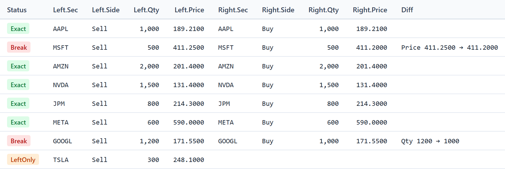

---

## 6. Cash: our ledger vs custodian statement

```csharp
DateOnly nov2 = new(2026, 11, 2);

LedgerEntry[] ledger =
[
    new(nov2, "USD", "9917",     "Buy AAPL",   -1_892_100.00m),
    new(nov2, "USD", "9918",     "Sell MSFT",     205_625.00m),
    new(nov2, "USD", "9920",     "Buy NVDA",     -262_800.00m),
    new(nov2, "USD", "9925",     "Buy F",          -3_306.00m),
    new(nov2, "USD", "SWEEP",    "Sweep in 1",    600_000.00m),
    new(nov2, "USD", "SWEEP",    "Sweep in 2",    400_000.00m),
    new(nov2, "USD", "INT-OCT",  "Interest",         1_842.17m),
    new(nov2, "EUR", "DIV-NVDA", "Dividend",        12_480.00m),
];
StatementLine[] statement =
[
    new(nov2, "USD", "9917",     "SETT 9917",  -1_892_100.00m),
    new(nov2, "USD", "9918",     "SETT 9918",     205_625.00m),
    new(nov2, "USD", "9920",     "SETT 9920",    -262_800.00m),
    new(nov2, "USD", "9925",     "SETT 9925",      -3_360.00m),
    new(nov2, "USD", "SWEEP",    "SWEEP IN",    1_000_000.00m),
    new(nov2, "USD", "INT-OCT",  "CREDIT INT",       1_842.17m),
    new(nov2, "EUR", "DIV-NVDA", "DIV NVDA",        12_479.99m),
    new(nov2, "USD", "FEE",      "BANK FEE",          -250.00m),
];

var cash = RecBuilder.Between(ledger, statement)
    .MatchOn(l => l.Ref, s => s.Ref)
    .Sum(l => l.Amount, s => s.Amount)
    .Compare(l => l.Amount, s => s.Amount, tolerance: 0.01m)
    .Run();

DataTable cashTable = cash.ToMatchTable();

record LedgerEntry(DateOnly ValueDate, string Ccy, string Ref, string Entry, decimal Amount);
record StatementLine(DateOnly ValueDate, string Ccy, string Ref, string Line, decimal Amount);
```

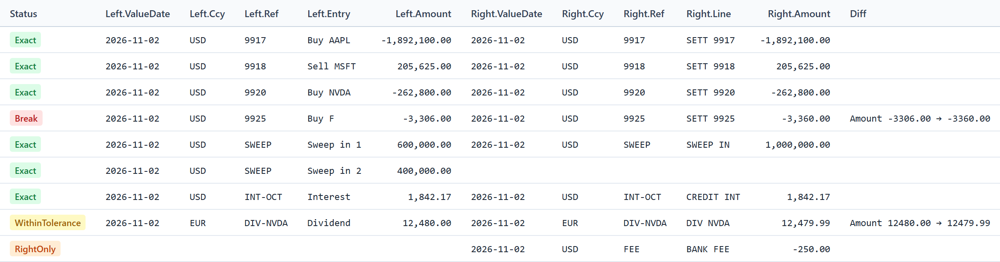

---

## 7. Pending settlements: our unsettled trades vs custodian pending and fails

```csharp
DateOnly oct31 = new(2026, 10, 31), nov4 = new(2026, 11, 4), nov5 = new(2026, 11, 5);

Unsettled[] unsettled =
[
    new("OMS-1042", "AAPL",  10_000, nov4),
    new("OMS-1043", "MSFT",   5_000, nov4),
    new("OMS-1030", "MSFT",   5_000, oct31),
    new("OMS-1038", "NVDA",   2_500, nov4),
    new("OMS-1039", "AMZN",   1_200, nov4),
    new("OMS-1040", "GOOGL",    900, nov4),
    new("OMS-1041", "JPM",    3_000, nov4),
    new("OMS-1045", "TSLA",     800, nov4),
];
CustodianPending[] pending =
[
    new("OMS-1042", "Pending",          nov4),
    new("OMS-1043", "Pending",          nov4),
    new("OMS-1030", "Failed: no stock", oct31),
    new("OMS-1038", "Pending",          nov5),
    new("OMS-1039", "Pending",          nov4),
    new("OMS-1040", "Pending",          nov4),
    new("OMS-1041", "Pending",          nov4),
    new("OMS-1029", "Pending",          oct31),
];

var settle = RecBuilder.Between(unsettled, pending)
    .MatchOn(u => u.Trade, p => p.Trade)
    .Compare(u => u.SettleDate, p => p.SettleDate)
    .Run();

DataTable settleTable = settle.ToMatchTable();

record Unsettled(string Trade, string Sec, int Qty, DateOnly SettleDate);
record CustodianPending(string Trade, string Status, DateOnly SettleDate);
```

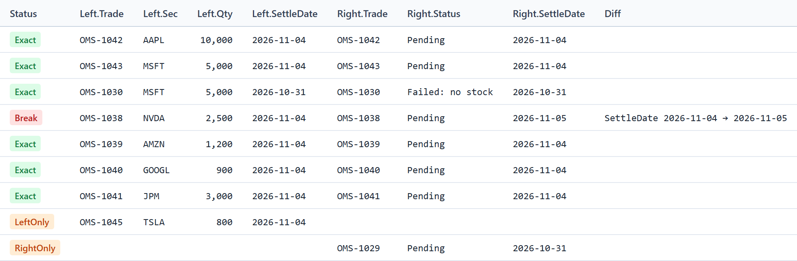

---

## 8. Corporate actions: expected events vs custodian entitlements

```csharp
DateOnly nov9 = new(2026, 11, 9), nov10 = new(2026, 11, 10), nov12 = new(2026, 11, 12), nov13 = new(2026, 11, 13);

ExpectedEvent[] expected =
[
    new("Fund A", "AAPL", "Dividend", nov9,  28_800.00m),
    new("Fund A", "V",    "Dividend", nov9,   3_575.00m),
    new("Fund B", "NVDA", "Dividend", nov10,  1_200.00m),
    new("Fund B", "JPM",  "Dividend", nov10,  3_450.00m),
    new("Fund A", "MSFT", "Dividend", nov12, 33_750.00m),
    new("Fund B", "META", "Dividend", nov12,  2_100.00m),
    new("Fund C", "KO",   "Dividend", nov13, 14_550.00m),
    new("Fund C", "PG",   "Dividend", nov13,  8_056.80m),
];
Entitlement[] entitlements =
[
    new("Fund A", "AAPL", "Dividend",  nov9,  28_800.00m),
    new("Fund B", "NVDA", "Dividend",  nov10,  1_199.99m),
    new("Fund B", "JPM",  "Dividend",  nov10,  3_450.00m),
    new("Fund A", "MSFT", "Dividend",  nov12, 28_687.50m),
    new("Fund B", "META", "Dividend",  nov12,  2_100.00m),
    new("Fund C", "KO",   "Dividend",  nov13, 14_550.00m),
    new("Fund C", "PG",   "Dividend",  nov13,  8_056.80m),
    new("Fund B", "XYZ",  "Split 2:1", nov13,          0m),
];

var corp = RecBuilder.Between(expected, entitlements)
    .MatchOn(e => e.Fund, n => n.Fund)
        .And(e => e.Sec, n => n.Sec)
        .And(e => e.Event, n => n.Event)
    .Compare(e => e.Net, n => n.Net, tolerance: 0.01m)
    .Run();

DataTable corpTable = corp.ToMatchTable();

record ExpectedEvent(string Fund, string Sec, string Event, DateOnly ExDate, decimal Net);
record Entitlement(string Fund, string Sec, string Event, DateOnly ExDate, decimal Net);
```

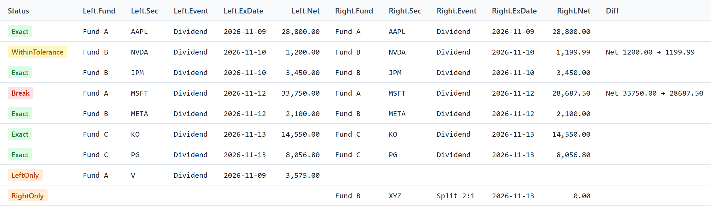

---

## 9. Stock loan: our books vs prime broker loan list

```csharp
Loan[] ours =
[
    new("SL-5518", "AAPL", 10_000,  0.30m, 1_987_000m),
    new("SL-5521", "TSLA",  5_000,  0.45m, 1_240_500m),
    new("SL-5524", "NVDA",  4_000,  0.35m,   551_880m),
    new("SL-5527", "BYND",  3_000, 12.50m,    21_600m),
    new("SL-5530", "GME",   2_000,  3.10m,    48_200m),
    new("SL-5533", "MSFT",  1_500,  0.25m,   649_500m),
    new("SL-5536", "RIVN",  6_000,  6.75m,    74_400m),
];
PbLoan[] pb =
[
    new("SL-5518", "AAPL", 10_000,  0.30m, 1_987_000m),
    new("SL-5521", "TSLA",  5_000,  0.45m, 1_240_500m),
    new("SL-5524", "NVDA",  4_000,  0.35m,   551_880m),
    new("SL-5527", "BYND",  3_000, 12.50m,    20_900m),
    new("SL-5530", "GME",   2_000,  3.40m,    48_200m),
    new("SL-5533", "MSFT",  1_500,  0.25m,   649_500m),
    new("SL-5536", "RIVN",  6_000,  6.75m,    74_400m),
    new("SL-5541", "AMC",   1_500,  5.00m,     6_300m),
];

var loans = RecBuilder.Between(ours, pb)
    .MatchOn(o => o.LoanId, p => p.LoanId)
    .Compare(o => o.Qty, p => p.Qty)
    .Compare(o => o.Rate, p => p.Rate)
    .Compare(o => o.Collateral, p => p.Collateral)
    .Run();

DataTable loanTable = loans.ToMatchTable();

record Loan(string LoanId, string Sec, int Qty, decimal Rate, decimal Collateral);
record PbLoan(string LoanId, string Sec, int Qty, decimal Rate, decimal Collateral);
```

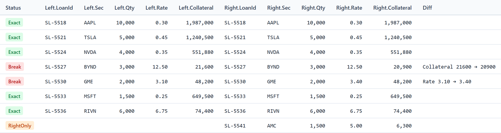

---

## 10. Fallback match: when the reference is missing

`MatchOn` tries the trade reference first. When a confirm has no reference, `ThenMatchOn` falls back to ISIN and side. C-1004 has no reference, so it matches T-5004 on the fallback key, and its `Diff` shows the missing reference.

```csharp
BrokerConfirm[] brokerConfirms =
[
    new("C-1001", "T-5001", "US0378331005", "B", 1_000, 189_250.00m),
    new("C-1002", "T-5002", "US5949181045", "S",   500, 206_050.00m),
    new("C-1003", "T-5003", "US88160R1014", "B",   250,  61_450.00m),
    new("C-1004", null,     "US02079K3059", "B",   300,  51_465.00m),
    new("C-1005", "T-5007", "US0231351067", "S",   120,  24_168.00m),
    new("C-1006", "T-5008", "US30303M1027", "B",   400, 236_000.00m),
    new("C-1007", "T-5009", "US46625H1005", "S", 1_500, 321_450.00m),
];
BlotterTrade[] blotter =
[
    new("T-5001", "US0378331005", "B", 1_000, 189_250.00m),
    new("T-5002", "US5949181045", "S",   500, 206_049.99m),
    new("T-5003", "US88160R1014", "B",   200,  49_160.00m),
    new("T-5004", "US02079K3059", "B",   300,  51_465.00m),
    new("T-5006", "US67066G1040", "B",    80,  11_624.00m),
    new("T-5008", "US30303M1027", "B",   400, 236_000.00m),
    new("T-5009", "US46625H1005", "S", 1_500, 321_450.00m),
];

var fallback = RecBuilder.Between(brokerConfirms, blotter)
    .MatchOn(c => c.TradeRef, t => t.TradeId)      // first: the trade reference
    .ThenMatchOn(c => c.Isin, t => t.Isin)         // fallback: ISIN and side
        .And(c => c.Side, t => t.Side)
    .Compare(c => c.Qty, t => t.Qty)
    .Compare(c => c.Net, t => t.Net, tolerance: 0.01m)
    .Run();

DataTable fallbackTable = fallback.ToMatchTable();

record BrokerConfirm(string ConfirmId, string? TradeRef, string Isin, string Side, int Qty, decimal Net);
record BlotterTrade(string TradeId, string Isin, string Side, int Qty, decimal Net);
```

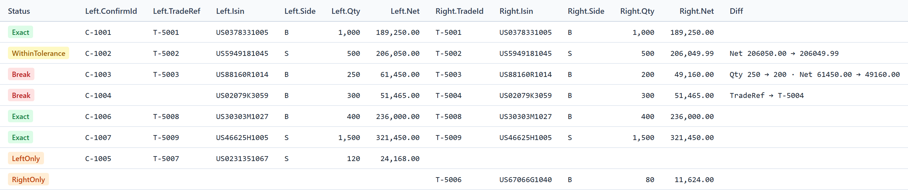

---

## Why trust it

- **Tests:** about 1,420 test methods (1,150 facts and 274 theories), about 42,800 lines of tests against 14,300 lines of library.
- **Acceptance bar:** 310 verification cases run on every build, from objects and from the Excel workbook.
- **Beyond examples:** oracle tests check the engine against independent implementations, and property tests sweep generated profiles, keys and decimal boundaries.
- **Analysis:** Stryker.NET mutation testing, CodeQL, and the Sonar quality gate in the badges above.
- **Determinism:** the same rows in any order, with the same profile and engine version, give the same result.
- **Scale, in the works:** a multi-parallel harness that reconciles 1 million rows in seconds. It is not released yet.

---

## Install

RecDiffy is on nuget.org. Every release is a prerelease, so `dotnet add package` needs `--prerelease`:

```shell
dotnet add package RecDiffy --prerelease
```

| Package | What it adds |
|---|---|
| [RecDiffy](https://www.nuget.org/packages/RecDiffy) | The engine: profiles, matching, comparison and results |
| [RecDiffy.IO](https://www.nuget.org/packages/RecDiffy.IO) | Reads CSV and Excel files as record sources |
| [RecDiffy.Excel](https://www.nuget.org/packages/RecDiffy.Excel) | Writes formatted Excel reports from a result |
| [RecDiffy.RulePacks.Trading](https://www.nuget.org/packages/RecDiffy.RulePacks.Trading) | Normalization rules for trade reconciliations |
| [RecDiffy.Extensions](https://www.nuget.org/packages/RecDiffy.Extensions) | The grids in this README: `DataTable` and HTML tables from a `RecResult` |

- **Runtimes.** The packages target .NET 8 and .NET 10, so any app on .NET 8 or later can use them.
- **Versions.** RecDiffy, RecDiffy.IO, RecDiffy.Excel and RecDiffy.RulePacks.Trading ship together; use the same version of each. RecDiffy.Extensions has its own version numbers and works beside them.

---

## Reconcile two CSV files with a profile

This builds a console app that reconciles a warehouse's bin counts against its stock book. You need the .NET SDK, version 8 or later, and nothing from this repository. It was checked against `1.2.0-preview.3`.

**1. Create the project.**

```shell
dotnet new console -n Warehouse
cd Warehouse
dotnet add package RecDiffy --version 1.2.0-preview.3
dotnet add package RecDiffy.IO --version 1.2.0-preview.3
```

The versions are pinned because a preview can change the API. Use `--prerelease` instead of `--version` to take the newest one.

**2. Add the two files.** The warehouse counts stock by bin, and the book holds one position per SKU. Save both files next to `Warehouse.csproj`.

`bins.csv`:

```csv
Bin,Sku,Quantity
A1,WIDGET,4
A2,WIDGET,6
B1,GADGET,3
C1,GIZMO,2
```

`book.csv`:

```csv
Position,Sku,Quantity
BOOK-1,WIDGET,10
BOOK-2,GADGET,5
```

**3. Add the profile.** A profile is the policy for a reconciliation: which fields matter, how each file's columns become those fields, and how rows are matched. Save this as `warehouse.profile.json`:

```json
{
  "formatVersion": 1,
  "profileId": "warehouse",
  "version": "1.0.0",
  "culture": "en-US",
  "sources": {
    "left":  { "rowKey": "Bin" },
    "right": { "rowKey": "Position" }
  },
  "fields": [
    { "name": "Sku", "type": "Symbol", "role": "Key" },
    { "name": "Quantity", "type": "Decimal", "scale": 0, "role": "Economic" }
  ],
  "normalization": {
    "left": {
      "identify": [ { "rule": "symbol.map", "from": "Sku", "to": "Sku" } ],
      "parse": [ { "rule": "decimal.parse", "from": "Quantity", "to": "Quantity" } ]
    },
    "right": {
      "identify": [ { "rule": "symbol.map", "from": "Sku", "to": "Sku" } ],
      "parse": [ { "rule": "decimal.parse", "from": "Quantity", "to": "Quantity" } ]
    }
  },
  "paths": [
    {
      "id": "stock",
      "route": { "rule": "route.all" },
      "passes": [
        { "id": "bins", "pass": "match.groupSum", "many": "left", "block": ["Sku"], "conserve": ["Quantity"] },
        { "id": "sku", "pass": "match.naturalKey", "key": ["Sku"] }
      ]
    }
  ]
}
```

- **`culture`** says how the text in both files is read, so the result is the same on every machine.
- **`sources`** names the column that identifies each row: `Bin` in the bins file, `Position` in the book.
- **`fields`** declares `Sku` as the key and `Quantity` as an economic field. Economic fields are compared once rows match.
- **`normalization`** maps each file's columns to those fields. Here both files happen to use the field names.
- **`paths`** lists the matching passes, tried in order. The `bins` pass matches several bins whose quantities add up to one book position. The `sku` pass then pairs what is left by SKU, one to one.

**4. Replace `Program.cs`:**

```csharp
using RecDiffy;
using RecDiffy.IO;
using RecDiffy.Results;

// 1. Compile the profile once.
var profile = Reconciler.Compile(
    ProfileDocument.Parse(File.ReadAllText("warehouse.profile.json")),
    RuleRegistry.CreateCore());

// 2. Read each file as a record source.
var csv = new CsvOptions { HasHeader = true, Delimiter = CsvDelimiter.Comma };
var bins = FileSources.FromCsv("bins", "bins.csv", csv);
var book = FileSources.FromCsv("book", "book.csv", csv);

// 3. Run the reconciliation and print every entry.
var result = Reconciler.Run(profile, bins, book, ReferenceDataSet.Empty);

var summary = result.Summary;
Console.WriteLine($"Matched {summary.Matched} ({summary.Break} with breaks) | Left only {summary.LeftOnly} | Right only {summary.RightOnly}");

foreach (var entry in result.Entries)
{
    Console.WriteLine($"{entry.Alignment,-9} {entry.Composition,-9} {entry.Outcome,-11} {Keys(entry.Left)} | {Keys(entry.Right)}");
    foreach (var diff in entry.Diffs.Where(diff => diff.Outcome == FieldOutcome.Break))
        Console.WriteLine($"    {diff.Field}: {result.Format(diff.Left)} vs {result.Format(diff.Right)}");
}

static string Keys(IReadOnlyList<SourceRef> rows) =>
    rows.Count == 0 ? "-" : string.Join(" + ", rows.OrderBy(row => row.Ordinal).Select(row => row.RowKey));
```

**5. Run it** from the project folder, where the three files are:

```shell
dotnet run
```

```text
Matched 2 (1 with breaks) | Left only 1 | Right only 0
Matched   ManyToOne Exact       A1 + A2 | BOOK-1
Matched   OneToOne  Break       B1 | BOOK-2
    Quantity: 3 vs 5
LeftOnly  None      NotCompared C1 | -
```

- **A1 + A2 and BOOK-1:** the `bins` pass matched two bins to one position, because 4 + 6 = 10. The quantities agree, so the outcome is `Exact`.
- **B1 and BOOK-2:** no group of bins adds up to 5, so the `sku` pass paired them by SKU. They match, but their quantities differ, so the outcome is `Break`.
- **C1:** no book position holds `GIZMO`, so the bin is left only.

To reconcile objects you already hold in memory, replace the two `FileSources.FromCsv` calls with `RecordSources.FromObjects` and a `SourceMap` for each type. [FirstReconciliation.cs](RecDiffy.NET/src/RecDiffy.Samples/FirstReconciliation.cs) shows how.

---

## Documentation

- **[Use RecDiffy.NET with your AI agent](docs/agents.md):** give your agent one link, [docs/llms.txt](docs/llms.txt), the root of a tree of `llms.txt` files it follows to the pages it needs.
- **[What a result means](RecDiffy.NET/docs/RESULTS.md):** how to read a result.
- **[Result examples](RecDiffy.NET/docs/RESULT-EXAMPLES.md):** real engine output for each result concept.
- **[Profile reference](RecDiffy.NET/docs/PROFILES.md):** what a profile can declare.
- **[Profile examples](RecDiffy.NET/docs/PROFILE-EXAMPLES.md):** profiles that run, with the output each gives.
- **[Support matrix](RecDiffy.NET/docs/SUPPORT.md):** what each package supports.
- **[Capacity and concurrency](RecDiffy.NET/docs/CAPACITY.md):** how large a reconciliation can be, and how many can run at once.
- **[Typed reconciliation](docs/typed-reconciliation/README.md):** `RecBuilder` with your own objects, step by step.
- **[Excel report layouts](RecDiffy.NET/docs/report-specs/README.md):** what each Excel report shows.

---

## Understand the result

These concepts answer different questions:

| Concept | Question | Examples |
|---|---|---|
| Alignment | Did records match across sides? | `Matched`, `LeftOnly`, `RightOnly` |
| Composition | How were records grouped? | `OneToOne`, `ManyToOne` |
| Field outcome | Do the compared values agree? | `Exact`, `WithinTolerance`, `Break` |
| Row disposition | What happened to this input row? | `Matched`, `Quarantined`, `SearchIncomplete` |

**A matched entry can still contain a break.** Matching establishes correspondence; it does not guarantee equal field values.

An entry can also represent multiple source rows. In the warehouse example, one result entry accounts for three input rows. Keep entry counts and source-row counts separate when building reports.

---

## Configure a reconciliation

A profile declares:

- **Fields:** canonical names, types, and roles.
- **Reading:** the culture each file's text is read with, and whether date formats are strict.
- **Normalization:** how source values become canonical values.
- **Consolidation:** optional lifecycle and package processing before matching. See [Consolidation](#consolidation).
- **Routes:** which matching path receives each row.
- **Matching passes:** ordered strategies for finding corresponding records.
- **Comparison rules:** fields to compare and tolerances to apply.
- **Search limits:** bounds on group matching.

Compile the profile once, then pass the compiled profile to reconciliation runs. Start with the warehouse profile in the quickstart above before adapting it to your own fields and source mappings.

---

## Consolidation

Consolidation runs on each side after normalization and before matching, and it is optional. It does two jobs: `lifecycle` collapses a cancel/correct chain into the one row that survives, and `packages` merges the linked legs of one trade into a single item. Each side gets its own `consolidation` entry, and either key can appear alone.

```json
"consolidation": {
  "right": {
    "lifecycle": { "action": "EventAction", "target": "EventTarget", "scope": "Counterparty", "corrTarget": "CANC" }
  }
}
```

`lifecycle` names the three fields it reads, all of which the profile must declare:

| Key | Default | What it names |
|---|---|---|
| `action` | `EventAction` | The field holding the event's action: `NEW`, `CANC`, `CORR`, or anything else. |
| `target` | `EventTarget` | The field holding the row key of the event this row acts on. A `CANC` or `CORR` with no target, or any event naming a row that does not exist in the same scope, quarantines the chain with `MissingLifecycleTarget`. |
| `scope` | `Counterparty` | The field that groups row keys. A target is looked up inside the same scope, so two counterparties can each have a row called `T-1`. |
| `corrTarget` | `CANC` | How a correction that names a cancel is read. With `CANC` the correction supersedes what the cancel cancelled, so `CORR → CANC → NEW` leaves the correction live. Any other action name treats the correction's target as the row it supersedes directly. |

A worked example. The broker sends three rows for one trade: the original, a cancel of it, and a correction of the cancel. Our side sends one row. Consolidation is declared on `right`, so only the broker's rows collapse; the single row on our side is left alone.

```csv
TradeId,Counterparty,Instrument,Side,TradeDate,Quantity,Price
O-1,ACME,BOND-A,BUY,2026-11-02,1000000,102.604
```

```csv
Ref,Counterparty,Instrument,Side,TradeDate,Quantity,Price,EventAction,EventTarget
T-1,ACME,BOND-A,BUY,2026-11-02,1000000,102.604,NEW,
T-2,ACME,BOND-A,BUY,2026-11-02,1000000,102.604,CANC,T-1
T-3,ACME,BOND-A,BUY,2026-11-02,1000000,105.149,CORR,T-2
```

The profile declares the two event fields as `Lifecycle` fields, maps their columns on the right side only, and adds the `consolidation` block:

```json
{
  "formatVersion": 1,
  "profileId": "trades",
  "version": "1.0.0",
  "culture": "en-US",
  "sources": {
    "left":  { "rowKey": "TradeId" },
    "right": { "rowKey": "Ref" }
  },
  "fields": [
    { "name": "Counterparty", "type": "Symbol", "role": "Key" },
    { "name": "Instrument", "type": "Symbol", "role": "Key" },
    { "name": "Side", "type": "Symbol", "role": "Key" },
    { "name": "TradeDate", "type": "Date", "role": "Key" },
    { "name": "Quantity", "type": "Decimal", "scale": 0, "role": "Economic" },
    { "name": "Price", "type": "Decimal", "scale": 3, "role": "Economic" },
    { "name": "EventAction", "type": "Symbol", "role": "Lifecycle" },
    { "name": "EventTarget", "type": "Text", "role": "Lifecycle" }
  ],
  "normalization": {
    "left": {
      "identify": [
        { "rule": "symbol.map", "from": "Counterparty", "to": "Counterparty" },
        { "rule": "symbol.map", "from": "Instrument", "to": "Instrument" },
        { "rule": "symbol.map", "from": "Side", "to": "Side" }
      ],
      "parse": [
        { "rule": "date.parse", "from": "TradeDate", "to": "TradeDate", "formats": ["yyyy-MM-dd"] },
        { "rule": "decimal.parse", "from": "Quantity", "to": "Quantity" },
        { "rule": "decimal.parse", "from": "Price", "to": "Price" }
      ]
    },
    "right": {
      "identify": [
        { "rule": "symbol.map", "from": "Counterparty", "to": "Counterparty" },
        { "rule": "symbol.map", "from": "Instrument", "to": "Instrument" },
        { "rule": "symbol.map", "from": "Side", "to": "Side" },
        { "rule": "symbol.map", "from": "EventAction", "to": "EventAction" },
        { "rule": "text.copy", "from": "EventTarget", "to": "EventTarget" }
      ],
      "parse": [
        { "rule": "date.parse", "from": "TradeDate", "to": "TradeDate", "formats": ["yyyy-MM-dd"] },
        { "rule": "decimal.parse", "from": "Quantity", "to": "Quantity" },
        { "rule": "decimal.parse", "from": "Price", "to": "Price" }
      ]
    }
  },
  "consolidation": {
    "right": {
      "lifecycle": { "action": "EventAction", "target": "EventTarget", "scope": "Counterparty", "corrTarget": "CANC" }
    }
  },
  "paths": [
    {
      "id": "trades",
      "route": { "rule": "route.all" },
      "passes": [
        { "id": "key", "pass": "match.naturalKey", "key": ["Counterparty", "Instrument", "TradeDate", "Side"] }
      ]
    }
  ]
}
```

The run reports two suppressed rows and one matched pair:

```text
Matched 1 | Suppressed 2 | Quarantined 0
  left   O-1    Matched
  right  T-1    Suppressed Superseded
  right  T-2    Suppressed CancelEvent
  right  T-3    Matched
  Matched OneToOne, LifecycleCollapsed Break O-1 | T-3
```

- **`T-3` is the survivor.** It is the only right row that reaches matching, so `O-1` pairs with it. The price break against our `102.604` is a comparison result, not a consolidation one.
- **`T-1` and `T-2` are suppressed, not dropped.** Both keep a disposition of `Suppressed`, so every input row still has one. `T-1` is `Superseded`, and `T-2` is a `CancelEvent`.
- **The entry is tagged `LifecycleCollapsed`.** That composition flag, plus the `LifecycleAction` and `LifecycleTarget` report roles, is what puts the chain on BO4.
- **A blank action is not an event.** A row whose action field is null passes through untouched, so nothing can target it.

A chain that cannot be resolved quarantines every row in it: `MissingLifecycleTarget`, `LifecycleCycle` when the targets form a loop, `LifecycleConflict` when more than one event survives, and `ChainMemberQuarantined` when another row in the chain is already quarantined.

`packages` merges linked rows, such as the legs of a swap, into one item. It is a list, applied in order:

```json
"consolidation": {
  "left": {
    "packages": [
      {
        "link": "PackageRef",
        "role": "LegRole",
        "requiredRoles": ["LEG_1_PAY", "LEG_2_RECEIVE"],
        "aggregate": {
          "Quantity": "Same",
          "Price": "FromRole(LEG_1_PAY)",
          "Side": "FromRole(LEG_1_PAY)",
          "NetCash": "DifferenceByRole(LEG_1_PAY,LEG_2_RECEIVE)"
        }
      }
    ]
  }
}
```

- **`link`** names the field whose value ties the legs together. Rows with a blank link stay separate.
- **`role`** names the field holding each leg's role, and **`requiredRoles`** lists the roles every package must have. A package missing one is quarantined with `IncompletePackage`.
- **`aggregate`** says how each merged field is built, keyed by field name: `"Same"` for the legs' common value, `"Sum"` for a total, `"FromRole(ROLE)"` for one leg's value, and `"DifferenceByRole(PAY,REC)"` for the first role minus the second. `Sum` and `DifferenceByRole` need a `Decimal` field, and every role an aggregator names must also be listed in `requiredRoles`. A field with no aggregator keeps its value when every leg agrees, and is unknown otherwise.

The two blocks are independent. `lifecycle` and `packages` can appear on the same side, and consolidation runs the lifecycle collapse first, then the packages. The full reference, with every key and diagnostic code, is in [PROFILES.md](RecDiffy.NET/docs/PROFILES.md#consolidation-lifecycles-and-packages).

---

## Declare how each file is read

Text in a file is read with a culture. Declare it once for the run and, when one file differs, for that side. Nothing below the declaration picks a culture, and nothing is guessed.

```json
{
  "culture": "en-US",
  "sources": {
    "left":  { "rowKey": "ConfirmId", "culture": "de-DE" },
    "right": { "rowKey": "TradeId" }
  }
}
```

```csharp
builder
    .Culture(CultureInfo.GetCultureInfo("en-US"))                // both files
    .Culture(Side.Left, CultureInfo.GetCultureInfo("de-DE"));    // this file is German
```

| | What happens |
|---|---|
| **Resolution** | A side uses its own culture, else the run's, else the server's culture, read once when the profile is compiled. `"culture": ""` is invariant. |
| **Numbers** | `1.234,56` on a de-DE side and `1,234.56` on an en-US side are both 1234.56, and compare `Exact`. A thousands separator where the culture puts none is `Invalid`: `1,5` on an en-US side is not 15. |
| **Dates** | Formats are strict: `/` and `:` mean exactly those characters, and the culture supplies month and day names. `"strictDateFormats": false`, for the run or one side, restores the .NET behaviour, where they also match the culture's separators. |
| **Floating point** | `float` and `double` are never converted. They are `Invalid` with `FloatValue`, so supply a `decimal` or text. Excel numbers arrive as the decimal the workbook stores, so only a number no `decimal` holds exactly — too large, or past 28 significant digits — stays a `double` and is rejected. |
| **Text RecDiffy makes** | Identifiers, symbols and row keys made from a number are invariant, so a numeric key matches across sides with different cultures. |
| **Record** | `result.Run.Reading` shows each side's culture, separators, where the culture came from, and whether dates were strict. It is a dictionary keyed by `"left"` and `"right"`, not an object with `Left` and `Right` properties. |

```csharp
var reading = result.Run.Reading["left"];   // SideReading
Console.WriteLine($"{reading.Culture} {reading.Origin} decimal '{reading.DecimalSeparator}' group '{reading.GroupSeparator}' strict {reading.StrictDateFormats}");
// en-US Run decimal '.' group ',' strict True
```

---

## Write Excel reports

The separate `RecDiffy.Excel` package writes formatted back- and middle-office reports from an `IReconciliationResult`, one `.xlsx` file per report. Numbers on a report tab are formulas that link to the engine's output in the same file, every decomposition has a ✓/✗ check, and ageing is a formula on a named `AsOf` cell.

It is the third of the four packages, so the quickstart project above does not have it yet. Add it before running this section:

```shell
dotnet add package RecDiffy.Excel --version 1.2.0-preview.3
```

```csharp
using RecDiffy.Excel;

var options = new ExcelReportOptions
{
    AsOf = new DateOnly(2026, 11, 13),
    Profile = profile, // profile id, tolerances, pass order; also maps report roles to fields of the same name
};

foreach (var outcome in result.WriteAll("reports", options))
    Console.WriteLine(outcome.Written ? outcome.Path : $"{outcome.FileName} skipped: {outcome.SkipReason}");
```

| Office | Reports |
|---|---|
| Back office | BO1 ExceptionBlotter, BO2 SideBySideCompare, BO3 RawVsNormalized, BO4 LifecycleChains, BO5 Allocations, BO6 CashLadder |
| Middle office | MO1 ControlTotals, MO2 Scorecard, MO3 CascadeFunnel, MO4 BreakHeatmap, MO5 Ageing, MO6 ToleranceUsage, MO7 AuditTrail |

Files are named `<ID>_<ReportName>_<profileId>_<asOf yyyy-MM-dd>.xlsx`. Reports read fields only through `FieldMap`; a report whose required roles are unmapped, or that has nothing to show, is skipped and the reason is returned. `RecDiffyExcel.RunAndWrite` runs the engine and writes in one call, and `WriteReport` writes one report to a stream. `Labels` replaces report wording with your own column names. The layout spec is in [docs/report-specs](RecDiffy.NET/docs/report-specs/README.md).

A run writes into the as-of date, so a second run on the same day silently replaces the workbooks already in the folder. Pick a new folder, or a new `AsOf`, when you want to keep both.

### Report roles

`FieldMap.FromProfile` looks for each role's field names in the order below, and maps the role only when the profile declares one. Any other name needs an explicit `With`, which sets the role's field and replaces any field `FromProfile` found: `FieldMap = FieldMap.FromProfile(profile).With(ReportRole.Counterparty, "Broker")`. `With` does not check the name against the profile. A field the profile does not declare still counts as mapped, so the report writes with that role's values empty instead of skipping. A role a report needs, but the map does not supply, skips that report and names it.

| Role | Field names `FromProfile` looks for | Required by |
|---|---|---|
| `Counterparty` | `Counterparty` | BO1, BO2, MO1, MO2, MO4 |
| `Instrument` | `Instrument` | BO1, BO2 |
| `Asset` | `Asset`, then `AssetClass` | MO1 |
| `Side` | `Side` | BO1, BO2, BO6 |
| `TradeDate` | `TradeDate` | BO1, MO5 |
| `SettleDate` | `SettleDate` | BO1, BO6, MO5 |
| `Quantity` | `Quantity` | BO5, MO1 |
| `Price` | `Price` | none; shown by BO2, and by BO5 beside the quantity |
| `Currency` | `Currency` | BO1, BO2, BO6, MO1 |
| `NetCash` | `NetCash` | BO6 |
| `Accrued` | `Accrued` | none; shown by BO2 and BO5 |
| `Fees` | `Fees` | none; shown by BO2 and BO5 |
| `Book` | `Book` | none; one line per allocation on BO5 |
| `LifecycleAction` | `EventAction` | BO4 |
| `LifecycleTarget` | `EventTarget` | BO4 |

- **The quickstart profile maps only `Quantity`.** Run against it with `Profile` set, as the snippet above does, 4 of the 13 reports write: BO3, BO5, MO3 and MO7. The other 9 skip, and each reason names the roles it wanted. Declare the trade-shaped fields in this table to reach the rest.
- **BO3 RawVsNormalized and MO6 ToleranceUsage need the profile, not a role.** BO3 reads each side's original columns, and MO6 reads the tolerance amounts; both come from `ExcelReportOptions.Profile`.
- **BO2 needs at least one compared field mapped:** one of `Quantity`, `Price`, `SettleDate`, `Accrued`, `Fees` or `NetCash`.
- **MO3 CascadeFunnel and MO7 AuditTrail need no role at all.** They report the engine's own counts and explanation trail.
- **A report also needs something to show.** BO3 skips when no one-to-one match broke, landed within tolerance, or had a value changed by normalization. BO5 skips when no entry was matched many-to-one or one-to-many. MO6 skips when no difference landed `WithinTolerance`. MO7 skips when every entry is an exact match with no lifecycle chain or package behind it. Each returns that reason, so a mapped role alone does not produce a file. `SelectedEntries` makes BO3 and MO7 show the entries you name instead.
- **BO6 signs cash by `Side`.** A row whose `Side` is in `ExcelReportOptions.PayingSides` pays, so its net cash counts negative, and every other side receives. The default is `BUY`, `PAY_FIXED` and `PAY`, compared exactly with the canonical value, so a profile whose sides are `B` and `S` needs `PayingSides = ["B"]`, or every row lands as a receipt.
- **BO4 needs consolidation, not just the two roles.** It draws the chains that `consolidation.lifecycle` collapsed, so a profile without that block writes no BO4 rows. See [Consolidation](#consolidation).

---

## Troubleshooting

| Symptom | First thing to check |
|---|---|
| `dotnet add package` says there are no stable versions | Every release is a prerelease. Add `--prerelease`, or pin one with `--version`. |
| Build cannot find a compatible SDK | Compare `dotnet --list-sdks` with [global.json](RecDiffy.NET/global.json). |
| Profile compilation fails | Inspect the errors on `ProfileCompileException`. |
| A row is quarantined | Inspect its diagnostics for missing keys or invalid values. |
| Rows remain unmatched | Check normalized key values, routing, and pass configuration. |
| A component reports `BlockTooLarge` | Inspect its size and blocking fields before increasing limits. |
| Records match but show `Break` | Inspect field differences and configured tolerances. |
| A row is `Invalid` with `FloatValue` | The source gave a `float` or `double`. Supply a `decimal` or text. An Excel number does this only when no `decimal` holds it exactly. |
| A number that looks right is `Invalid` with `DecimalParse` | Check the side's culture in `result.Run.Reading`: `1.5` on a de-DE side is not a number. |
| Compile reports `UnknownCulture` | The name is not a culture this host knows. A host in invariant-globalization mode, such as the AOT host, knows only `""`. |

`SearchIncomplete` means the search did not establish a complete decision. Do not present it as an ordinary unmatched result.

---

## Run the samples

The repository has a sample program that goes further than the quickstart: a quarantined row, a side-by-side view, an async run, a trading-pack run that uses reference data, Excel reports, a profile built in code, and `RecBuilder` with typed objects. It needs a clone, and the .NET SDK that [global.json](RecDiffy.NET/global.json) pins.

```shell
git clone https://github.com/m-vaysman/recdiffy.net.git
cd recdiffy.net/RecDiffy.NET
dotnet run --project src/RecDiffy.Samples/RecDiffy.Samples.csproj
```

The clone checks out `main`, which holds the latest release. The first example reconciles two bins against one book position, built from objects: [FirstReconciliation.cs](RecDiffy.NET/src/RecDiffy.Samples/FirstReconciliation.cs). `Matches_warehouse_bins_to_book_stock_without_the_trading_pack` in [VerificationTests.cs](RecDiffy.NET/src/RecDiffy.Tests/VerificationTests.cs) checks the same behavior:

```shell
dotnet test src/RecDiffy.Tests/RecDiffy.Tests.csproj --filter FullyQualifiedName~Matches_warehouse_bins_to_book_stock_without_the_trading_pack
```

---

## Contribute

To build RecDiffy from source, test it or change it, follow [CONTRIBUTING.md](CONTRIBUTING.md). It covers the SDK, the build, the branch to start from, and the rules for a change.

GitHub Actions publishes an [Allure](https://allurereport.org/) report for pushes to `dev` and `main`, and for pull requests opened from this repository. A pull request from a fork skips the upload, because GitHub does not pass the Allure secrets to that run, and a failed upload does not fail the build.

[Latest test report](https://recdiffytests.cobblerhill.net/allure-docker-service/projects/recdiffy/reports/latest/index.html)

`dotnet test` writes `allure-results` under each RecDiffy.NET test project's build output, once for `net8.0` and once for `net10.0`. The packages that ship RecDiffy do not reference Allure.

---

## Find your way around

| Directory | Purpose |
|---|---|
| [src/RecDiffy](RecDiffy.NET/src/RecDiffy) | Core reconciliation library |
| [src/RecDiffy.RulePacks.Trading](RecDiffy.NET/src/RecDiffy.RulePacks.Trading) | Trading-specific rules |
| [src/RecDiffy.Tests](RecDiffy.NET/src/RecDiffy.Tests) | Behavior tests and usage examples |
| [src/RecDiffy.Benchmarks](RecDiffy.NET/src/RecDiffy.Benchmarks) | Performance benchmarks |
| [src/RecDiffy.AotHost](RecDiffy.NET/src/RecDiffy.AotHost) | Native AOT host |
| [src/RecDiffy.Samples](RecDiffy.NET/src/RecDiffy.Samples) | Runnable demonstration of the application API |
| [src/RecDiffy.Excel](RecDiffy.NET/src/RecDiffy.Excel) | Excel report writer (separate package) |
| [RecDiffy.ExcelAddIn](RecDiffy.ExcelAddIn) | Excel add-in (preview): reconcile two datasets without leaving Excel |
| [docs/report-specs](RecDiffy.NET/docs/report-specs) | Layout spec and reference workbooks for the Excel reports |
| [docs/SPEC-STATUS.md](RecDiffy.NET/docs/SPEC-STATUS.md) | Which architecture spec is in force, and the shipped behavior that amends it; the committed v1 spec is historical |

See the [Architecture Overview](https://github.com/m-vaysman/recdiffy.net/wiki/Architecture-Overview) for more background.

---

## License

RecDiffy.NET is licensed under the [MIT License](LICENSE).
