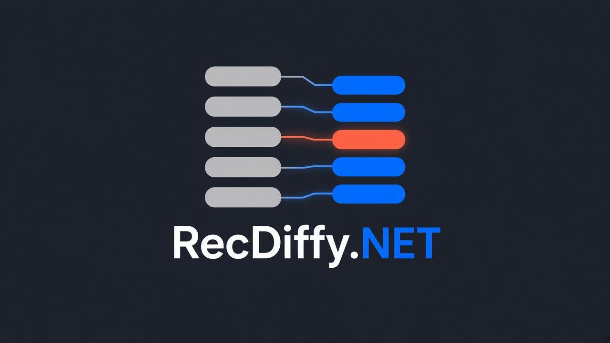
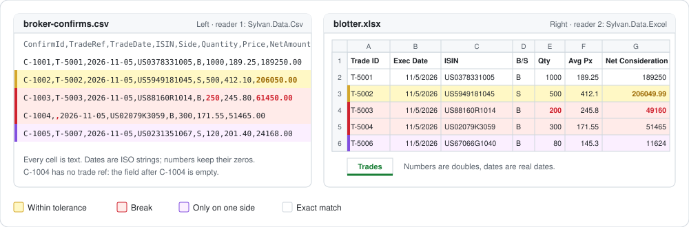

<p align="center">
  
</p>

# RecDiffy.NET

[](https://www.nuget.org/packages/RecDiffy)
[](https://github.com/m-vaysman/recdiffy.net/actions/workflows/ci.yml)
[](https://sonar.cobblerhill.net/dashboard?id=m-vaysman_recdiffy.net) [](https://sonar.cobblerhill.net/dashboard?id=m-vaysman_recdiffy.net) [](https://sonar.cobblerhill.net/dashboard?id=m-vaysman_recdiffy.net) [](https://sonar.cobblerhill.net/dashboard?id=m-vaysman_recdiffy.net) [](https://sonar.cobblerhill.net/dashboard?id=m-vaysman_recdiffy.net) [](https://sonar.cobblerhill.net/dashboard?id=m-vaysman_recdiffy.net) [](https://sonar.cobblerhill.net/dashboard?id=m-vaysman_recdiffy.net)
[](https://bench.cobblerhill.net/perf/recdiffy)
[](https://recdiffytests.cobblerhill.net/allure-docker-service/projects/recdiffy/reports/latest/index.html)

Reconciliation for two datasets: match every record, show every difference, and explain every unmatched row.

> **Prerelease.** Every RecDiffy release is a prerelease for now, and the API may change from one preview to the next. Pin the version you build against.

RecDiffy.NET is a reconciliation and diffing library for .NET. Use it when records from two systems represent the same underlying activity but differ in identifiers, formatting, or grouping—for example, warehouse bins versus book inventory, or internal trades versus broker records.

A reconciliation runs through:

**Normalize → Consolidate → Match → Compare → Explain**

Matching determines which records belong together. Comparison determines whether their field values agree.

## What is reconciliation?

Reconciliation is the accounting and data-engineering control that proves two records of the same activity agree. A ledger and a broker statement, a warehouse count and a stock book, or two database extracts are meant to describe the same events, so every row should have a counterpart and every amount should match. Reconciling is how you find the ones that do not.

A reconciliation answers five questions, and RecDiffy.NET answers each one:

| Question | What you get |
|---|---|
| Which records belong together? | Matching, even when identifiers, formatting or grouping differ: one row to one row, several rows to one, or a subset that adds up. |
| Do their values agree? | Field-by-field comparison at each declared tolerance, so `Exact`, `WithinTolerance` and `Break` are distinct outcomes. |
| Which rows are unmatched, on which side? | Every entry is `Matched`, `LeftOnly`, `RightOnly`, `Ambiguous` or `SearchIncomplete`, and every input row has a disposition. |
| Where is the difference, and how much of it? | Grouping, packages, lifecycle collapse and attributions, with totals and subsets that balance. |
| Can I prove the result to someone else? | A deterministic result with a profile hash and an engine version, and Excel reports that tie every number back to the files. |

That makes it the .NET tool for data reconciliation, trade reconciliation and ledger matching, record linkage, data quality checks, and revenue or billing controls, whether the input is CSV, Excel, or your own objects in memory.

## See it work: two files, two readers, one reconciliation

The broker emails a CSV of confirmations. Your order system exports its blotter to Excel. Read each with any reader you like, then let `RecBuilder` line them up:



```csharp
var confirms = ReadConfirms("broker-confirms.csv");  // reader 1: Sylvan.Data.Csv
var blotter = ReadBlotter("blotter.xlsx");           // reader 2: Sylvan.Data.Excel

var result = RecBuilder.Between(confirms, blotter)
    .MatchOn(confirm => confirm.TradeRef, trade => trade.TradeId)
    .ThenMatchOn(confirm => confirm.Isin, trade => trade.Isin)
        .And(confirm => confirm.TradeDate, trade => trade.ExecutedOn)
        .And(confirm => confirm.Side, trade => trade.BuySell)
    .Compare(confirm => confirm.Quantity, trade => trade.Qty)
    .Compare(confirm => confirm.Price, trade => trade.AvgPrice, tolerance: 0.0001m)
    .Compare(confirm => confirm.NetAmount, trade => trade.NetConsideration, tolerance: 0.01m)
    .Run();
```

```text
Matched 4 (2 with breaks) | Ambiguous 0 | Left only 1 | Right only 1

  Exact             C-1001 ↔ T-5001
  Within tolerance  C-1002 ↔ T-5002
                      NetAmount: 206050.00 vs 206049.99
  Break             C-1003 ↔ T-5003
                      Quantity: 250 vs 200
                      NetAmount: 61450.00 vs 49160
  Break             C-1004 ↔ T-5004
                      TradeRef: (blank) vs T-5004
  Left only         C-1005
  Right only        T-5006
```

Every bucket holds your own `BrokerConfirm` and `BlotterTrade` objects. RecDiffy doesn't read the files here: [Sylvan](https://github.com/MarkPflug/Sylvan) does, and any reader that gives you objects works. The [full walkthrough](docs/typed-reconciliation/README.md) covers the two readers, the mapping line by line, and examples from logistics, retail and healthcare billing.

When several rows on one side add up to one row on the other, add `Sum`. Three allocations of 300, 200 and 500 match one block of 1,000, whichever side holds the several rows:

```csharp
var result = RecBuilder.Between(allocations, blocks)
    .MatchOn(allocation => allocation.Isin, block => block.Isin)
        .And(allocation => allocation.TradeDate, block => block.TradeDate)
    .Sum(allocation => allocation.Quantity, block => block.Quantity)
    .Run();
// result.Matched: one RecMatch, with three Left rows and one Right row.
```

## Install

RecDiffy is on nuget.org. Every release is a prerelease, so `dotnet add package` needs `--prerelease`:

```shell
dotnet add package RecDiffy --prerelease
```

| Package | What it adds |
|---|---|
| [RecDiffy](https://www.nuget.org/packages/RecDiffy) | The engine: profiles, matching, comparison and results |
| [RecDiffy.IO](https://www.nuget.org/packages/RecDiffy.IO) | Reads CSV and Excel files as record sources |
| [RecDiffy.Excel](https://www.nuget.org/packages/RecDiffy.Excel) | Writes formatted Excel reports from a result |
| [RecDiffy.RulePacks.Trading](https://www.nuget.org/packages/RecDiffy.RulePacks.Trading) | Normalization rules for trade reconciliations |

- **Runtimes.** The packages target .NET 8 and .NET 10, so any app on .NET 8 or later can use them.
- **Versions.** The four packages ship together. Use the same version of each.

## Quickstart: your first reconciliation

This builds a console app that reconciles a warehouse's bin counts against its stock book. You need the .NET SDK, version 8 or later, and nothing from this repository. It was checked against `1.2.0-preview.3`.

**1. Create the project.**

```shell
dotnet new console -n Warehouse
cd Warehouse
dotnet add package RecDiffy --version 1.2.0-preview.3
dotnet add package RecDiffy.IO --version 1.2.0-preview.3
```

The versions are pinned because a preview can change the API. Use `--prerelease` instead of `--version` to take the newest one.

**2. Add the two files.** The warehouse counts stock by bin, and the book holds one position per SKU. Save both files next to `Warehouse.csproj`.

`bins.csv`:

```csv
Bin,Sku,Quantity
A1,WIDGET,4
A2,WIDGET,6
B1,GADGET,3
C1,GIZMO,2
```

`book.csv`:

```csv
Position,Sku,Quantity
BOOK-1,WIDGET,10
BOOK-2,GADGET,5
```

**3. Add the profile.** A profile is the policy for a reconciliation: which fields matter, how each file's columns become those fields, and how rows are matched. Save this as `warehouse.profile.json`:

```json
{
  "formatVersion": 1,
  "profileId": "warehouse",
  "version": "1.0.0",
  "culture": "en-US",
  "sources": {
    "left":  { "rowKey": "Bin" },
    "right": { "rowKey": "Position" }
  },
  "fields": [
    { "name": "Sku", "type": "Symbol", "role": "Key" },
    { "name": "Quantity", "type": "Decimal", "scale": 0, "role": "Economic" }
  ],
  "normalization": {
    "left": {
      "identify": [ { "rule": "symbol.map", "from": "Sku", "to": "Sku" } ],
      "parse": [ { "rule": "decimal.parse", "from": "Quantity", "to": "Quantity" } ]
    },
    "right": {
      "identify": [ { "rule": "symbol.map", "from": "Sku", "to": "Sku" } ],
      "parse": [ { "rule": "decimal.parse", "from": "Quantity", "to": "Quantity" } ]
    }
  },
  "paths": [
    {
      "id": "stock",
      "route": { "rule": "route.all" },
      "passes": [
        { "id": "bins", "pass": "match.groupSum", "many": "left", "block": ["Sku"], "conserve": ["Quantity"] },
        { "id": "sku", "pass": "match.naturalKey", "key": ["Sku"] }
      ]
    }
  ]
}
```

- **`culture`** says how the text in both files is read, so the result is the same on every machine.
- **`sources`** names the column that identifies each row: `Bin` in the bins file, `Position` in the book.
- **`fields`** declares `Sku` as the key and `Quantity` as an economic field. Economic fields are compared once rows match.
- **`normalization`** maps each file's columns to those fields. Here both files happen to use the field names.
- **`paths`** lists the matching passes, tried in order. The `bins` pass matches several bins whose quantities add up to one book position. The `sku` pass then pairs what is left by SKU, one to one.

**4. Replace `Program.cs`:**

```csharp
using RecDiffy;
using RecDiffy.IO;
using RecDiffy.Results;

// 1. Compile the profile once.
var profile = Reconciler.Compile(
    ProfileDocument.Parse(File.ReadAllText("warehouse.profile.json")),
    RuleRegistry.CreateCore());

// 2. Read each file as a record source.
var csv = new CsvOptions { HasHeader = true, Delimiter = CsvDelimiter.Comma };
var bins = FileSources.FromCsv("bins", "bins.csv", csv);
var book = FileSources.FromCsv("book", "book.csv", csv);

// 3. Run the reconciliation and print every entry.
var result = Reconciler.Run(profile, bins, book, ReferenceDataSet.Empty);

var summary = result.Summary;
Console.WriteLine($"Matched {summary.Matched} ({summary.Break} with breaks) | Left only {summary.LeftOnly} | Right only {summary.RightOnly}");

foreach (var entry in result.Entries)
{
    Console.WriteLine($"{entry.Alignment,-9} {entry.Composition,-9} {entry.Outcome,-11} {Keys(entry.Left)} | {Keys(entry.Right)}");
    foreach (var diff in entry.Diffs.Where(diff => diff.Outcome == FieldOutcome.Break))
        Console.WriteLine($"    {diff.Field}: {result.Format(diff.Left)} vs {result.Format(diff.Right)}");
}

static string Keys(IReadOnlyList<SourceRef> rows) =>
    rows.Count == 0 ? "-" : string.Join(" + ", rows.OrderBy(row => row.Ordinal).Select(row => row.RowKey));
```

**5. Run it** from the project folder, where the three files are:

```shell
dotnet run
```

```text
Matched 2 (1 with breaks) | Left only 1 | Right only 0
Matched   ManyToOne Exact       A1 + A2 | BOOK-1
Matched   OneToOne  Break       B1 | BOOK-2
    Quantity: 3 vs 5
LeftOnly  None      NotCompared C1 | -
```

- **A1 + A2 and BOOK-1:** the `bins` pass matched two bins to one position, because 4 + 6 = 10. The quantities agree, so the outcome is `Exact`.
- **B1 and BOOK-2:** no group of bins adds up to 5, so the `sku` pass paired them by SKU. They match, but their quantities differ, so the outcome is `Break`.
- **C1:** no book position holds `GIZMO`, so the bin is left only.

To reconcile objects you already hold in memory, replace the two `FileSources.FromCsv` calls with `RecordSources.FromObjects` and a `SourceMap` for each type. [FirstReconciliation.cs](RecDiffy.NET/src/RecDiffy.Samples/FirstReconciliation.cs) shows how.

## Documentation

- **[What a result means](RecDiffy.NET/docs/RESULTS.md):** how to read a result.
- **[Profile reference](RecDiffy.NET/docs/PROFILES.md):** what a profile can declare.
- **[Support matrix](RecDiffy.NET/docs/SUPPORT.md):** what each package supports.
- **[Capacity and concurrency](RecDiffy.NET/docs/CAPACITY.md):** how large a reconciliation can be, and how many can run at once.
- **[Typed reconciliation](docs/typed-reconciliation/README.md):** `RecBuilder` with your own objects, step by step.
- **[Excel report layouts](RecDiffy.NET/docs/report-specs/README.md):** what each Excel report shows.

## Understand the result

These concepts answer different questions:

| Concept | Question | Examples |
|---|---|---|
| Alignment | Did records match across sides? | `Matched`, `LeftOnly`, `RightOnly` |
| Composition | How were records grouped? | `OneToOne`, `ManyToOne` |
| Field outcome | Do the compared values agree? | `Exact`, `WithinTolerance`, `Break` |
| Row disposition | What happened to this input row? | `Matched`, `Quarantined`, `SearchIncomplete` |

**A matched entry can still contain a break.** Matching establishes correspondence; it does not guarantee equal field values.

An entry can also represent multiple source rows. In the warehouse example, one result entry accounts for three input rows. Keep entry counts and source-row counts separate when building reports.

## Configure a reconciliation

A profile declares:

- **Fields:** canonical names, types, and roles.
- **Reading:** the culture each file's text is read with, and whether date formats are strict.
- **Normalization:** how source values become canonical values.
- **Consolidation:** optional lifecycle and package processing before matching. See [Consolidation](#consolidation).
- **Routes:** which matching path receives each row.
- **Matching passes:** ordered strategies for finding corresponding records.
- **Comparison rules:** fields to compare and tolerances to apply.
- **Search limits:** bounds on group matching.

Compile the profile once, then pass the compiled profile to reconciliation runs. Start with the warehouse profile in the quickstart above before adapting it to your own fields and source mappings.

## Consolidation

Consolidation runs on each side after normalization and before matching, and it is optional. It does two jobs: `lifecycle` collapses a cancel/correct chain into the one row that survives, and `packages` merges the linked legs of one trade into a single item. Each side gets its own `consolidation` entry, and either key can appear alone.

```json
"consolidation": {
  "right": {
    "lifecycle": { "action": "EventAction", "target": "EventTarget", "scope": "Counterparty", "corrTarget": "CANC" }
  }
}
```

`lifecycle` names the three fields it reads, all of which the profile must declare:

| Key | Default | What it names |
|---|---|---|
| `action` | `EventAction` | The field holding the event's action: `NEW`, `CANC`, `CORR`, or anything else. |
| `target` | `EventTarget` | The field holding the row key of the event this row acts on. A `CANC` or `CORR` with no target, or any event naming a row that does not exist in the same scope, quarantines the chain with `MissingLifecycleTarget`. |
| `scope` | `Counterparty` | The field that groups row keys. A target is looked up inside the same scope, so two counterparties can each have a row called `T-1`. |
| `corrTarget` | `CANC` | How a correction that names a cancel is read. With `CANC` the correction supersedes what the cancel cancelled, so `CORR → CANC → NEW` leaves the correction live. Any other action name treats the correction's target as the row it supersedes directly. |

A worked example. The broker sends three rows for one trade: the original, a cancel of it, and a correction of the cancel. Our side sends one row. Consolidation is declared on `right`, so only the broker's rows collapse; the single row on our side is left alone.

```csv
TradeId,Counterparty,Instrument,Side,TradeDate,Quantity,Price
O-1,ACME,BOND-A,BUY,2026-11-02,1000000,102.604
```

```csv
Ref,Counterparty,Instrument,Side,TradeDate,Quantity,Price,EventAction,EventTarget
T-1,ACME,BOND-A,BUY,2026-11-02,1000000,102.604,NEW,
T-2,ACME,BOND-A,BUY,2026-11-02,1000000,102.604,CANC,T-1
T-3,ACME,BOND-A,BUY,2026-11-02,1000000,105.149,CORR,T-2
```

The profile declares the two event fields as `Lifecycle` fields, maps their columns on the right side only, and adds the `consolidation` block:

```json
{
  "formatVersion": 1,
  "profileId": "trades",
  "version": "1.0.0",
  "culture": "en-US",
  "sources": {
    "left":  { "rowKey": "TradeId" },
    "right": { "rowKey": "Ref" }
  },
  "fields": [
    { "name": "Counterparty", "type": "Symbol", "role": "Key" },
    { "name": "Instrument", "type": "Symbol", "role": "Key" },
    { "name": "Side", "type": "Symbol", "role": "Key" },
    { "name": "TradeDate", "type": "Date", "role": "Key" },
    { "name": "Quantity", "type": "Decimal", "scale": 0, "role": "Economic" },
    { "name": "Price", "type": "Decimal", "scale": 3, "role": "Economic" },
    { "name": "EventAction", "type": "Symbol", "role": "Lifecycle" },
    { "name": "EventTarget", "type": "Text", "role": "Lifecycle" }
  ],
  "normalization": {
    "left": {
      "identify": [
        { "rule": "symbol.map", "from": "Counterparty", "to": "Counterparty" },
        { "rule": "symbol.map", "from": "Instrument", "to": "Instrument" },
        { "rule": "symbol.map", "from": "Side", "to": "Side" }
      ],
      "parse": [
        { "rule": "date.parse", "from": "TradeDate", "to": "TradeDate", "formats": ["yyyy-MM-dd"] },
        { "rule": "decimal.parse", "from": "Quantity", "to": "Quantity" },
        { "rule": "decimal.parse", "from": "Price", "to": "Price" }
      ]
    },
    "right": {
      "identify": [
        { "rule": "symbol.map", "from": "Counterparty", "to": "Counterparty" },
        { "rule": "symbol.map", "from": "Instrument", "to": "Instrument" },
        { "rule": "symbol.map", "from": "Side", "to": "Side" },
        { "rule": "symbol.map", "from": "EventAction", "to": "EventAction" },
        { "rule": "text.copy", "from": "EventTarget", "to": "EventTarget" }
      ],
      "parse": [
        { "rule": "date.parse", "from": "TradeDate", "to": "TradeDate", "formats": ["yyyy-MM-dd"] },
        { "rule": "decimal.parse", "from": "Quantity", "to": "Quantity" },
        { "rule": "decimal.parse", "from": "Price", "to": "Price" }
      ]
    }
  },
  "consolidation": {
    "right": {
      "lifecycle": { "action": "EventAction", "target": "EventTarget", "scope": "Counterparty", "corrTarget": "CANC" }
    }
  },
  "paths": [
    {
      "id": "trades",
      "route": { "rule": "route.all" },
      "passes": [
        { "id": "key", "pass": "match.naturalKey", "key": ["Counterparty", "Instrument", "TradeDate", "Side"] }
      ]
    }
  ]
}
```

The run reports two suppressed rows and one matched pair:

```text
Matched 1 | Suppressed 2 | Quarantined 0
  left   O-1    Matched
  right  T-1    Suppressed Superseded
  right  T-2    Suppressed CancelEvent
  right  T-3    Matched
  Matched OneToOne, LifecycleCollapsed Break O-1 | T-3
```

- **`T-3` is the survivor.** It is the only right row that reaches matching, so `O-1` pairs with it. The price break against our `102.604` is a comparison result, not a consolidation one.
- **`T-1` and `T-2` are suppressed, not dropped.** Both keep a disposition of `Suppressed`, so every input row still has one. `T-1` is `Superseded`, and `T-2` is a `CancelEvent`.
- **The entry is tagged `LifecycleCollapsed`.** That composition flag, plus the `LifecycleAction` and `LifecycleTarget` report roles, is what puts the chain on BO4.
- **A blank action is not an event.** A row whose action field is null passes through untouched, so nothing can target it.

A chain that cannot be resolved quarantines every row in it: `MissingLifecycleTarget`, `LifecycleCycle` when the targets form a loop, `LifecycleConflict` when more than one event survives, and `ChainMemberQuarantined` when another row in the chain is already quarantined.

`packages` merges linked rows, such as the legs of a swap, into one item. It is a list, applied in order:

```json
"consolidation": {
  "left": {
    "packages": [
      {
        "link": "PackageRef",
        "role": "LegRole",
        "requiredRoles": ["LEG_1_PAY", "LEG_2_RECEIVE"],
        "aggregate": {
          "Quantity": "Same",
          "Price": "FromRole(LEG_1_PAY)",
          "Side": "FromRole(LEG_1_PAY)",
          "NetCash": "DifferenceByRole(LEG_1_PAY,LEG_2_RECEIVE)"
        }
      }
    ]
  }
}
```

- **`link`** names the field whose value ties the legs together. Rows with a blank link stay separate.
- **`role`** names the field holding each leg's role, and **`requiredRoles`** lists the roles every package must have. A package missing one is quarantined with `IncompletePackage`.
- **`aggregate`** says how each merged field is built, keyed by field name: `"Same"` for the legs' common value, `"Sum"` for a total, `"FromRole(ROLE)"` for one leg's value, and `"DifferenceByRole(PAY,REC)"` for the first role minus the second. `Sum` and `DifferenceByRole` need a `Decimal` field, and every role an aggregator names must also be listed in `requiredRoles`. A field with no aggregator keeps its value when every leg agrees, and is unknown otherwise.

The two blocks are independent. `lifecycle` and `packages` can appear on the same side, and consolidation runs the lifecycle collapse first, then the packages. The full reference, with every key and diagnostic code, is in [PROFILES.md](RecDiffy.NET/docs/PROFILES.md#consolidation-lifecycles-and-packages).

## Declare how each file is read

Text in a file is read with a culture. Declare it once for the run and, when one file differs, for that side. Nothing below the declaration picks a culture, and nothing is guessed.

```json
{
  "culture": "en-US",
  "sources": {
    "left":  { "rowKey": "ConfirmId", "culture": "de-DE" },
    "right": { "rowKey": "TradeId" }
  }
}
```

```csharp
builder
    .Culture(CultureInfo.GetCultureInfo("en-US"))                // both files
    .Culture(Side.Left, CultureInfo.GetCultureInfo("de-DE"));    // this file is German
```

| | What happens |
|---|---|
| **Resolution** | A side uses its own culture, else the run's, else the server's culture, read once when the profile is compiled. `"culture": ""` is invariant. |
| **Numbers** | `1.234,56` on a de-DE side and `1,234.56` on an en-US side are both 1234.56, and compare `Exact`. A thousands separator where the culture puts none is `Invalid`: `1,5` on an en-US side is not 15. |
| **Dates** | Formats are strict: `/` and `:` mean exactly those characters, and the culture supplies month and day names. `"strictDateFormats": false`, for the run or one side, restores the .NET behaviour, where they also match the culture's separators. |
| **Floating point** | `float` and `double` are never converted. They are `Invalid` with `FloatValue`, so supply a `decimal` or text. Excel numbers arrive as the decimal the workbook stores, so only a number no `decimal` holds exactly — too large, or past 28 significant digits — stays a `double` and is rejected. |
| **Text RecDiffy makes** | Identifiers, symbols and row keys made from a number are invariant, so a numeric key matches across sides with different cultures. |
| **Record** | `result.Run.Reading` shows each side's culture, separators, where the culture came from, and whether dates were strict. It is a dictionary keyed by `"left"` and `"right"`, not an object with `Left` and `Right` properties. |

```csharp
var reading = result.Run.Reading["left"];   // SideReading
Console.WriteLine($"{reading.Culture} {reading.Origin} decimal '{reading.DecimalSeparator}' group '{reading.GroupSeparator}' strict {reading.StrictDateFormats}");
// en-US Run decimal '.' group ',' strict True
```

## Write Excel reports

The separate `RecDiffy.Excel` package writes formatted back- and middle-office reports from an `IReconciliationResult`, one `.xlsx` file per report. Numbers on a report tab are formulas that link to the engine's output in the same file, every decomposition has a ✓/✗ check, and ageing is a formula on a named `AsOf` cell.

It is the third of the four packages, so the quickstart project above does not have it yet. Add it before running this section:

```shell
dotnet add package RecDiffy.Excel --version 1.2.0-preview.3
```

```csharp
using RecDiffy.Excel;

var options = new ExcelReportOptions
{
    AsOf = new DateOnly(2026, 11, 13),
    Profile = profile, // profile id, tolerances, pass order; also maps report roles to fields of the same name
};

foreach (var outcome in result.WriteAll("reports", options))
    Console.WriteLine(outcome.Written ? outcome.Path : $"{outcome.FileName} skipped: {outcome.SkipReason}");
```

| Office | Reports |
|---|---|
| Back office | BO1 ExceptionBlotter, BO2 SideBySideCompare, BO3 RawVsNormalized, BO4 LifecycleChains, BO5 Allocations, BO6 CashLadder |
| Middle office | MO1 ControlTotals, MO2 Scorecard, MO3 CascadeFunnel, MO4 BreakHeatmap, MO5 Ageing, MO6 ToleranceUsage, MO7 AuditTrail |

Files are named `<ID>_<ReportName>_<profileId>_<asOf yyyy-MM-dd>.xlsx`. Reports read fields only through `FieldMap`; a report whose required roles are unmapped, or that has nothing to show, is skipped and the reason is returned. `RecDiffyExcel.RunAndWrite` runs the engine and writes in one call, and `WriteReport` writes one report to a stream. `Labels` replaces report wording with your own column names. The layout spec is in [docs/report-specs](RecDiffy.NET/docs/report-specs/README.md).

A run writes into the as-of date, so a second run on the same day silently replaces the workbooks already in the folder. Pick a new folder, or a new `AsOf`, when you want to keep both.

### Report roles

`FieldMap.FromProfile` looks for each role's field names in the order below, and maps the role only when the profile declares one. Any other name needs an explicit `With`, which sets the role's field and replaces any field `FromProfile` found: `FieldMap = FieldMap.FromProfile(profile).With(ReportRole.Counterparty, "Broker")`. `With` does not check the name against the profile. A field the profile does not declare still counts as mapped, so the report writes with that role's values empty instead of skipping. A role a report needs, but the map does not supply, skips that report and names it.

| Role | Field names `FromProfile` looks for | Required by |
|---|---|---|
| `Counterparty` | `Counterparty` | BO1, BO2, MO1, MO2, MO4 |
| `Instrument` | `Instrument` | BO1, BO2 |
| `Asset` | `Asset`, then `AssetClass` | MO1 |
| `Side` | `Side` | BO1, BO2, BO6 |
| `TradeDate` | `TradeDate` | BO1, MO5 |
| `SettleDate` | `SettleDate` | BO1, BO6, MO5 |
| `Quantity` | `Quantity` | BO5, MO1 |
| `Price` | `Price` | none; shown by BO2, and by BO5 beside the quantity |
| `Currency` | `Currency` | BO1, BO2, BO6, MO1 |
| `NetCash` | `NetCash` | BO6 |
| `Accrued` | `Accrued` | none; shown by BO2 and BO5 |
| `Fees` | `Fees` | none; shown by BO2 and BO5 |
| `Book` | `Book` | none; one line per allocation on BO5 |
| `LifecycleAction` | `EventAction` | BO4 |
| `LifecycleTarget` | `EventTarget` | BO4 |

- **The quickstart profile maps only `Quantity`.** Run against it with `Profile` set, as the snippet above does, 4 of the 13 reports write: BO3, BO5, MO3 and MO7. The other 9 skip, and each reason names the roles it wanted. Declare the trade-shaped fields in this table to reach the rest.
- **BO3 RawVsNormalized and MO6 ToleranceUsage need the profile, not a role.** BO3 reads each side's original columns, and MO6 reads the tolerance amounts; both come from `ExcelReportOptions.Profile`.
- **BO2 needs at least one compared field mapped:** one of `Quantity`, `Price`, `SettleDate`, `Accrued`, `Fees` or `NetCash`.
- **MO3 CascadeFunnel and MO7 AuditTrail need no role at all.** They report the engine's own counts and explanation trail.
- **A report also needs something to show.** BO3 skips when no one-to-one match broke, landed within tolerance, or had a value changed by normalization. BO5 skips when no entry was matched many-to-one or one-to-many. MO6 skips when no difference landed `WithinTolerance`. MO7 skips when every entry is an exact match with no lifecycle chain or package behind it. Each returns that reason, so a mapped role alone does not produce a file. `SelectedEntries` makes BO3 and MO7 show the entries you name instead.
- **BO6 signs cash by `Side`.** A row whose `Side` is in `ExcelReportOptions.PayingSides` pays, so its net cash counts negative, and every other side receives. The default is `BUY`, `PAY_FIXED` and `PAY`, compared exactly with the canonical value, so a profile whose sides are `B` and `S` needs `PayingSides = ["B"]`, or every row lands as a receipt.
- **BO4 needs consolidation, not just the two roles.** It draws the chains that `consolidation.lifecycle` collapsed, so a profile without that block writes no BO4 rows. See [Consolidation](#consolidation).

## Troubleshooting

| Symptom | First thing to check |
|---|---|
| `dotnet add package` says there are no stable versions | Every release is a prerelease. Add `--prerelease`, or pin one with `--version`. |
| Build cannot find a compatible SDK | Compare `dotnet --list-sdks` with [global.json](RecDiffy.NET/global.json). |
| Profile compilation fails | Inspect the errors on `ProfileCompileException`. |
| A row is quarantined | Inspect its diagnostics for missing keys or invalid values. |
| Rows remain unmatched | Check normalized key values, routing, and pass configuration. |
| A component reports `BlockTooLarge` | Inspect its size and blocking fields before increasing limits. |
| Records match but show `Break` | Inspect field differences and configured tolerances. |
| A row is `Invalid` with `FloatValue` | The source gave a `float` or `double`. Supply a `decimal` or text. An Excel number does this only when no `decimal` holds it exactly. |
| A number that looks right is `Invalid` with `DecimalParse` | Check the side's culture in `result.Run.Reading`: `1.5` on a de-DE side is not a number. |
| Compile reports `UnknownCulture` | The name is not a culture this host knows. A host in invariant-globalization mode, such as the AOT host, knows only `""`. |

`SearchIncomplete` means the search did not establish a complete decision. Do not present it as an ordinary unmatched result.

## Run the samples

The repository has a sample program that goes further than the quickstart: a quarantined row, a side-by-side view, an async run, a trading-pack run that uses reference data, Excel reports, a profile built in code, and `RecBuilder` with typed objects. It needs a clone, and the .NET SDK that [global.json](RecDiffy.NET/global.json) pins.

```shell
git clone https://github.com/m-vaysman/recdiffy.net.git
cd recdiffy.net/RecDiffy.NET
dotnet run --project src/RecDiffy.Samples/RecDiffy.Samples.csproj
```

The clone checks out `main`, which holds the latest release. The first example reconciles two bins against one book position, built from objects: [FirstReconciliation.cs](RecDiffy.NET/src/RecDiffy.Samples/FirstReconciliation.cs). `Matches_warehouse_bins_to_book_stock_without_the_trading_pack` in [VerificationTests.cs](RecDiffy.NET/src/RecDiffy.Tests/VerificationTests.cs) checks the same behavior:

```shell
dotnet test src/RecDiffy.Tests/RecDiffy.Tests.csproj --filter FullyQualifiedName~Matches_warehouse_bins_to_book_stock_without_the_trading_pack
```

## Contribute

To build RecDiffy from source, test it or change it, follow [CONTRIBUTING.md](CONTRIBUTING.md). It covers the SDK, the build, the branch to start from, and the rules for a change.

GitHub Actions publishes an [Allure](https://allurereport.org/) report for pushes to `dev` and `main`, and for pull requests opened from this repository. A pull request from a fork skips the upload, because GitHub does not pass the Allure secrets to that run, and a failed upload does not fail the build.

[Latest test report](https://recdiffytests.cobblerhill.net/allure-docker-service/projects/recdiffy/reports/latest/index.html)

`dotnet test` writes `allure-results` under each RecDiffy.NET test project's build output, once for `net8.0` and once for `net10.0`. The packages that ship RecDiffy do not reference Allure.

## Find your way around

| Directory | Purpose |
|---|---|
| [src/RecDiffy](RecDiffy.NET/src/RecDiffy) | Core reconciliation library |
| [src/RecDiffy.RulePacks.Trading](RecDiffy.NET/src/RecDiffy.RulePacks.Trading) | Trading-specific rules |
| [src/RecDiffy.Tests](RecDiffy.NET/src/RecDiffy.Tests) | Behavior tests and usage examples |
| [src/RecDiffy.Benchmarks](RecDiffy.NET/src/RecDiffy.Benchmarks) | Performance benchmarks |
| [src/RecDiffy.AotHost](RecDiffy.NET/src/RecDiffy.AotHost) | Native AOT host |
| [src/RecDiffy.Samples](RecDiffy.NET/src/RecDiffy.Samples) | Runnable demonstration of the application API |
| [src/RecDiffy.Excel](RecDiffy.NET/src/RecDiffy.Excel) | Excel report writer (separate package) |
| [RecDiffy.ExcelAddIn](RecDiffy.ExcelAddIn) | Excel add-in (preview): reconcile two datasets without leaving Excel |
| [docs/report-specs](RecDiffy.NET/docs/report-specs) | Layout spec and reference workbooks for the Excel reports |
| [docs/SPEC-STATUS.md](RecDiffy.NET/docs/SPEC-STATUS.md) | Which architecture spec is in force, and the shipped behavior that amends it; the committed v1 spec is historical |

See the [Architecture Overview](https://github.com/m-vaysman/recdiffy.net/wiki/Architecture-Overview) for more background.

## License

RecDiffy.NET is licensed under the [MIT License](LICENSE).
