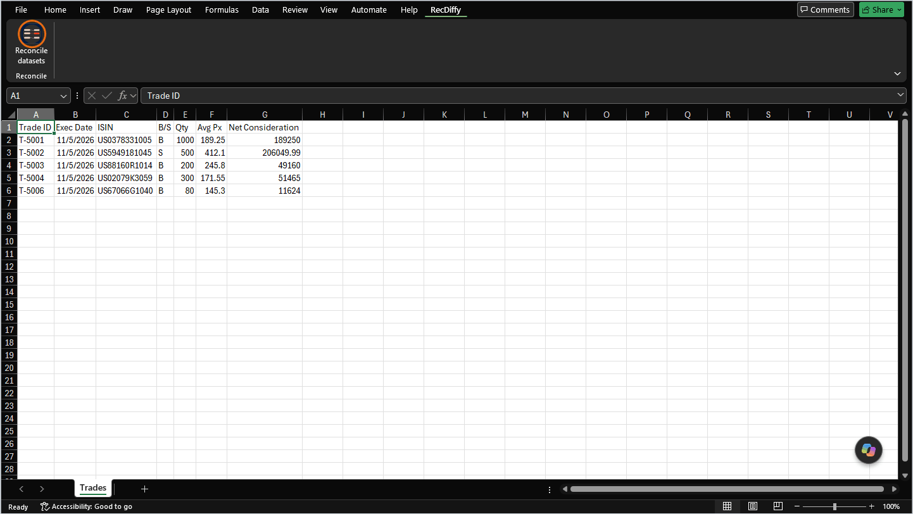
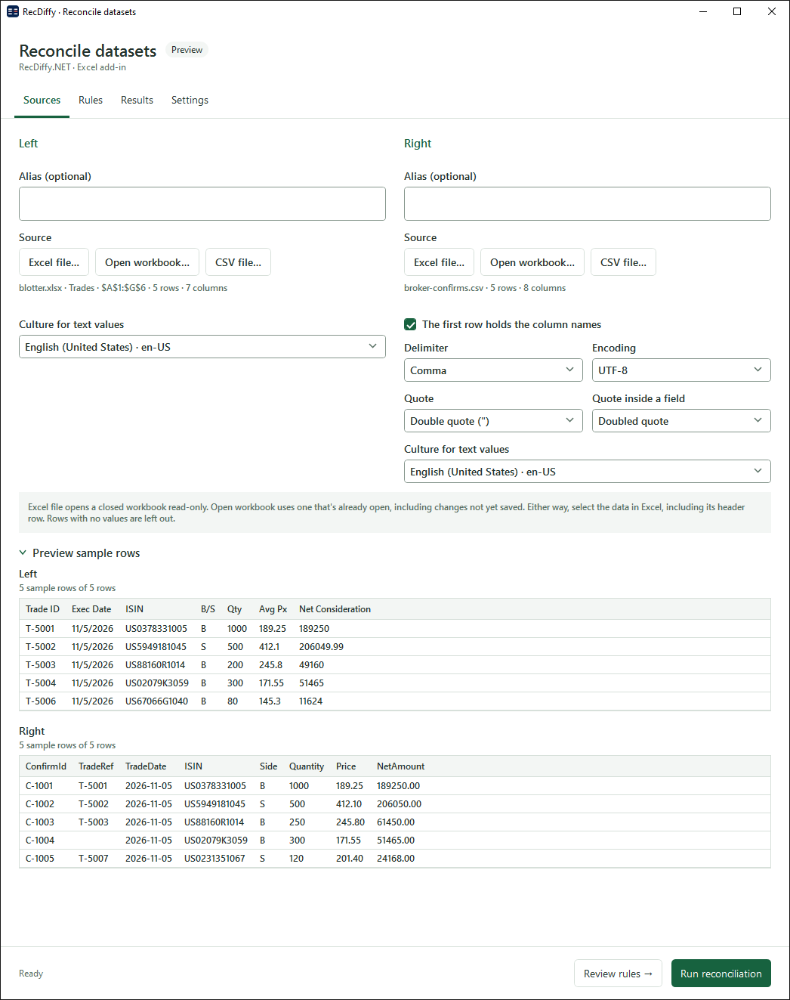
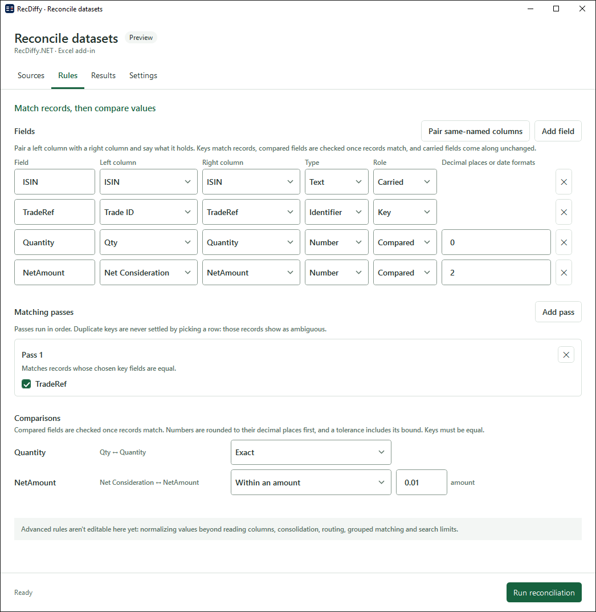
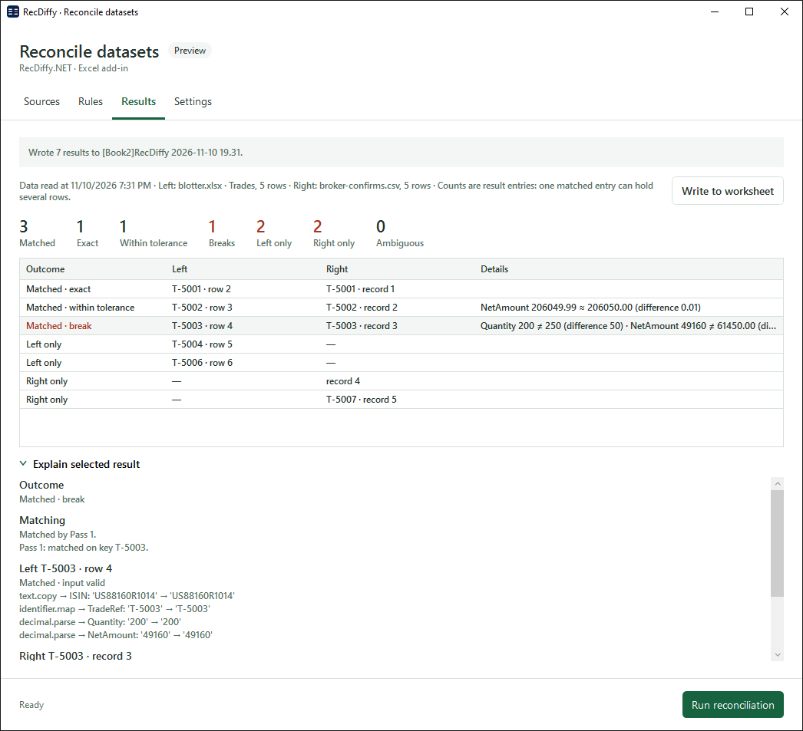
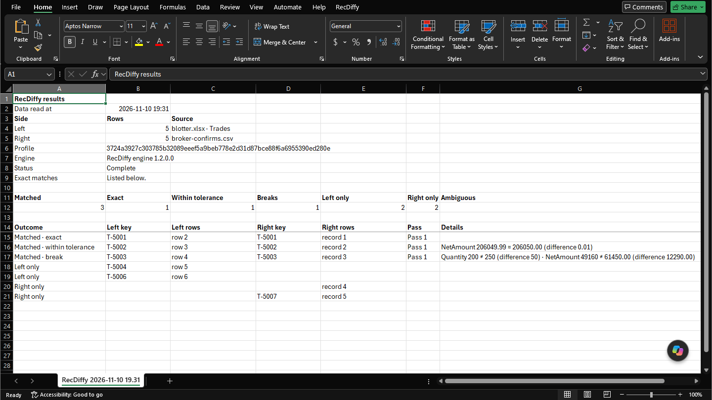
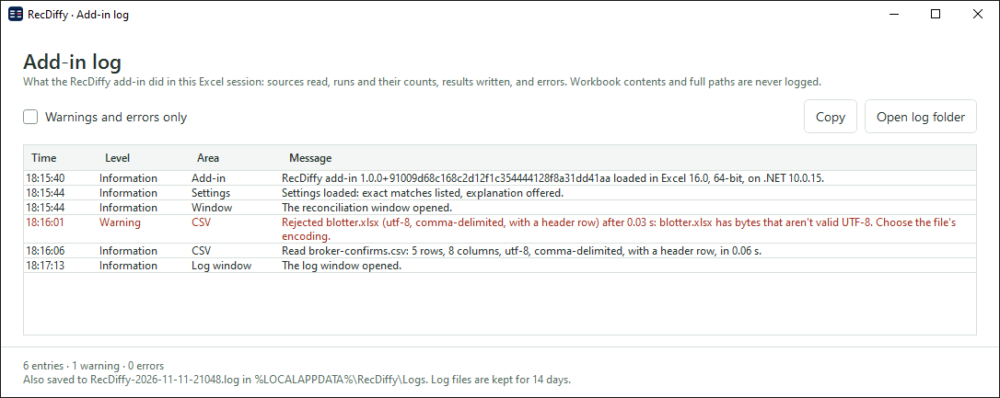

# RecDiffy Excel add-in

Reconcile two datasets without leaving Excel. Choose the data for each side, from an open workbook, a closed workbook or a CSV file. Say which columns match records and which values must agree. RecDiffy lines the records up and lists every difference.

> **Preview.** The add-in works end to end. Its installer isn't signed yet, so Windows warns before it runs it. See [Install](#install).



*A broker's confirmations, in a CSV file, against the order system's blotter, in a workbook. It goes from the ribbon to a results worksheet.*

## How it works

### 1. Sources

Choose the data for each side. **Open workbook…** reads a range from a workbook you have open, including changes not yet saved. **Excel file…** opens a closed workbook read-only. Either way, you select the data in Excel, including its header row. **CSV file…** reads a CSV file with the delimiter, encoding and quoting you choose.

Each side has its own culture for text values, so numbers and dates written as text are read the way that side writes them, and never guessed. The preview shows the first rows of each side as RecDiffy reads them.



### 2. Rules

Pair a left column with a right column, even when their names differ, and say what each field holds:

- **Key:** matches records.
- **Compared:** a value that must agree once records match.
- **Carried:** a value that comes along unchanged.

Matching passes run in order. A duplicate key is never settled by picking a row: those records show as ambiguous. Each compared field is exact or within a tolerance. Numbers are rounded to their decimal places first, and a tolerance includes its bound.



### 3. Results

**Run reconciliation** shows the counts, then one row per result, such as matched and exact, matched within tolerance, matched with a break, left only, right only or ambiguous. A match lines records up. It doesn't mean their values agree, so a matched result can still be a break.

Select a result and open **Explain selected result** to see which pass matched it, and how each value was read.



### 4. Write to worksheet

**Write to worksheet** puts the results on a new sheet in a new workbook, so nothing you have open changes. The sheet says:

- when the data was read;
- each side's source and row count;
- the profile hash and engine version;
- the counts;
- one row per result, with the rows it came from.



### Settings

The **Settings** tab has two switches. One chooses whether exact matches are listed. The counts always include them. The other chooses whether **Explain selected result** is offered. Both are remembered for your Windows account.

## Install

You need:

- Windows;
- Excel for Windows: Microsoft 365, or Excel 2016 or later, in 64-bit or 32-bit;
- the [.NET 10 Desktop Runtime](https://dotnet.microsoft.com/download/dotnet/10.0), in the same bitness as Excel.

1. **Get the installer,** `RecDiffy.ExcelAddIn.msi`. Use the `recdiffy-excel-addin-installer` artifact of a CI run, which needs a GitHub sign-in, or [build it](#build-and-test). There's no public download until the installer is signed (#198).
2. **Close Excel.** Excel rewrites its list of add-ins when it closes, so the installer stops if Excel is open.
3. **Run the installer.** It isn't signed yet, so Windows SmartScreen asks first: choose **More info**, then **Run anyway**.

The installer:

- installs for you only, with no administrator rights;
- puts both packed add-ins in `%LOCALAPPDATA%\Programs\RecDiffy`;
- registers the one that matches Excel's bitness, so Excel loads it every time it starts.

It stops with a message if Excel is open, if Excel isn't found, or if the .NET Desktop Runtime for Excel's bitness is missing. The next time you start Excel, a **RecDiffy** tab appears on the ribbon.

- **To upgrade,** run a newer installer. It replaces the old version.
- **To uninstall,** close Excel, then remove **RecDiffy Excel add-in** in Settings → Apps.
- **To install without questions,** for example from a script, run:

  ```
  msiexec /i RecDiffy.ExcelAddIn.msi /qn
  ```

  To uninstall the same way, use `/x` instead of `/i`.

## Try it

To load a build into one Excel session without installing it:

1. [Build the add-in](#build-and-test).
2. Open the packed add-in for Excel's bitness in Excel, using File → Open or a double-click. For 64-bit Excel, that's `src/RecDiffy.ExcelAddIn/bin/Release/net10.0-windows/publish/RecDiffy.ExcelAddIn-AddIn64-packed.xll`.
3. The build is unsigned, so Excel shows a security notice. Choose "Enable this add-in for this session only".
4. A **RecDiffy** tab appears on the ribbon. **Reconcile datasets** opens the window.

To repeat the animation, use the files in [docs/typed-reconciliation/data](../docs/typed-reconciliation/data):

1. Put `blotter.xlsx` on the left and `broker-confirms.csv` on the right.
2. On Rules, pair `Trade ID` with `TradeRef` as the key, `Qty` with `Quantity`, and `Net Consideration` with `NetAmount`.
3. Set `NetAmount` to within 0.01.

## The log

The add-in logs what it does:

- each source it reads, with its rows and how long it took;
- each run, with its counts;
- each write;
- settings saved;
- every error.

It never logs workbook contents or full paths.

- **See it:** on the **Add-ins** tab, choose **RecDiffy → Show log**. The window lists this Excel session's entries. It can show only warnings and errors, and **Copy** copies the entries shown. When the add-in hits an unexpected error, the window opens by itself.
- **Find it later:** each Excel session also writes `%LOCALAPPDATA%\RecDiffy\Logs\RecDiffy-<date>-<process id>.log`. When the add-in loads, it deletes log files older than 14 days.



## Troubleshooting

**The add-in doesn't load.** The add-in's own log starts only once the add-in has loaded. For a failure before that, turn on Excel-DNA's file logging for one Excel session. In a Command Prompt, run:

```
set EXCELDNA_DIAGNOSTICS_FILE_LEVEL=Verbose
set EXCELDNA_DIAGNOSTICS_SOURCE_LEVEL=Verbose
set EXCELDNA_DIAGNOSTICS_FILE_NAME=%TEMP%\exceldna.log
start excel
```

Then open the `.xll` in that Excel, and read `%TEMP%\exceldna.log`. The settings apply only to an Excel started from that Command Prompt. To keep them, put the same values under `HKCU\Software\ExcelDna\Diagnostics` as `FileLevel`, `SourceLevel` and `FileName`.

**One .NET runtime per Excel process.** Excel-DNA can load only one .NET runtime into an Excel process. If another .NET add-in loads an older runtime first, this add-in won't load. Excel-DNA then reports, for example, "The required .NET Desktop Runtime 10.0.0 x64 is incompatible with the runtime 6.0.36 already loaded in this process". In that case, turn the other add-in off for the session, or have it target .NET 10 or allow `RollForward="LatestMajor"`.

## For contributors

This is an Excel-DNA add-in that reconciles a left and a right dataset with RecDiffy.NET (#192). It's a separate solution from `RecDiffy.NET/RecDiffy.slnx`, with its own CI workflow (`.github/workflows/excel-addin.yml`) that runs only when this folder changes.

Agents: read `.agents/skills/excel-dna/SKILL.md` before changing this code. No Excel COM code without the lead's approval; see "Excel-DNA add-in" in `AGENTS.md`.

### Projects

| Project | Target | Holds |
|---|---|---|
| `RecDiffy.ExcelAddIn` | `net10.0-windows`, WPF, Excel-DNA 1.9.0, RecDiffy.IO 1.2.0-preview.2 | The ribbon, the window host, the views, the Excel reader and the CSV reader. The Excel reader uses the C API and the cell conversions registered at startup. The CSV reader uses `RecDiffy.IO`. |
| `RecDiffy.ExcelAddIn.ViewModels` | `net10.0`, RecDiffy 1.2.0-preview.2 | View models (CommunityToolkit.Mvvm) and the serializable reconciliation setup (#193), with no Excel or WPF types |
| `RecDiffy.ExcelAddIn.ViewModels.Tests` | `net10.0` | xunit tests of the view models, which run without Excel |
| `RecDiffy.ExcelAddIn.Tests` | `net10.0-windows` | xunit tests of the cell conversions and the table built from a picked range, which run without Excel |
| `RecDiffy.ExcelAddIn.Installer` | WiX v5 (`WixToolset.Sdk` 5.0.2) | The per-user MSI: both packed add-ins, the checks it makes before installing, and the registration |
| `RecDiffy.ExcelAddIn.InstallerActions` | `net472`, `WixToolset.Dtf.CustomAction` 5.0.2 | The installer's custom actions. They find Excel and its bitness, and add the add-in to Excel's `OPEN` values under `HKCU\Software\Microsoft\Office\16.0\Excel\Options`, or remove it. |
| `RecDiffy.ExcelAddIn.InstallerActions.Tests` | `net10.0` | xunit tests of the `OPEN` values and of reading an executable's bitness |

### Logging

- **One trace source:** the add-in owns a single `TraceSource`, `RecDiffy.ExcelAddIn`. It writes to the log window's in-memory book and to the daily file.
- **Decorators:** `AddInServices` wraps each service in a `Logged…` decorator, which logs the outcome, counts and time. View models see only `IAddInLog` and the service interfaces, with no Excel-DNA types.
- **Internal types:** the listener types are internal. With `ExplicitExports="false"`, Excel-DNA would try to register a public static method of a public type as a worksheet function.

### Build and test

```
dotnet build RecDiffy.ExcelAddIn/RecDiffy.ExcelAddIn.slnx -c Release -warnaserror
dotnet test RecDiffy.ExcelAddIn/RecDiffy.ExcelAddIn.slnx -c Release
```

The build writes packed add-ins to `src/RecDiffy.ExcelAddIn/bin/Release/net10.0-windows/publish/`: `RecDiffy.ExcelAddIn-AddIn64-packed.xll` for 64-bit Excel, and `RecDiffy.ExcelAddIn-AddIn-packed.xll` for 32-bit Excel.

It also writes the installer, `src/RecDiffy.ExcelAddIn.Installer/bin/Release/RecDiffy.ExcelAddIn.msi`.

- **Version:** the installer's version is the `InstallerVersion` property, 0.1.0 by default. CI builds 0.1.<run number>, so each CI installer upgrades the one before it.
- **Runtime:** `DesktopRuntimeVersion`, 10.0.0 by default, is the .NET Desktop Runtime it checks for.
- **Building it:** WiX v5 is free to use. From v6, WiX requires its Open Source Maintenance Fee to generate revenue (#198).

### The README's images

The animation is built from the frames in `docs/demo/frames` by `docs/demo/make-gif.ps1`, which needs ffmpeg (`winget install Gyan.FFmpeg`). After a UI change, capture new frames of the same size (1440 × 810), check the click positions in the script's table, and run it:

```
pwsh RecDiffy.ExcelAddIn/docs/demo/make-gif.ps1
```

Before you commit a capture, make sure it shows no account name or initials, no user paths, and no other windows or notifications. The other files in `docs/` are the screenshots from each phase's PR.
