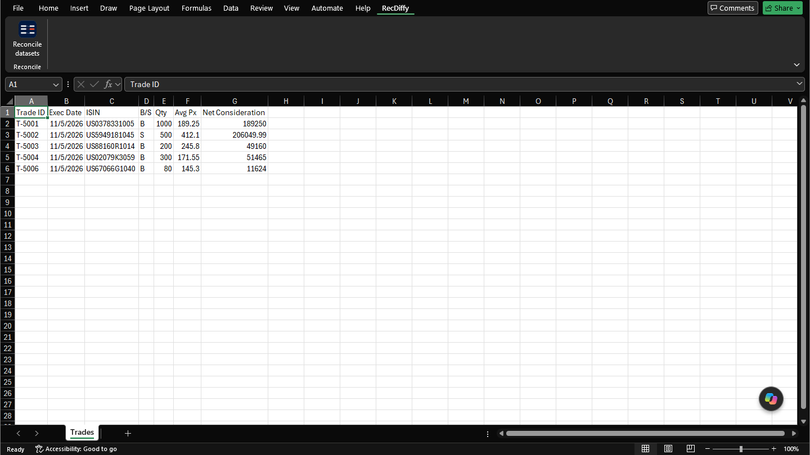
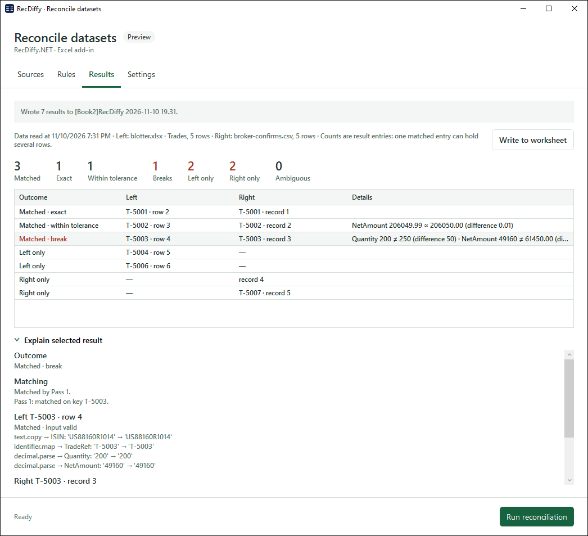
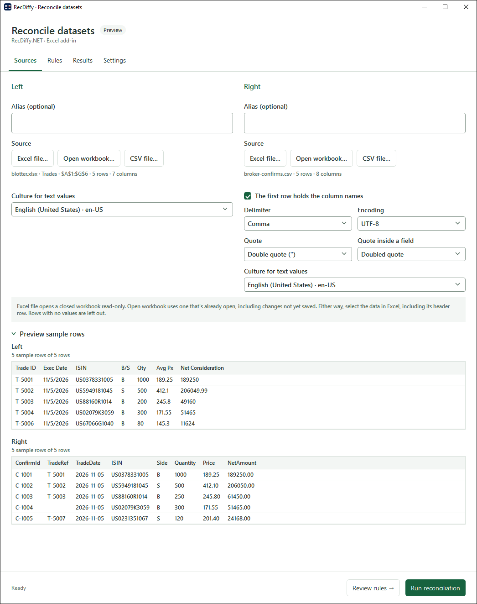
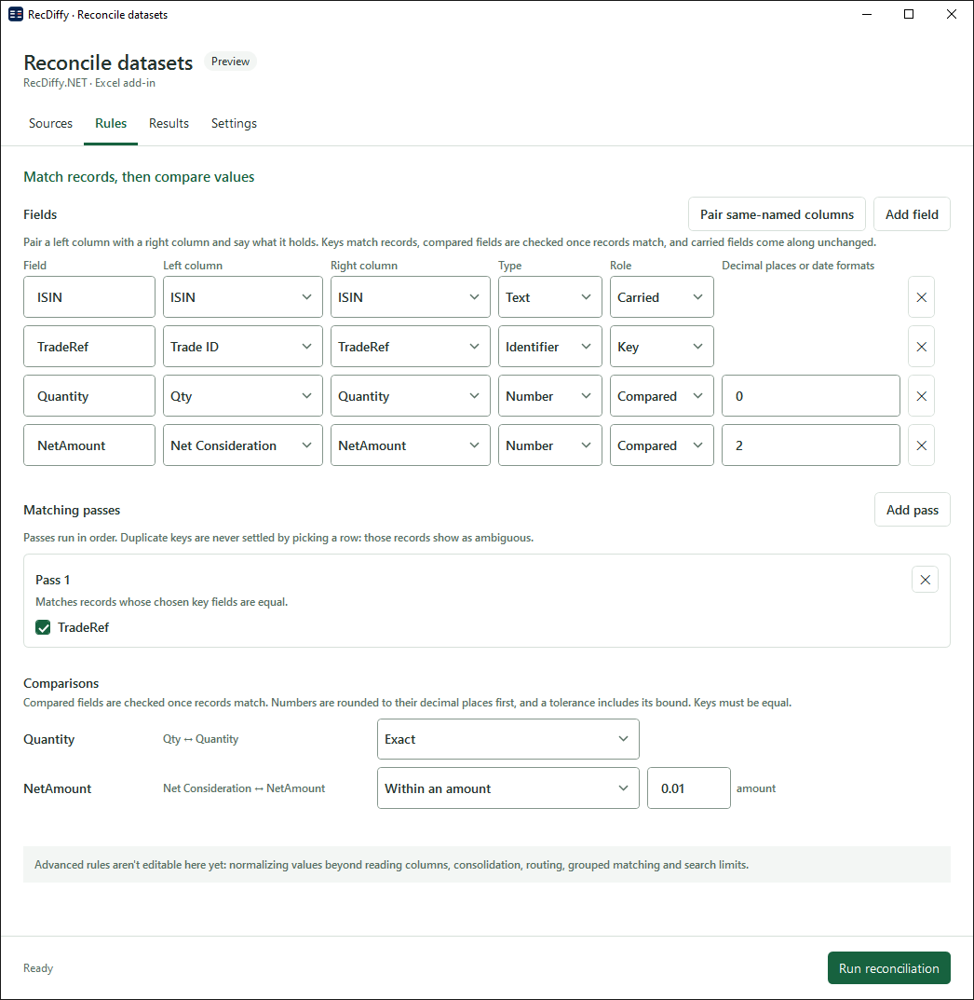
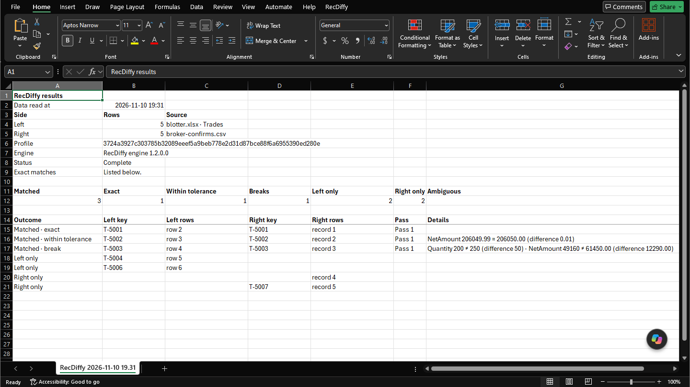

# RecDiffy Excel add-in: user guide

This guide is for people who reconcile data in Excel. It takes you from opening the add-in to reading the results. You don't need to know how the add-in is built.

A **reconciliation** compares two lists of records, a **left** side and a **right** side. It first lines up the records that belong together, then checks whether their values agree.

- [1. Getting started](#1-getting-started)
- [2. A reconciliation, step by step](#2-a-reconciliation-step-by-step)
- [3. Every control](#3-every-control)
- [4. Every dropdown](#4-every-dropdown)
- [5. Setting up rules](#5-setting-up-rules)
- [6. Reading the output](#6-reading-the-output)
- [Open questions](#open-questions)

To install the add-in, see [Install](../README.md#install) in the README.

## 1. Getting started

1. Open Excel. On the ribbon, choose the **RecDiffy** tab.
2. Choose **Reconcile datasets**. The RecDiffy window opens over Excel.

The window has four tabs, which you use from left to right:

| Tab | What you do there |
|---|---|
| **Sources** | Choose the left data and the right data. |
| **Rules** | Say which columns line records up, and which values must agree. |
| **Results** | Run the reconciliation and read what it found. |
| **Settings** | Choose what the results list shows. |

The bar at the bottom is always there. It shows a status message on the left and the **Run reconciliation** button on the right.

Good to know:

- You can keep working in Excel while the window is open. If it gets hidden, choose **Reconcile datasets** again to bring it back.
- The add-in never changes your data. It only reads it, and it writes results to a new workbook.
- Closing the window clears your sources and rules. Only the choices on the Settings tab are remembered.

## 2. A reconciliation, step by step

This example compares an order blotter in a workbook with a broker's confirmations in a CSV file.

1. **Open the window.** On the **RecDiffy** ribbon tab, choose **Reconcile datasets**.
2. **Choose the left data.** On the **Sources** tab, under **Left**, choose **Open workbook…** for a workbook you have open, or **Excel file…** for one that is closed. Excel asks you to select the data. Drag over it, including its header row, and choose **OK**.
3. **Choose the right data.** Under **Right**, choose **CSV file…** and pick the file. If the preview looks wrong, change the **Delimiter** or **Encoding**.
4. **Check the preview.** **Preview sample rows** shows a few rows of each side as RecDiffy reads them. Check that the columns and values look right.
5. **Go to the rules.** Choose **Review rules →**, or the **Rules** tab.
6. **Add the fields.** A field pairs one left column with one right column. Choose **Pair same-named columns** to add every pair with the same name, or **Add field** to pair columns with different names.
7. **Set each field's type and role.** Give the field that identifies a record, such as a trade reference, the type **Identifier** and the role **Key**. Give each value to check, such as a quantity or an amount, the type **Number** and the role **Compared**.
8. **Add a matching pass.** Choose **Add pass** and tick the key field. The pass lines up records whose keys are equal.
9. **Set the comparisons.** Under **Comparisons**, each compared field starts as **Exact**. To allow a small difference, choose **Within an amount** and enter the amount, for example 0.01.
10. **Run.** When the status bar says **Ready**, choose **Run reconciliation**. The window moves to the **Results** tab.
11. **Read the results.** The counts are at the top, with one row per result below. Counts in red need your attention.
12. **Look into a result.** Select a row and open **Explain selected result** to see how RecDiffy reached it.
13. **Keep a copy.** Choose **Write to worksheet** to put the results on a new sheet in a new workbook.

## 3. Every control

### Bottom bar

| Control | What it does |
|---|---|
| Status message | Says what to do next, or what the add-in is doing. For example: "Select the left and right data to begin", "2 rule problems to fix before running", or "Ready". |
| **Review rules →** | Moves to the Rules tab. It shows only on the Sources tab. |
| **Run reconciliation** | Reads both sides again and runs the reconciliation. It's available once both sides have data and the rules have no problems. |

### Sources tab

The tab has the same controls for **Left** and for **Right**.

| Control | What it does |
|---|---|
| **Alias (optional)** | A name for this side, such as "Blotter". It's added to the side's heading in this window. The results still say Left and Right. |
| **Excel file…** | Opens a closed workbook read-only, then asks you to select the data. Leave that workbook open until you've run. |
| **Open workbook…** | Asks you to select the data in a workbook that's already open. It reads the workbook as it is now, including changes you haven't saved. |
| **CSV file…** | Reads a CSV or text file. More options then appear: see the next table. |
| Summary line | Shows what was chosen: the workbook, sheet and range, or the file, with the number of rows and columns. |
| Message in red | Says why the data couldn't be used, and what to do about it. |
| **Culture for text values** | Says how this side writes numbers and dates when they're stored as text. See [Culture](#culture-for-text-values). |
| **Preview sample rows** | Shows up to five sample rows of each side as RecDiffy reads them. Click the heading to fold it away. |

When you select data in Excel:

- Select one rectangular block, with the header row first.
- Every column needs a name in the header row, and no name can appear twice.
- A cell with an Excel error, such as `#N/A`, stops the read. Fix or remove the error, then select the data again.
- Rows with no values are left out.

In the preview, a **highlighted cell** has hidden characters, such as a space at the end of the text. Point at the cell to see what's there and whether it affects matching.

These options show only for a CSV file. Changing one reads the file again straight away.

| Control | What it does |
|---|---|
| **The first row holds the column names** | Ticked: the first row gives the column names. Unticked: every row is data, and the columns are named Column1, Column2 and so on. |
| **Delimiter** | The character between values. |
| **Encoding** | How the file's characters are stored. Change it if accented letters or symbols look wrong, or if the add-in says the file has invalid bytes. |
| **Quote** | The character that wraps a value containing the delimiter. |
| **Quote inside a field** | How the file writes a quote character inside a quoted value. |

### Rules tab

| Control | What it does |
|---|---|
| **Pair same-named columns** | Adds a field for each left and right column with the same name. Upper and lower case don't matter. It skips columns you've already used. |
| **Add field** | Adds an empty field row. |
| **Field** | The field's name. It appears in the results. Each field needs a different name. |
| **Left column**, **Right column** | The two columns this field pairs. Their names can differ. |
| **Type** | What kind of value the field holds. See [Type](#type). |
| **Role** | What the field is used for. See [Role](#role). |
| **Decimal places** | For a Number only. Values are rounded to this many places before they're compared. It starts at 2, and can be 0 to 28. |
| **Date formats** | For a Date only. The formats of dates stored as text, such as `dd.MM.yyyy`. Separate several with `;`. |
| **✕** on a field | Removes the field. |
| **Add pass** | Adds a matching pass. |
| Tick boxes in a pass | One for each Key field. Tick the keys this pass matches on. |
| **✕** on a pass | Removes the pass. The passes after it are renumbered. |
| Comparison dropdown | How a compared field is checked. See [Comparison](#comparison). |
| **amount**, **%**, **days** boxes | The size of the allowed difference. Which boxes show depends on the comparison. |
| Messages in red | What to fix before you can run. They appear under the row with the problem, and at the bottom of the tab. |

### Results tab

| Control | What it does |
|---|---|
| Progress bar and **Cancel** | Show while a run or a write is in progress. **Cancel** stops it. |
| Run line | Says when the data was read, and each side's source and row count. |
| Counts | How many results fall under each heading. Red counts need attention. |
| **Write to worksheet** | Writes the results to a new sheet in a new workbook. |
| Results table | One row per result. Select a row to explain it. |
| **Rows RecDiffy couldn't read** | Shows only when some rows couldn't be read. Open it to list them. |
| **Explain selected result** | Shows how the selected result was reached. |

### Settings tab

| Control | What it does |
|---|---|
| **Include exact matches** | Ticked: exact matches are listed in the results table and on the worksheet. Unticked: they're left out, so you see only what needs attention. The counts include them either way. |
| **Offer "Explain selected result"** | Ticked: the explanation area shows under the results table. Unticked: it's hidden. |

Both settings are remembered for your Windows account.

### The log window

The add-in keeps a log of what it did: sources read, runs, writes and errors. It never logs your data. To see it, go to Excel's **Add-ins** tab and choose **RecDiffy → Show log**.

| Control | What it does |
|---|---|
| **Warnings and errors only** | Hides the routine entries. |
| **Copy** | Copies the entries shown, for example to send to support. |
| **Open log folder** | Opens the folder that holds the log files. |

## 4. Every dropdown

### Culture for text values

On the Sources tab, one for each side. It tells RecDiffy how that side writes numbers and dates **when they're stored as text**. Every value in a CSV file is text. In a workbook, true number and date cells are read as they are, so the culture doesn't affect them.

| Value | What it means |
|---|---|
| A language and region, such as **English (United States) · en-US** or **German (Germany) · de-DE** | Text is read the way that region writes it. In en-US, `1,234.56` is one thousand two hundred and thirty-four point five six. In de-DE, the same number is written `1.234,56`. |
| **Invariant culture** | A fixed format that doesn't depend on any region: a point for decimals, a comma for thousands. Use it for files written by a system rather than typed by a person. |

It starts as your own regional setting. Change it when a side comes from somewhere that writes numbers differently. If it's wrong, numbers are misread or the rows can't be read at all. RecDiffy never guesses.

### Delimiter

| Value | What it means |
|---|---|
| **Comma** | Values are separated by `,`. This is the starting value. |
| **Semicolon** | Values are separated by `;`. This is common where the comma is the decimal separator. |
| **Tab** | Values are separated by tabs. |
| **Pipe** | Values are separated by `\|`. |
| **Detect from the header row** | RecDiffy works out the delimiter from the first row. Use it when you aren't sure. |

### Encoding

| Value | What it means |
|---|---|
| **UTF-8** | The most common encoding today. This is the starting value. |
| **UTF-16 LE**, **UTF-16 BE** | Two-byte encodings. Some Windows tools save files as UTF-16 LE, sometimes labelled "Unicode". |
| **Windows-1252** | Older Western European files from Windows. |
| **ISO-8859-1** | Older Western European files from other systems. Also called Latin-1. |

### Quote

| Value | What it means |
|---|---|
| **Double quote (")** | A value containing the delimiter is wrapped like `"Smith, John"`. This is the starting value. |
| **Single quote (')** | It's wrapped like `'Smith, John'`. |

### Quote inside a field

| Value | What it means |
|---|---|
| **Doubled quote** | A quote inside a quoted value is written twice: `"He said ""yes"""`. This is the starting value. |
| **Backslash (\\)** | It's written with a backslash before it: `"He said \"yes\""`. |

### Type

On the Rules tab, one for each field. It says what kind of value the field holds. That decides how the value is read and which comparisons you can choose.

| Value | What it means | Effect on matching |
|---|---|---|
| **Text** | Free text, such as a name or a comment. This is the starting value. | Spaces at the start and end are removed. Otherwise the text must be the same, including upper and lower case. A Text field can't be a key. |
| **Identifier** | A value that identifies a record, such as a trade reference or an account number. | Read as text, with spaces at the start and end removed. `ABC1` and `abc1` are different. A number cell and the same number stored as text are the same value. |
| **Code** | A short code from a fixed list, such as a currency or Buy/Sell. | Read the same way as an Identifier. |
| **Number** | A quantity, price or amount. | Rounded to the field's decimal places, then compared as a number. `100` and `100.00` are equal. A tolerance is allowed. |
| **Date** | A calendar date. | Compared as a date, whatever its format on each side. A tolerance in days is allowed. A date stored as text needs a format in **Date formats**. |

### Role

On the Rules tab, one for each field. It says what the field is used for.

| Value | What it means | Effect on matching |
|---|---|---|
| **Key** | The field identifies a record. | Records line up when their keys are equal. A key field is offered as a tick box in each pass. |
| **Compared** | A value that should agree once two records are lined up. | It doesn't affect which records line up. If the values differ by more than you allow, the result is a break. Each compared field gets a row under **Comparisons**. |
| **Carried** | Extra information that comes along. This is the starting value. | None. You can see the value in **Explain selected result**. |

### Comparison

On the Rules tab, one for each compared field. The choices depend on the field's type.

| Value | Offered for | What it means |
|---|---|---|
| **Exact** | Every type | The two values must be equal. Numbers are rounded to their decimal places first. This is the starting value. |
| **Within an amount** | Number | The values may differ by up to the amount you enter. With 0.01, 100.00 and 100.01 agree, and 100.00 and 100.02 don't. |
| **Within a percentage** | Number | The values may differ by up to that percentage of the larger value. With 1, 1,000 and 1,010 agree, because the difference of 10 is within 1% of 1,010. |
| **Within an amount or a percentage** | Number | The values agree if either test passes. Use it when small amounts need a fixed allowance and large amounts need a proportional one. |
| **Within a number of days** | Date | The dates may be up to that many days apart. With 2, 3 March and 5 March agree. |

A tolerance includes its limit: a difference equal to the limit is allowed. Values that agree only because of a tolerance are reported as **within tolerance**, not as exact. Type the amount and percentage with the decimal separator your Excel uses. The days must be a whole number.

## 5. Setting up rules

The Rules tab has three parts. Fill them in from top to bottom.

1. **Fields** say what each pair of columns holds.
2. **Matching passes** line records up by their keys.
3. **Comparisons** check the values of the records that lined up.

### Add a rule

1. **Add a field.** Choose **Add field**. Type a name, choose the left column and the right column, then choose the type and the role.
2. **Add a pass.** Choose **Add pass**, then tick the key fields it matches on. You need at least one pass with at least one key ticked.
3. **Add a comparison.** Set a field's role to **Compared**. A row for it appears under **Comparisons**. Choose how it's compared and enter the allowed difference.

### Edit a rule

Change any box, dropdown or tick box in place. There's nothing to save: the change applies the next time you run. If you already have results, the Results tab says they're out of date until you run again.

### Remove a rule

- **A field:** choose **✕** at the end of its row. Any tick box or comparison for it goes too.
- **A pass:** choose **✕** at the top right of the pass.
- **A comparison:** change the field's role from **Compared** to **Carried**, or remove the field.

### How passes work

- Passes run in order. Pass 1 looks at every record. Each later pass looks only at the records that are still unmatched.
- A pass with several keys ticked needs all of them to be equal.
- If two or more records on one side share the same key, RecDiffy doesn't pick one. Those records are reported as **ambiguous**.
- A record with an empty key doesn't match anything in that pass.

Use a second pass as a fallback. Match on the strongest key first, then on a weaker combination for whatever is left.

### Example 1: one key and a tolerance

You're comparing a blotter with a broker's confirmations. Both have a trade reference, a quantity and a net amount, under different column names.

| Field | Left column | Right column | Type | Role | Decimal places |
|---|---|---|---|---|---|
| TradeRef | Trade ID | TradeRef | Identifier | Key | |
| Quantity | Qty | Quantity | Number | Compared | 0 |
| NetAmount | Net Consideration | NetAmount | Number | Compared | 2 |

- **Pass 1:** tick `TradeRef`.
- **Comparisons:** leave `Quantity` as **Exact**. Set `NetAmount` to **Within an amount**, with 0.01.

Trades with the same reference line up. A one-cent difference in the net amount is reported as within tolerance. A bigger difference, or any difference in quantity, is a break. A trade on one side only is reported as left only or right only.

### Example 2: a fallback pass and a date tolerance

Some confirmations arrive without a trade reference. You want those matched on the account and the trade date, and you accept a settlement date up to two days out.

| Field | Type | Role | Date formats |
|---|---|---|---|
| TradeRef | Identifier | Key | |
| Account | Identifier | Key | |
| TradeDate | Date | Key | `dd/MM/yyyy` |
| SettleDate | Date | Compared | `dd/MM/yyyy` |
| Trader | Text | Carried | |

- **Pass 1:** tick `TradeRef`.
- **Pass 2:** tick `Account` and `TradeDate`.
- **Comparisons:** set `SettleDate` to **Within a number of days**, with 2.

Pass 1 matches every record that has a reference. Pass 2 then matches the rest on account and trade date together. If an account has two unmatched trades on the same date, they're reported as ambiguous. The date formats are needed only where the dates are stored as text, as they always are in a CSV file.

### What the Rules tab can't do yet

A note at the bottom of the tab lists what isn't available yet: changing values before they're compared, combining rows, sending records down different paths, matching groups of records, and search limits.

## 6. Reading the output

A **match** means two records were lined up. It doesn't mean their values agree. A matched result can still be a break.

### The counts

| Count | What it means |
|---|---|
| **Matched** | Results where a left record and a right record lined up. It includes the next three. |
| **Exact** | Matched, and every compared value is equal. |
| **Within tolerance** | Matched, and at least one value differs, but only by an amount you allowed. |
| **Breaks** | Matched, and at least one value differs by more than you allowed. |
| **Left only** | A left record with no partner on the right. |
| **Right only** | A right record with no partner on the left. |
| **Ambiguous** | Records that share a key with other records, so RecDiffy didn't pick a partner. |
| **Search incomplete** | Shows only when it isn't zero. RecDiffy stopped looking for a match before it could settle one. |
| **Quarantined rows** | Shows only when it isn't zero. Rows that couldn't be read, so they took no part in matching. They're listed under **Rows RecDiffy couldn't read**. |
| **Suppressed rows** | Shows only when it isn't zero. Rows left out on purpose by a rule. |

The counts are results, not rows. One result can hold several rows, so the counts may not add up to the row counts.

### The results table

| Column | What it means |
|---|---|
| **Outcome** | What happened to the record or pair. Breaks are in red. |
| **Left**, **Right** | The record on each side: its key, then where it is. For a workbook that's the worksheet row, such as "row 14". For a CSV file it's the position in the file, such as "record 13". A dash means there's no record on that side. |
| **Details** | For a matched result, the values that differ: `≠` marks a break and `≈` marks a difference within tolerance, with the size of the difference. For any other result, the reason no match was made. |

| Outcome | What it means | What to do |
|---|---|---|
| **Matched · exact** | Lined up, and all compared values are equal. | Nothing. |
| **Matched · within tolerance** | Lined up, with a difference you allowed. | Usually nothing. Details shows the difference. |
| **Matched · break** | Lined up, with a difference bigger than you allowed. | Investigate. Details shows the field and both values. |
| **Matched** | Lined up, and no values were compared. | See [Open questions](#open-questions). |
| **Left only** | On the left, with no partner on the right. | Check whether the record is missing on the right, or whether its key is written differently. |
| **Right only** | On the right, with no partner on the left. | The same, the other way round. |
| **Ambiguous** | Several records share the key, so none was picked. | Remove the duplicates, or add a key field that tells them apart. |
| **Search incomplete** | RecDiffy stopped before it could settle a match. | See [Open questions](#open-questions). |

### Rows RecDiffy couldn't read

This list shows each row that had a value RecDiffy couldn't read as the field's type, such as text in a Number field or a date in an unexpected format. Each line gives the side, the row and the problem. These rows aren't matched, so fix the data or the field's type, then run again. The window lists the first 200.

### Explain selected result

Select a result and open **Explain selected result**. It has these parts:

| Part | What it shows |
|---|---|
| **Outcome** | The outcome, and how many rows are on each side when there's more than one. |
| **Matching** | Which pass made the match, and what each pass found. For example: "Pass 1: no record on the other side has key T-1007." |
| **Hints** | Extra notes from RecDiffy, when it has any. |
| One part for each row | How each value in the row was read: the value as it was in your data, then the value RecDiffy used. Look here when two values look the same but don't match. |
| Last line | A code that identifies the rules, and the RecDiffy version. Two runs with the same code used the same rules. |

### Messages on the Results tab

| Message | What it means |
|---|---|
| "The rules or sources changed after this run. Run again to refresh the results." | The results on screen are from before your last change. |
| "… The results below are from the previous run." | The latest run was canceled or failed, so the earlier results are still shown. |
| "N exact matches aren't listed. The counts include them." | **Include exact matches** is turned off on the Settings tab. |

### The results worksheet

**Write to worksheet** makes a new workbook, with a sheet named after the time the data was read, such as `RecDiffy 2026-03-05 14.30`. Nothing you have open is changed.

The top of the sheet describes the run:

| Line | What it means |
|---|---|
| **Data read at** | When RecDiffy read the two sides for this run. |
| **Left**, **Right** | Each side's row count and source. |
| **Profile** | A code that identifies the rules. Two runs with the same code used the same rules. |
| **Engine** | The RecDiffy version. |
| **Status** | **Complete** when everything was written. **Incomplete** when the write was canceled or failed: the sheet keeps what was written. It also says if the rules or sources had changed since the run. |
| **Exact matches** | Whether exact matches are listed below. |
| Counts | The same counts as on the Results tab. |

Then comes one row per result:

| Column | What it means |
|---|---|
| **Outcome** | The same as on the Results tab. |
| **Left key**, **Right key** | The key values of the record on each side. |
| **Left rows**, **Right rows** | Where the records are: worksheet rows for a workbook, record numbers for a CSV file. |
| **Pass** | The pass that made the match. It's empty when there was no match. |
| **Details** | The same as on the Results tab. |

If any rows couldn't be read, a last section, **Rows RecDiffy couldn't read**, lists each one's side, row and problem. Results that don't fit on one sheet continue on further sheets in the same workbook.

## Open questions

These points weren't clear from the add-in's source. They need an answer from the team before this guide can state them firmly.

1. **Identifier and Code.** In this add-in the two types are read and compared the same way. When should a user choose one over the other?
2. **Outcome "Matched".** The add-in can show a plain **Matched** outcome, with no "exact", "within tolerance" or "break", for a pair whose values weren't compared. When does that happen? It may be when no field has the role Compared.
3. **Search incomplete.** Can a reconciliation built on the Rules tab ever report it? The tab has no search limits to set. If it can, what should the user do?
4. **Suppressed rows.** Can rules built on the Rules tab ever suppress a row? If not, the count never shows.
5. **Text dates with no format.** The guide says a date stored as text needs a format in **Date formats**. Is such a date ever read from the side's culture alone, when the box is empty?
6. **Date format letters.** The box takes patterns such as `dd.MM.yyyy`. Should the guide list the letters, or link to a reference?
7. **Rounding.** A Number is rounded to its decimal places before it's compared. Should the guide say how a value exactly halfway is rounded?
8. **Alias.** It only changes the side's heading in the window. Is it meant to appear in the results and on the worksheet too?
9. **Excel file… leaves the workbook open.** The workbook it opens stays open in Excel, read-only, and the run needs it open. Should the guide tell the user to close it afterwards?
