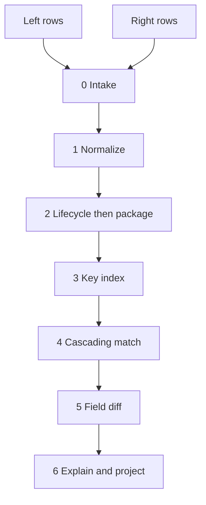

# RecDiffy.NET architectural specification (v1, historical)

> **Historical.** This is v1 (2026-11-04). It is superseded by the architecture spec v3.1 (2026-11-13), which is kept out of git. [SPEC-STATUS.md](SPEC-STATUS.md) says how to get it, which shipped behavior overrides it, and why v1 must not be implemented.

**Status:** Historical decision document. Not the spec in force. It contains no implementation.
**Date:** 2026-11-04
**Runtime:** C# 12, `net8.0` minimum, nullable enabled. `net9.0` is a compatible target.
**Authority:** Michael's wiki pages are requirements. `Argon.MD` is the baseline pipeline. The trade workbooks and hidden-test oracles are the acceptance data. The library-research page and the seven `opinions/argon-missing` write-ups are inputs. Where they disagree, this document decides.

The engine reconciles two populations of records. Bond matching, trade matching, and cash matching are profiles on that engine.

## 1. Scope and non-goals

### What the library is

RecDiffy.NET matches every record from a left population to a right population, or reports that it did not, and then compares the fields of each committed group. The two populations may differ in size, schema, and encoding. A definition supplied at run time, the profile, decides keys, normalization, lifecycle, grouping, and tolerances.

The wiki's dynamic definition layer is the profile. The wiki's two peer paths are two pass families inside one pipeline:

| Wiki path | Engine meaning | Sample |
|---|---|---|
| Trade matching | Identifier passes. A shared execution reference, then a natural business key. | `UTI_Exec_ID` = `Shared_Market_Exec_Ref`, else counterparty + instrument + side + trade date |
| Cash-type matching | Measure passes. Group rows and compare a summed or netted amount. | Three internal allocations `2200 + 5400 + 1400` against one street quantity `9000` |

Neither path is nested under the other. A profile lists identifier passes and measure passes as peers. Asset class is a field value a rule may read. It is not a branch in the core.

The same pipeline runs a non-financial profile. A warehouse profile maps bin counts to book counts on `Sku`, sums split bins with the measure pass, and tolerates a configured unit count. It has no lifecycle and no price convention. That profile is the generality check. It does not get its own engine.

### Batch, cardinality, nested diff

| Question | Decision |
|---|---|
| Batch or streaming | **Batch.** Stage 2 and stage 3 need both full sides. An adapter may read `IAsyncEnumerable<T>` and buffer it. The engine method takes `IReadOnlyList<T>`. |
| N-to-1 or N-to-M | **1:1 and N:1 in the acceptance profiles.** 1:N is the same measure pass with the block side flipped, and it is off in those profiles. General N:M assignment is out of scope. |
| Partial row consumption | **Whole records only.** A row is in a group or it is not. |
| Nested diff | **No object-graph walk.** The differ compares the canonical fields the profile lists. If the profile also declares a child collection with a child key, that collection is aligned with the same matcher, at a depth of one. Cycles are not representable. The trade acceptance profiles collapse legs before the diff, so those tests compare one canonical payload per group. |

An 80% quantity gap is a matched field break, not an N:M problem. In the Sonnet workbook, `OMS3512650` quantity `1,000,000` matches `CG-43060951` quantity `800,000` on the natural key, and the oracle outcome is `BREAK_1_TO_1`.

### Packaging

The NuGet package is the core DLL. It references the BCL only. REST and MCP hosts are separate deployments and are outside this spec. The core reads no file paths. Callers pass records and a profile.

### Non-goals for this version

- Persistence, break aging, workflow states, comments, and day-over-day carry-forward. Group ids are stable so a later product can do that.
- A user interface and Excel file output. The side-by-side grid is an in-memory projection.
- Holiday calendars and business-day arithmetic. Settlement dates compare as `DateOnly`.
- Fuzzy auto-match of free text, tickers, or descriptions.
- Streaming, watermarks, and incremental late-event correction.
- Arbitrary POCO graph comparison, cycle detection, and private-field reflection.
- Check-digit validation of ISIN, CUSIP, SEDOL, or LEI, unless a profile rule turns it on. Several fixture identifiers are synthetic.

### Design order

1. Explainable, correct results against the oracles.
2. The same inputs, profile, and reference snapshot always produce the same groups.
3. A hot compare path that does not box value-type fields.
4. Rules a caller can add without editing the engine.
5. A small public surface.

## 2. Canonical record model

### Handles, keys, payload

Every input row receives a handle before any rule runs. The handle is the provenance key back to the raw row.

```csharp
public enum Side { Left, Right }

public readonly record struct RecordHandle(Side Side, int Ordinal, string SourceId);

public readonly record struct KeyClaim(string Kind, string Scope, string NormalizedValue);
```

`Ordinal` is the index after sorting that side by `SourceId`. Workbook row position is not an identity and is not a tie-break. `SourceId` is `Internal_Trade_ID` on the left and `Cpty_Report_ID` on the right for the trade profiles.

A key claim is typed. `Kind` is the role (`shared-exec`, `instrument`, `counterparty`, `natural`, `package`, `lifecycle-target`). `Scope` is the namespace (`UTI`, `ISIN`, `CUSIP`, `SEDOL`, `TICKER`, `LEI`, `ALIAS`). A CUSIP and a ticker never share a bucket just because the strings look similar. `91282CT68` is a CUSIP claim. `T 4.75 11/15/49` is a ticker claim. They do not collide.

Claims do not form a union-find. Two trades that share an ISIN stay two trades. Posting the same handle under several claims does not copy the record.

```csharp
public enum InputValidity { Valid, Warning, Quarantined, Suppressed }

public sealed record CanonicalRecord<TPayload>(
    RecordHandle Handle,
    InputValidity Validity,
    IReadOnlyList<Diagnostic> Diagnostics,
    IReadOnlyList<KeyClaim> Keys,
    TPayload? Payload,
    IReadOnlyList<RecordHandle> Lineage);
```

`Payload` is null when the row is quarantined or when the event carries only a reference. Lineage on a survivor lists the raw handles collapsed into it, including the survivor. The raw values those handles point at stay reachable through the run's input tables. A canonical equality of `96.078125` and `96-02+` still has both raw values available to the explanation.

`TPayload` is the caller's canonical shape. The core has no `Bond`, `Swap`, or `CanonicalTrade` type.

### Trade-sample payload

The trade sample profile projects both sheets onto this record. Names are the economic concepts, not the sheet headers.

```csharp
public sealed record TradeFacts
{
    public required string Counterparty { get; init; }
    public required string Instrument { get; init; }
    public required string InstrumentScope { get; init; }
    public required string AssetClass { get; init; }
    public required string BookSide { get; init; }
    public required decimal Quantity { get; init; }
    public required decimal Price { get; init; }
    public required string Currency { get; init; }
    public required DateOnly TradeDate { get; init; }
    public required DateOnly SettleDate { get; init; }
    public decimal? Accrued { get; init; }
    public decimal? Fees { get; init; }
    public required decimal NetCash { get; init; }
    public decimal? Coupon { get; init; }
    public DateOnly? Maturity { get; init; }
}
```

`Quantity` is unsigned after normalization. `BookSide` is the canonical side (`BUY`, `SELL`, `PAY_FIXED`, `REC_FIXED` in the trade sample). Blank coupon and maturity stay null. They are not zero.

### Provenance

```csharp
public sealed record FieldOrigin(
    RecordHandle Handle,
    string SourceField,
    string? RawText,
    object? RawValue,
    string RuleId);
```

Each canonical field the differ will read has a `FieldOrigin`. `RawValue` may box. That object is audit data, built when a result is materialized. The compare hot path does not consult it.

### Identifier roles

| Role | Trade-sample source | What it identifies |
|---|---|---|
| Source row | `Internal_Trade_ID`, `Cpty_Report_ID` | One input row |
| Shared execution | `UTI_Exec_ID`, `Shared_Market_Exec_Ref` | One economic trade, even when price or quantity later breaks |
| Instrument | `ISIN` / `CUSIP` / `SEDOL` / `Ticker` on the left; `Primary_Security_ID` plus `Security_ID_Source` on the right | The instrument, after the security master resolves aliases |
| Counterparty | `Counterparty_Code`; street name or LEI through the alias map | The legal entity |
| Package | `Parent_Link_ID` | Legs that must become one item before matching |
| Lifecycle target | `Cancels_Prior_Report_ID` | An earlier event on the same side |
| Natural key | counterparty + instrument + book side + trade date | A 1:1 match when no unique shared execution reference exists |

Quantity, price, fees, accrued, net cash, and settlement date are economic fields. They are compared after alignment. The fixture schema-2 rule that puts unsigned quantity into the 1:1 natural key is not the acceptance rule: Sonnet group `G0144` has no shared execution reference, quantities `1,000,000` and `800,000`, and outcome `BREAK_1_TO_1`. A natural key that required equal quantity would leave that pair unmatched.

Conflicting claims on an already proposed pair do not veto a unique shared-execution match. `OMS2827093` and `GS-85339531` share `SWU69BMJ17DGR1VWAZ3442EEBDA8AA` and disagree on price (`96.572` vs `99.966`). They still align. The price disagreement is a field break.

## 3. Pipeline stages



Each stage reads an immutable batch and returns a new batch plus diagnostics. Rules are pure. A stage applies an ordered list of rule objects. There is no central `if` chain for asset class, side codes, or price conventions.

| Stage | Input | Output | Failure policy | Order |
|---|---|---|---|---|
| 0 Intake | Raw rows, id selector | Handles, duplicate-id quarantine | Duplicate `SourceId` on one side quarantines every row with that id. The run continues. | First. Sorting by `SourceId` happens here. |
| 1 Normalize | Accepted rows, reference snapshot, ordered rules | `CanonicalRecord<TPayload>`, possibly with a null payload | A rule returns a diagnostic. Severity `Quarantine` removes the row from later stages and keeps it on the result. Severity `Warning` keeps the row. Profile build errors throw before stage 0. | Rules run in profile order. Perspective inversion runs after sign normalization. |
| 2 Consolidate | Canonical rows per side | Survivors, suppressed events, packages | Missing lifecycle target, cycle, or a required leg that is absent quarantines the component. A fully cancelled chain with no survivor is `Suppressed`, not a right-only row. | Lifecycle links resolve before packages. Left and right consolidate independently. |
| 3 Index | Survivors | Inverted index of `KeyClaim` to handles | A survivor with no claims is legal. It can only fall out as left-only or right-only. Duplicate claims are retained as many handles. The index never overwrites. | After consolidation, so a busted `NEW` is not indexed. |
| 4 Match | Index, residue pool, ordered passes | Committed groups, unresolved, ambiguous, residue | A pass that hits its work budget marks that block `Unresolved` and does not guess. | Passes run in profile order. Earlier commits are final. |
| 5 Diff | Committed groups whose validity is `Valid` | Field outcomes and deltas | A field marked not comparable stays `NotComparable` and does not become a break. | After alignment. Quarantined rows are not diffed. |
| 6 Project | All of the above | `ReconciliationResult`, explanations, side-by-side grid, totals | Projection does not change membership. | Last. |

Default record policy is quarantine-and-continue. `RunOptions.FailFast` stops the run on the first quarantine and returns no successful result. Cancellation is a different path: `OperationCanceledException`, no successful result.

### Stage 0 sample

`Internal_Trade_ID` `OMS4152729` becomes handle `(Left, ordinal, "OMS4152729")`. `Cpty_Report_ID` `BA-18777889` becomes `(Right, ordinal, "BA-18777889")`. The ordinals follow sorted source ids, so shuffling the sheet does not move them.

### Stage 1 is an ordered rule list

The trade sample uses these rules, one type per file. Order is the contract.

| Order | Rule | Effect on the sample |
|---|---|---|
| 1 | Parse dates with the field's format list, invariant culture | `11/06/2025` with format `dd/MM/yyyy` is 11 June 2025. `10-JUN-2025` uses the explicit month-name format. Unparseable text quarantines the row. |
| 2 | Resolve counterparty alias and LEI | `BOFA_MLPF&S` and `GS_NY_PRIME` become `BAML` and `GSCO`. An unknown required alias quarantines the row. |
| 3 | Resolve `Primary_Security_ID` through `Security_ID_Source` | Source `CUSIP` posts a CUSIP claim only. The security master may add the ISIN as another claim. It does not fuzzy-match `Security_Text`. |
| 4 | Map direction tokens | See the truth table below. |
| 5 | Apply blank-direction sign, then redundant explicit sign | `Dir_Ind` blank and quantity negative becomes sell or pay-fixed. `S` together with `-2000` is one sell of `2000`. |
| 6 | Invert once when perspective is `DEALER_BILATERAL_VIEW` | Street `S` opposite an internal `BUY` becomes `BUY`. `PB_CLIENT_VIEW` does not invert. |
| 7 | Parse price by `Price_Quote_Convention` | `32NDS_UST` and `DIRTY_PCT_PAR` below. Other conventions take a decimal. |
| 8 | Scale decimals | Amounts to 2 places, midpoint away from zero. Bond clean prices to 6. Equity prices to 2. FX rates to 6. Scaling happens before compare. |
| 9 | Canonical quantity is the absolute value | Sign lives only in `BookSide`. |

Direction truth table for the trade sample. "Then invert" is rule 6 and runs only for `DEALER_BILATERAL_VIEW`.

| `Dir_Ind` | Quantity sign | Result before perspective | Sample |
|---|---|---|---|
| `B`, `BOT`, `BUY`, `buy` | positive | `BUY`, absolute quantity | `GS-85339531` `B` / `1,750,000` |
| `S`, `SLD`, `SELL`, `sell` | positive | `SELL` | `BA-18777889` `SLD` / `3,000,000` |
| blank | positive | `BUY`, or `REC_FIXED` when the product rule says the blank sign is a swap | `JP-48051575` blank / `9000` equity |
| blank | negative | `SELL`, or `PAY_FIXED` for a swap | `JP-32003590` blank / `-13,000,000` is `PAY_FIXED` |
| `S` or `P` | negative | That side once. The negative sign is redundant. | `MS-18204082` `S` and `-2000` is a sell of `2000` |
| `B` or `R` | negative | Quarantine `DirectionConflict` | No oracle row does this |
| blank | zero | Quarantine `DirectionConflict` | The oracles have no zero quantity |
| `P` / `PAY` / `pay` | n/a | `PAY_FIXED` | Dealer sample can arrive as `P` |
| `R` / `REC` / `rec` | n/a | `REC_FIXED` | |

`OMS3008502` is internal `BUY` of `USDCHF`, `19,500,000`, trade date 11 June 2025, counterparty `BARC`. Street `BC-51721586` says `Dir_Ind` `S`, perspective `DEALER_BILATERAL_VIEW`, name `Barclays Bank PLC`. Rule 4 reads `S` as sell. Rule 6 flips it to `BUY`. The shared references differ (`1HDNAU1VGN38H5FTZ187110E7F6707` vs `BCX1431235033`), so only the natural key aligns them.

32nds grammar, culture-invariant:

```text
price      := whole "-" thirtyseconds [ "+" ]
whole      := digits
thirtyseconds := two digits, 00..31
```

`96-02+` = `96 + 2/32 + 1/64` = `96.078125`. That is `OMS4152729` `Clean_Price_Rate` against `BA-18777889` `Exec_Price_Rate` `"96-02+"`. A token such as `98-1X` quarantines with `UnparseableValue`. The row is not a price break.

Dirty convention on the sample profile:

```text
clean = dirty - accrued / unsignedFace * 100
```

`OMS1091827` clean `98.755`, face `3,750,000`, accrued `54,687.50`. Street `CG-51174451` reports dirty `100.213333`. `54,687.50 / 3,750,000 * 100` = `1.458333`, and `98.755 + 1.458333` = `100.213333`. The differ compares clean to clean. Accrued stays its own field. Missing accrued on a dirty quote quarantines the row. The engine does not invent a day-count.

### What a quarantine looks like

A malformed 32nds row leaves stages 3–5. The result still contains it:

```text
handle:     (Right, ordinal, "BA-EXAMPLE")
validity:   Quarantined
code:       UnparseableValue
rule:       Treasury32ndsPriceRule
field:      Exec_Price_Rate
raw:        "98-1X"
alignment:  none
```

## 4. Cascading matcher

### Pass contract

A pass sees only handles that no earlier pass committed. It returns proposals. The orchestrator commits a proposal atomically or rejects it. A handle is in at most one committed group.

```csharp
public interface IMatchPass<TPayload>
{
    string PassId { get; }
    int Order { get; }
    PassResult Propose(in MatchPassInput<TPayload> input);
}
```

| Pass id | Trade-sample behavior | Commits when |
|---|---|---|
| `shared-exec-1-1` | Bucket on kind `shared-exec` | Exactly one left survivor and one right survivor carry that value |
| `natural-1-1` | Bucket on kind `natural` | Exactly one left and one right |
| `measure-n-1` | Bucket on the profile block key, then subset-sum the measure | One subset conserves the measure inside tolerance, under the search limits |
| `score` | Off in the acceptance profiles | Enabled only by the profile. A cleared score and margin propose a group; the group commits only when `autoCommit` is true |

Cardinality other than 1:1 on a 1:1 pass **defers** the whole bucket. Deferral is not ambiguity and does not consume rows. Ambiguity is decided after the last pass.

Terminal classification, in order:

1. Handles in a committed group stay there.
2. A block stopped by the search budget is `Unresolved`.
3. A component that still has two or more eligible candidates is `Ambiguous`. No handle in that component is left-only or right-only.
4. Anything else is `LeftOnly` or `RightOnly`.

### Worked cascade

**Exact natural-key match, `G0004`.** `OMS3008502` ↔ `BC-51721586`.

| Pass | Why it does not commit, or why it does |
|---|---|
| `shared-exec-1-1` | `UTI_Exec_ID` `1HDNAU1VGN38H5FTZ187110E7F6707` ≠ `Shared_Market_Exec_Ref` `BCX1431235033` |
| `natural-1-1` | Commits. Counterparty `BARC`, instrument `USDCHF` / `TICKER`, side `BUY` after dealer inversion, trade date 2025-06-11. Both sides are unique on that key. |
| `measure-n-1` | Not invoked. The handles are already consumed. |

**Shared-id match that is still an economic break, `G0139`.** `OMS2827093` ↔ `GS-85339531`, shared value `SWU69BMJ17DGR1VWAZ3442EEBDA8AA`. Pass `shared-exec-1-1` commits. Price `96.572` vs `99.966` is not consulted. Stage 5 reports the break.

**80% fill, `G0144`.** `OMS3512650` quantity `1,000,000` ↔ `CG-43060951` quantity `800,000`, references differ. Pass 1 misses. Pass 2 commits on counterparty `CITI`, instrument, `SELL`, trade date. Quantity is the field diff, not the key. The measure pass does not see the pair.

**Allocation, `G0159`.** Three left rows and one street row share `2WLCOQ6NG42WAXGXUP937CB88FD742`. `Parent_Link_ID` is null on all three. The block key is the shared execution reference, not the parent link.

| Book | Id | Quantity | Net cash |
|---|---|---:|---:|
| `STAT_ARB_EQ` | `OMS4044414` | 2,200 | 250,811 |
| `MACRO_RATES` | `OMS7849940` | 5,400 | 615,627 |
| `CREDIT_OPP` | `OMS4003839` | 1,400 | 159,607 |
| Street block | `JP-48051575` | 9,000 | 1,026,045 |

Pass 1 sees 3:1 and defers. Pass 2's natural key is also 3:1 because quantity is not part of it, and defers. Pass `measure-n-1` sums `2200 + 5400 + 1400 = 9000` and the net-cash figures to `1,026,045`. One subset fits. The group commits. Fees `11 + 27 + 7 = 45` are the street fee total on this group.

### Candidate generation

1:1 passes probe a dictionary of claims. Building the index is linear in handles times claims per handle. A 1:1 pass does not scan the opposite population.

The measure pass probes only inside one block key. The acceptance block keys are:

- shared execution reference, when the 1:1 pass deferred it because cardinality was not 1:1
- `Parent_Link_ID`, for legs
- an explicit package id produced in stage 2

There is no subset search over the unblocked residue.

### Ambiguity and ties

A 1:1 tie is two or more right handles eligible for one left handle, or the reverse, after every pass has run. The engine commits none of them.

Synthetic case, not in the oracles: internal `OMS-A` and street `ST-1`, `ST-2`, same counterparty, instrument, side, and trade date, 1:N disabled. Result:

```text
alignment: Ambiguous
members:   OMS-A, ST-1, ST-2
pass:      natural-1-1
reason:    key (CITI, US3PYMT59712, BUY, 2025-06-10) had 1 left and 2 right;
           measure pass is N:1 only and did not take a 1:2 block
```

A measure tie is two different subsets inside the same block that both meet the measure. Default policy commits nothing and marks the block `Ambiguous`. A profile may switch that pass to `SmallestCardinalityThenSourceId`, which commits the smallest subset and, on equal size, the lexicographically smallest sorted source-id list. The acceptance profiles keep the default. Their allocation groups have a single subset, so both policies accept those groups.

Enumeration order, dictionary order, and `GetHashCode` are not tie-breaks.

### Atomic consumption

Commit is all-or-nothing for the proposal's handles. A later pass cannot take a handle back. Parallel candidate generation is allowed per disjoint block. The commit step runs on one thread in pass order, then by sorted proposal key.

### Subset-sum limits

The measure is a `decimal` scaled to the field scale before search, so equality is integer equality on that scale. Members are sorted by `(Ordinal, SourceId)` before the DP.

| Limit | Default | On breach |
|---|---:|---|
| Maximum subset cardinality | 8 | Stop the block |
| Maximum handles in one block | 24 | `Unresolved`, code `SearchBudgetExhausted` |
| Maximum DP cells visited | 1,000,000 | `Unresolved` |
| Solutions retained before declaring a tie | 2 | `Ambiguous` once a second solution exists |
| Quantity tolerance inside the search | profile; `0` for the acceptance measure unless the field says otherwise | A miss is not a match |

Wall-clock timeouts are not a limit. They vary by machine and would change the result. `CancellationToken` aborts the run; it does not classify a block.

The acceptance allocations have 3 members. The bound of 8 covers them with room for a larger book split. A block of 50 is `Unresolved`, not a silent non-match and not a partial greedy fill.

These are different problems, and only the first two are in scope:

| Problem | In scope |
|---|---|
| Choose a subset of whole rows whose measure equals the block | Yes |
| Aggregate a known package, such as two legs that stage 2 already grouped | Yes |
| Consume part of a row's quantity | No |
| General N:M transportation | No |

### Score pass

The interface exists. The trade acceptance profiles set `enabled: false`. The oracles contain no fuzzy pairs, and the fixture rules forbid fuzzy ticker or description matching. A profile that enables the pass must supply a blocker, a pure scorer, a minimum score, and a minimum margin over the runner-up. Missing margin yields `Ambiguous`. Scores are `decimal`. Auto-commit of a scored pair is off unless the profile sets `autoCommit: true`.

## 5. Lifecycle and packages

Stage 2 runs inside each side. Cross-side matching never sees a suppressed event.

### Event envelope

Normalization does not require a full `TradeFacts` payload. A cancel may carry only a target id.

```csharp
public enum LifeAction { Snapshot, New, Cancel, Correct }

public sealed record LifeEvent<TPayload>(
    RecordHandle Handle,
    LifeAction Action,
    string? TargetSourceId,
    int? Sequence,
    TPayload? Payload);
```

The trade sheets encode action in `Trans_Lifecycle_Action` (`NEW`, `CANC`, `CORR`) and the target in `Cancels_Prior_Report_ID`. Rows with no lifecycle columns are `Snapshot`.

### Graph rules

- Links are explicit ids. Sheet order is irrelevant.
- The profile names which actions point at which prior action. This is a real split between oracles:
  - Sonnet chains: `CANC` points at `NEW`, `CORR` points at `CANC`. Group `G0179`: `CS-74239776` cancels `CS-39633954`, and `CS-36468090` points at `CS-74239776`.
  - Fixture schema 2.0: `CANC` and `CORR` both point at the same `NEW`.
- The survivor is the `CORR` payload when the chain is `NEW` + `CANC` + `CORR`. `NEW` and `CANC` are `Suppressed` and listed on the survivor's lineage.
- A `CANC` whose target is not in the batch quarantines the cancel with `MissingLifecycleTarget`. It does not invent a reversal.
- A cycle quarantines the component with `LifecycleCycle`.
- Duplicate delivery of the same `(SourceId, Action, Target)` is one event. A second distinct payload for the same source id was already quarantined at intake.
- No timestamps exist in these workbooks. `Sequence`, when the profile supplies it, orders events. Otherwise the link graph is the only order.
- A chain with `NEW` + `CANC` and no `CORR` suppresses both. It is not an alleged trade.
- Both sides use the same stage. The internal sheet in these workbooks has no cancel rows, so its lifecycle rule matches nothing.

`G0179` after collapse:

| Row | Action | Price | Fate |
|---|---|---:|---|
| `OMS9063540` | internal snapshot | 105.149 | Stays, one left item |
| `CS-39633954` | `NEW` | 102.604 | Suppressed |
| `CS-74239776` | `CANC` of the `NEW` | 102.604 | Suppressed. Its direction is not a new trade. |
| `CS-36468090` | `CORR` | 105.149 | Survivor |

Pass `shared-exec-1-1` then sees one left and one right on `59X9FFWD1GPOFWDWZM3565BB15BBC9`. The busted price `102.604` is lineage, not a field break. Outcome in the Sonnet oracle: `CHAIN_COLLAPSES_TO_EXACT_MATCH`.

Out-of-order delivery in a batch does not matter, because the batch is complete and links are ids. A target that is genuinely absent is the missing-event case above. Streaming late events are out of scope.

### Packages

A package rule groups handles, checks constraints, and emits one survivor whose lineage is the members. Members are suppressed as matching inputs and remain visible in lineage.

Two package rules cover the oracles. They are not the same operation.

**Allocation roll-up** (`G0159`, and the twelve groups like it). Stage 2 may leave the rows unmerged and let the measure pass select the subset. That is what happens when `Parent_Link_ID` is null and the shared id is the block. Aggregation of a committed allocation group:

| Field | Function |
|---|---|
| Quantity, accrued, fees, signed net cash | Sum of the member values after each member was scaled |
| Price, currency, dates, counterparty, instrument, side | `RequireEqual`. A disagreement is a package diagnostic, not a silent average |
| Source ids | Keep all |

Use the sum of the already rounded member cash amounts. Do not re-round from a recomputed block principal. `250,811 + 615,627 + 159,607 = 1,026,045`, which equals `JP-48051575`.

**Leg package** (`G0171`). Stage 2 must merge before matching. Both legs share `Parent_Link_ID` `PLK-158918` and the same UTI.

| Leg | Id | Structure | Side | Notional | Cash |
|---|---|---|---|---:|---:|
| Pay | `OMS9369884` | `LEG_1_PAY` | `PAY_FIXED` | 13,000,000 | 278,961.22 |
| Receive | `OMS9929303` | `LEG_2_RECEIVE` | `REC_FIXED` | 13,000,000 | 259,124.12 |
| Street | `JP-32003590` | one row | blank, quantity `-13,000,000` | 13,000,000 | 19,837.10 |

`278,961.22 - 259,124.12 = 19,837.10`. The Sonnet package keeps one notional and nets the cash. It does not publish `26,000,000`. Street direction follows `LEG_1_PAY`. The fixture schema-2 swap rule is a different profile: both internal rows are `PAY_FIXED`, notionals must be equal, one notional is retained, and signed cash is summed. The core exposes the aggregators `Sum`, `NetSigned`, `KeepOne`, `RequireEqual`, `First`, and `QuantityWeightedAverage`. Each sample profile binds them. A missing required leg quarantines the package with `IncompletePackage`.

If a package rule nets to a quantity that is not the block quantity, the survivor still matches only if a pass says so, and the diff then reports the quantity break. The rule does not force a match. `QuantityNotConserved` is the diagnostic when a package rule's own check fails before matching, for example two legs marked `RequireEqual` on notional that disagree.

## 6. Result model

Three axes stay independent.

| Axis | Values | Question it answers |
|---|---|---|
| Alignment | `Matched`, `LeftOnly`, `RightOnly`, `Ambiguous`, `Unresolved` | Did the engine commit a group? |
| Input validity | `Valid`, `Warning`, `Quarantined`, `Suppressed` | Can this row be compared? |
| Field outcome | `Exact`, `WithinTolerance`, `Break`, `Ignored`, `NotComparable` | After a valid match, what about this field? |

A matched group also has a roll-up: `Exact` if every compared field is `Exact`; `WithinTolerance` if none is `Break` and at least one is `WithinTolerance`; `Break` if any compared field is `Break`. `Ignored` fields are omitted. `NotComparable` does not by itself make the roll-up a break; it raises validity to `Warning` when the profile marked the field optional, or quarantines when the profile marked it required.

`LeftOnly` and `RightOnly` are alignment results. They do not go through field diff. Their roll-up is `NotCompared`.

### How oracle outcomes map

The oracles do not contain ambiguous, quarantined, or unresolved rows. `scope_limits` on fixture schema 2.0 says so. The engine still has those statuses. On these workbooks a correct run produces zero of them.

| Oracle population | Counts | Alignment | Validity | Roll-up |
|---|---:|---|---|---|
| Known exact, 120 pairs | 120 ↔ 120 | `Matched` on `shared-exec-1-1` or `natural-1-1` | `Valid` | `Exact` |
| Near matches | 18 ↔ 18 | `Matched` | `Valid` | `WithinTolerance` |
| Economic breaks | 20 ↔ 20 | `Matched` | `Valid` | `Break` |
| Allocations | 36 ↔ 12 | `Matched` group of 3+1 | `Valid`. Stage 2 leaves them unmerged when `Parent_Link_ID` is null; stage 4 consumes them | `Exact` on the twelve Sonnet groups |
| Multi-leg | 16 ↔ 8 | `Matched` group of 2+1 | package lineage | `Exact` on the eight Sonnet groups |
| Cancel / correct | 5 ↔ 15 | `Matched` survivor ↔ internal | `NEW` and `CANC` are `Suppressed` | `Exact` |
| Internal orphans | 85 ↔ 0 | `LeftOnly` | `Valid` | `NotCompared` |
| Alleged street | 0 ↔ 7 | `RightOnly` | `Valid` | `NotCompared` |

Every input handle appears in exactly one of: a committed group, that group's suppressed lineage, a quarantine, an ambiguous component, an unresolved block, or a single-sided result. The Sonnet oracle already has this partition: 275 groups, each row once.

`Known_Exact_Matches` is not an input. It labels 120 pairs for the harness. The matcher receives the first two sheets only.

### Explanation

Every committed group and every non-match carries an explanation. The text is a rendering of the structured fields, not the source of truth.

```csharp
public sealed record Explanation(
    string PassId,
    string RuleId,
    IReadOnlyList<KeyClaim> KeysUsed,
    IReadOnlyList<DeclinedCandidate> Declined,
    string Summary);

public sealed record DeclinedCandidate(
    RecordHandle Handle,
    string PassId,
    string ReasonCode);
```

`G0004` explanation:

```text
pass:    natural-1-1
keys:    counterparty=BARC, instrument=USDCHF/TICKER, side=BUY, tradeDate=2025-06-11
declined shared-exec-1-1:
         left 1HDNAU1VGN38H5FTZ187110E7F6707
         right BCX1431235033
         reason: values differ
summary: Unique natural key after alias Barclays Bank PLC → BARC
         and dealer inversion S → BUY.
```

`G0139` explanation records pass `shared-exec-1-1` and key `SWU69BMJ17DGR1VWAZ3442EEBDA8AA`. The field diff is separate and says price `96.572` vs `99.966`, delta `+3.394` (right − left), outcome `Break`.

`OMS7586315` is `LeftOnly`, reason `NoCandidate`, pass `natural-1-1`. The Sonnet oracle calls that orphan `DK_BY_CPTY`. That label is harness metadata. The engine does not read it. The engine's reason is that no right handle shared a key.

### Side-by-side grid

The wiki page on Excel reconciliation describes a sheet where each column is a field and each cell holds our value and their value, with totals underneath. That projection is `SideBySideGrid` on the result. It is not a matcher.

One row per committed group, plus one row per left-only, right-only, ambiguous, unresolved, and quarantined handle. Each cell:

```csharp
public readonly record struct SideBySideCell(
    object? Left,
    object? Right,
    FieldOutcome Outcome,
    decimal? Delta);
```

Price cell for `G0139`:

| Group | Clean price | Quantity | Settle |
|---|---|---|---|
| `OMS2827093` ↔ `GS-85339531` | 96.572 \| 99.966, `Break`, Δ +3.394 | 1,750,000 \| 1,750,000, `Exact` | 2025-06-13 \| 2025-06-13, `Exact` |

Allocation quantity cell for `G0159` shows the aggregated left `9,000` and the street `9,000`, outcome `Exact`. A child row per book is available from lineage: `2,200`, `5,400`, `1,400`.

Totals are a second projection. Additive fields (`Quantity`, `NetCash`, `Accrued`, `Fees`) sum with the same aggregator the profile used. Price and dates do not sum. Left-only rows add into the left total only. Right-only rows add into the right total only. Suppressed `NEW` and `CANC` rows are excluded, otherwise the busted price would double-count.

Group id is `g:` plus the first 16 hex chars of SHA-256 over the profile hash, the pass id, and the sorted member source ids. It does not depend on row position. `G0159` in the oracle is the harness id; the engine id for that membership is stable across shuffles.

## 7. Tolerance contract

Comparisons use `decimal` for money, prices, rates, and quantities. `double` is not a money type. There is no `NaN` or infinity on the acceptance fields. A `double` field, if a future profile adds one, treats `NaN` as `NotComparable` and does not treat it as a numeric break.

Delta is **right minus left**, on canonical values. Sonnet near-match `G0121`: accrued `123,252.60` vs `123,251.58`, delta `−1.02`. FX `G0127`: rate `1.2705` vs `1.2706`, delta `+0.0001`.

Exact canonical equality is tested first. A zero delta is `Exact`, including when a tolerance is configured. Raw textual equality is not the test: `96.078125` and `96-02+` are `Exact` after parsing.

### Formula

A numeric tolerance is one of these modes. The profile picks the mode per field. Bounds are inclusive.

| Mode | Within tolerance when |
|---|---|
| `Absolute` | `abs(delta) <= absolute` |
| `Relative` | `abs(delta) <= relative * max(abs(left), abs(right))` |
| `AbsoluteOrRelative` | either clause holds |
| `AbsoluteAndRelative` | both clauses hold |

`relative` is a fraction, not a percent. Denominator is `max(abs(left), abs(right))`. A zero denominator with a non-zero delta fails the relative clause.

Rounding to the field scale happens in normalization, before this test. The tolerance test does not round again. Midpoint-away-from-zero is the scale rule for the trade sample.

Tolerance equality is not transitive and is not a dictionary comparer. Indexes use ordinal equality on key claims only.

### Boundaries on the oracles

| Case | Values | Profile threshold | Outcome |
|---|---|---|---|
| `G0121` accrued | Δ `−1.02`, net cash moves by the same `−1.02` | Sonnet absolute `1.25`; fixture absolute `1.20` | `WithinTolerance` on both |
| `G0127` FX | rate Δ `+0.0001`, net-cash Δ `+100.00` | Sonnet and fixture rate absolute `0.0001` | `WithinTolerance` because inclusive |
| Rate Δ `0.00011` | — | `0.0001` | `Break` |
| `G0133` fee | `212.50` vs `212.51`, Δ `+0.01` | Sonnet fee `0.05`; fixture fee `0.01` | `WithinTolerance` on both |
| `G0154` fee | inferred fee `1,187.50` vs `1,637.50`, net cash `4,675,517.36` vs `4,675,067.36`, Δ `−450.00` | either fee threshold | `Break` |
| `G0149` settle | 2025-06-13 vs 2025-06-16, cash equal | date mode `Exact` | `Break`. Cash stays `Exact`. |

The street sheet has no commission column. Fee is inferred by a profile rule from net cash and the other economics, then compared. A missing street fee column is not itself a break. Fixture rules say the same: a 450 fee break is a net-cash difference whose cause is commission.

### Derived fields

A blanket cash tolerance would hide a real cash break that happens to be small, or flag a cash line that only moved because accrued moved. The trade profiles use a derived rule:

- Accrued near-match: `abs(accrued delta) <= threshold`, and the signed cash delta equals that accrued delta at the trade direction. Every other economic field is `Exact`.
- FX near-match: `abs(rate delta) <= threshold`, and the cash delta equals quantity times rate delta, scaled to cents. No separate cash tolerance.
- Fee near-match: `abs(fee delta) <= threshold`, cash delta matches it, other economics `Exact`.

If the cash move does not reconcile, the field that failed is a `Break` even when the accrued or rate delta was inside its own threshold.

### Nulls and dates

| Situation | Default |
|---|---|
| Both missing | `Exact` for optional fields (coupon and maturity on an equity) |
| One missing | `Break` when the field is required; `NotComparable` when the profile marks it optional |
| Null treated as zero | Off. A missing price is not a zero price. |
| Dates | `DateOnly`, mode `Exact`, unless the profile sets an inclusive day span `abs(days) <= n` |
| Date kinds and time zones | The trade sheets are dates without a time. Parse to `DateOnly`. No conversion from UTC. |
| Strings | Ordinal compare after the normalizer. No `WithinTolerance` for strings in the trade profiles. |

`G0149` is the settle sample: trade date 12 June 2025, internal settle 13 June, street settle 16 June, same price `99.203125`, same cash `9,250,032.12`. The only break is the date. The engine does not ask whether 16 June is T+2 on a holiday calendar.

### Per-profile numbers

Do not bake one number into the core. The two acceptance profiles carry their own thresholds because the oracles differ:

| Field | Sonnet profile | Fixture schema-2 profile |
|---|---|---|
| Accrued, absolute | 1.25 | 1.20 |
| FX rate, absolute | 0.0001 | 0.0001, and cash must equal quantity × delta |
| Fee, absolute | 0.05 | 0.01 |
| Dates | exact | exact |

Opus-fixture FX tolerance is `0.0005` and accrued is `1.25`. That workbook is a third profile.

## 8. Diff engine

### What is compared

The differ compares canonical fields of one committed group: the left payload (or the package aggregate) and the right payload. It does not reflect over `InternalTrade` and `CounterpartyTrade`. Those types may differ in every property name. The profile's field plan is the schema.

```csharp
public sealed record FieldPlanEntry(
    string Path,
    string LeftOrigin,
    string RightOrigin,
    FieldRole Role,
    IFieldComparer Comparer);
```

`FieldRole` is `Economic`, `IdentityMetadata`, or `Ignored`. Record ids, execution references, portfolio labels, raw aliases, and free-text descriptions are `IdentityMetadata`. They are not economic breaks. The fixture rules exclude them. The explanation can still show them.

### Compiled plan

A plan is built once per `(profileHash, typeof(TLeft), typeof(TRight), canonicalShape)` and reused for every group in the run and for later runs that pass the same profile instance.

```csharp
public delegate void FieldDiff<TCanonical>(
    in TCanonical left,
    in TCanonical right,
    in DiffContext context,
    ref DiffBuffer buffer);
```

For a concrete `TradeFacts` profile, a source generator emits `FieldDiff<TradeFacts>` with direct property access. `decimal`, `DateOnly`, and enums reach a generic comparer without boxing. Strings use `ITextComparer` and ordinal equality; they are reference types and are not forced through the struct comparer.

```csharp
public interface IFieldComparer<T> where T : struct
{
    FieldComparison Compare(T left, T right, in Tolerance tolerance);
}

public readonly record struct FieldComparison(
    FieldOutcome Outcome,
    decimal? Delta);
```

`Expression.Compile` is a JIT-only builder for profiles created entirely at run time from types the generator did not see. Native AOT and trimmed deployments use the generated delegate or a closed set of interpreter slots registered by the profile (`DecimalAbsolute`, `DateExact`, `StringOrdinal`, and the derived cash rules). They do not call `Expression.Compile`. The core does not require the interpreter to be present when a generated plan is linked.

Dynamic rows (`IReadOnlyDictionary<string, object>`) are supported through the interpreter slots. Each value is parsed once in stage 1 into a `decimal` or `DateOnly`. Stage 5 does not call `PropertyInfo.GetValue`.

### Boxing and allocation

| Path | Guarantee |
|---|---|
| Generated or generic field compare | No boxing of `decimal`, `DateOnly`, `int`, or enums. No per-field string allocation for unchanged fields. |
| Diff buffer | Struct buffer, stack or pooled. Materializing `FieldDiffLine` records allocates, and that is allowed. |
| Explanations, grid, provenance | Allocate. They are the product, not the hot path. |
| Plan cache | The compiled delegate is cached. Diff results are not cached. |
| Claim of "zero allocation" | Not made. |

The plan cache is a `ConcurrentDictionary` on the profile object, not a static cache keyed only by `Type`. Dropping the profile drops the plan. A profile is immutable after `Build`, so the cache does not retain a stale rule set.

### AOT and trimming

- The core marks reflection used only by the JIT builder with the appropriate trim annotations. The AOT build excludes that builder.
- Published AOT tests compile the trade sample profile with the generator and run the Sonnet acceptance fixture.
- JSON profiles bind named rules from a registry the sample assembly passes in. JSON cannot name an arbitrary method.

### Group diff

An allocation or leg group diffs the aggregated canonical payload against the other side. Lineage is attached to the result and is not a second economic diff unless the profile adds child field plans. The acceptance profiles do not. `G0159` is exact when the sums match. A child-quantity mismatch against the street is not a separate break, because the street has no child rows.

## 9. Configuration and profile schema

Profiles are data. The fluent builder and the JSON document produce the same `ProfileDocument`. `Build` validates and freezes it. A frozen profile is safe to share across runs and threads. It holds no per-run residue.

```csharp
public sealed class ReconciliationProfile<TLeft, TRight, TCanonical>
{
    public ProfileDocument Document { get; }
    public string Hash { get; }
    public static ProfileBuilder<TLeft, TRight, TCanonical> Create(string id, int schemaVersion);
}
```

JSON schema version for this spec is `1`. Unknown properties fail validation. A missing pass, a tolerance that names an unknown field, a lifecycle stage enabled with no link rule, or a measure pass with no block key fails `Build` with a list of `ProfileDiagnostic`. Those are configuration errors, thrown before any row is read.

```json
{
  "schemaVersion": 1,
  "id": "trades-sonnet-2026-11-04",
  "hashAlgorithm": "sha256",
  "reference": { "snapshotId": "sonnet-aliases-v1" },
  "fields": [
    { "path": "Quantity", "role": "Economic", "scale": 2, "tolerance": { "mode": "Absolute", "absolute": "0" } },
    { "path": "Accrued", "role": "Economic", "scale": 2, "tolerance": { "mode": "Absolute", "absolute": "1.25" },
      "derived": "cashDeltaEqualsAccruedDelta" },
    { "path": "Price", "role": "Economic", "scale": 6, "tolerance": { "mode": "Absolute", "absolute": "0" } },
    { "path": "SettleDate", "role": "Economic", "tolerance": { "mode": "Exact" } }
  ],
  "passes": [
    { "id": "shared-exec-1-1", "type": "oneToOne", "keyKind": "shared-exec" },
    { "id": "natural-1-1", "type": "oneToOne", "keyKind": "natural" },
    { "id": "measure-n-1", "type": "subsetSum", "blockKind": "shared-exec",
      "measure": "Quantity", "maxCardinality": 8, "onTie": "ambiguous" },
    { "id": "score", "type": "score", "enabled": false }
  ]
}
```

The fixture schema-2 profile is a second document: accrued `1.20`, fee `0.01`, lifecycle links both pointing at `NEW`, leg aggregator `Sum` of signed cash. It is not a migration of the Sonnet document. Schema evolution, when it happens, bumps `schemaVersion` and the loader accepts only versions it knows. There is no silent upgrade.

Reference data is an input snapshot, not code: alias tables, LEI tables, and the security master. The run stamps `snapshotId` on the result. Swapping `GS_NY_PRIME` from `GSCO` to another entity changes the hash inputs and the matches, and the result says which snapshot was used.

Rule types are resolved by id from a registry. Each concrete rule is one class in one file, for example `Treasury32ndsPriceRule.cs`, `DealerPerspectiveRule.cs`, `SharedIdOneToOnePass.cs`, `SubsetSumMeasurePass.cs`. The engine stores them as `IReadOnlyList<INormalizationRule<TIn,TCanonical>>` and the matching list. Adding a convention means adding a rule and naming it in the profile.

Conditional tolerances, such as a wider fee on a book, are a rule that selects a `Tolerance` from other fields. They are still data: a list of `{ when, tolerance }` clauses evaluated in order. The core does not special-case FX.

## 10. Determinism, threading, cancellation, observability

### Determinism

The same profile hash, the same reference snapshot id and contents, the same source ids and payloads, and the same engine version produce the same committed membership, the same field outcomes, the same deltas, and the same diagnostic codes.

The run does not depend on input order, `GetHashCode`, dictionary enumeration, thread scheduling, or the clock. `TimeProvider` is not an input. Dates come from the rows.

Output order is `(alignment rank, minimum left ordinal, minimum right ordinal, group id)`.

### Threading

| Object | Contract |
|---|---|
| Frozen profile | Immutable, shareable |
| One `Run` | One result. Do not overlap two runs on one mutable buffer. |
| Normalization | Parallel across rows is allowed. Rules have no shared mutable state. Merge by ordinal. |
| Index build | Parallel per partition, merged by sorted claim. |
| Commit | Single-threaded. |
| Plan cache | Concurrent reads, one publication per key. |

### Cancellation

Every stage polls `CancellationToken`. Cancellation throws `OperationCanceledException` and does not return a `ReconciliationResult` flagged as success. Partial groups already found are discarded with the stack. Quarantine is not cancellation.

### Observability

Meter name `RecDiffy`. Activity source `RecDiffy`.

| Instrument | Tags |
|---|---|
| `recdiffy.stage.duration` | stage |
| `recdiffy.rows` | stage, validity |
| `recdiffy.matches` | pass id, alignment |
| `recdiffy.bucket.size.max` | pass id |
| `recdiffy.field.outcomes` | path, outcome |
| `recdiffy.search.budget_exhausted` | pass id |

Default log and tag policy redacts payloads. A handle id, a pass id, a reason code, and counts are safe. Raw prices, quantities, and counterparty names are emitted only when `RunOptions.RevealPayloadsInTelemetry` is true. The explanation object still holds the values for the caller; redaction applies to logs and metrics, not to the result the caller asked for.

## 11. Public API

Namespaces and signatures only. Names are the ones implementation should use.

```csharp
namespace RecDiffy;

public static class Reconciler
{
    public static ReconciliationResult<TCanonical> Run<TLeft, TRight, TCanonical>(
        ReconciliationProfile<TLeft, TRight, TCanonical> profile,
        IReadOnlyList<TLeft> left,
        IReadOnlyList<TRight> right,
        RunContext context);
}

public sealed record RunContext(
    IReferenceSnapshot References,
    CancellationToken Cancellation,
    RunOptions Options);

public sealed record RunOptions(
    bool FailFast = false,
    bool RevealPayloadsInTelemetry = false);
```

```csharp
namespace RecDiffy.Model;

public enum AlignmentStatus { Matched, LeftOnly, RightOnly, Ambiguous, Unresolved }
public enum InputValidity { Valid, Warning, Quarantined, Suppressed }
public enum FieldOutcome { Exact, WithinTolerance, Break, Ignored, NotComparable }
public enum RollupOutcome { Exact, WithinTolerance, Break, NotCompared }

public sealed record ReconciliationResult<TCanonical>(
    string ProfileId,
    string ProfileHash,
    string ReferenceSnapshotId,
    IReadOnlyList<GroupResult<TCanonical>> Groups,
    IReadOnlyList<RowResult<TCanonical>> Rows,
    IReadOnlyList<Diagnostic> Diagnostics);

public sealed record GroupResult<TCanonical>(
    string GroupId,
    AlignmentStatus Alignment,
    RollupOutcome Rollup,
    string PassId,
    IReadOnlyList<RecordHandle> Members,
    IReadOnlyList<RecordHandle> Lineage,
    TCanonical? Left,
    TCanonical? Right,
    IReadOnlyList<FieldDiffLine> Fields,
    Explanation Explanation);

public sealed record FieldDiffLine(
    string Path,
    FieldOutcome Outcome,
    string? LeftText,
    string? RightText,
    decimal? Delta,
    string? ToleranceId);

public sealed record RowResult<TCanonical>(
    RecordHandle Handle,
    InputValidity Validity,
    AlignmentStatus Alignment,
    string? GroupId,
    Explanation Explanation);

public sealed record Diagnostic(
    string Code,
    string RuleId,
    RecordHandle? Handle,
    string? Field,
    string? RawText);
```

```csharp
namespace RecDiffy.Pipeline;

public interface INormalizationRule<TIn, TCanonical>
{
    string RuleId { get; }
    RuleStep Apply(RuleStep prior, in NormalizeContext context);
}

public interface ILifecycleRule<TCanonical>
{
    string RuleId { get; }
    Consolidation<TCanonical> Apply(IReadOnlyList<CanonicalRecord<TCanonical>> side);
}

public interface IPackageRule<TCanonical>
{
    string RuleId { get; }
    Consolidation<TCanonical> Apply(Consolidation<TCanonical> side);
}
```

```csharp
namespace RecDiffy.Matching;

public interface IMatchPass<TCanonical>
{
    string PassId { get; }
    int Order { get; }
    PassResult Propose(in MatchPassInput<TCanonical> input);
}

public interface IReferenceSnapshot
{
    bool TryResolveAlias(string scope, string raw, out string canonical);
    bool TryResolveInstrument(string scope, string raw, out InstrumentHit hit);
}
```

```csharp
namespace RecDiffy.Diff;

public interface IFieldComparer<T> where T : struct
{
    FieldComparison Compare(T left, T right, in Tolerance tolerance);
}

public interface ITextComparer
{
    FieldComparison Compare(string? left, string? right);
}

public readonly record struct Tolerance(
    ToleranceMode Mode,
    decimal Absolute,
    decimal Relative);

public enum ToleranceMode { Exact, Absolute, Relative, AbsoluteOrRelative, AbsoluteAndRelative }
```

```csharp
namespace RecDiffy.Configuration;

public sealed class ReconciliationProfile<TLeft, TRight, TCanonical>
{
    public string Id { get; }
    public int SchemaVersion { get; }
    public string Hash { get; }
    public static ProfileBuilder<TLeft, TRight, TCanonical> Create(string id, int schemaVersion);
}

public static class ProfileJson
{
    public static ProfileDocument Load(ReadOnlySpan<byte> utf8, RuleRegistry registry);
}
```

```csharp
namespace RecDiffy.Explanation;

public sealed record Explanation(
    string PassId,
    string RuleId,
    IReadOnlyList<KeyClaim> KeysUsed,
    IReadOnlyList<DeclinedCandidate> Declined,
    string Summary);

public static class SideBySide
{
    public static SideBySideGrid Project<TCanonical>(
        ReconciliationResult<TCanonical> result,
        IReadOnlyList<string> columns);
}
```

`RuleRegistry` maps rule ids in JSON to the rule instances the application registered. The core registry contains the generic passes (`oneToOne`, `subsetSum`, `score`) and the generic comparers. Price grammars, dealer inversion, and alias tables are registered by the trade sample.

## 12. Test plan and benchmarks

### What the oracles actually contain

Confirmed by reading the JSON, not by the prompt's wish list.

| File | Shape | Use |
|---|---|---|
| `test-data/trade-reconciliation-dataset/claude-sonnet-5.5/` workbook + `RecDiffy_Hidden_Test_Oracle.json` | 300 / 200 / 120. 275 groups. Each row in one group. Outcomes: `EXACT_MATCH_AFTER_NORMALIZATION` 120, `MATCH_WITHIN_TOLERANCE` 18, `BREAK_1_TO_1` 20, `MANY_TO_ONE_MATCH` 12, `TWO_TO_ONE_NET_MATCH` 8, `CHAIN_COLLAPSES_TO_EXACT_MATCH` 5, `UNMATCHED_INTERNAL` 85, `UNMATCHED_COUNTERPARTY` 7. | **Primary acceptance profile.** No scenario labels on the sheets. Ids are not aligned across sides. |
| `test-data/trade-reconciliation-fixtures/RecDiffy_Hidden_Test_Oracle.json` schema 2.0, with its workbook | Cases with `expected_outcome`, `expected_differences`, `expected_canonical`, plus `rules` and `reference_data`. Same eight populations. Outcomes use names such as `MATCH_EXACT_AFTER_NORMALIZATION`, `MATCH_WITH_FIELD_BREAKS`, `MATCH_AGGREGATED`, `MATCH_AFTER_LIFECYCLE_COLLAPSE`. | **Second acceptance profile.** Richest written rules. Different link shape, cash sign, and thresholds. |
| `test-data/trade-reconciliation-fixtures/RecDiffy_Hidden_Test_Oracle-v2.json` | `ground_truth_cases` with `expected_match_status` and `expected_breaks`. | Same populations again. Use as a cross-check of its own workbook, not as a second rule set for the Sonnet file. |
| `test-data/trade-reconciliation-fixtures/RecDiffy_Hidden_Test_Oracle-claude-opus-5.5.json` | Normalization reference, tolerances accrued `1.25`, FX `0.0005`, fee `0.05`, and blind scenario arrays. | Third profile for that workbook only. |
| `qwen-3.8` oracle | Counts match the prompt. | **Not an acceptance oracle.** `Portfolio_Book` is `DK_UNCONFIRMED` on orphans and `Leg_Structure` is `ALLOCATION` on splits. Pair ids share a number. |
| `deepseek-v4-pro` oracle | Category lists, 120 / 18 / 20 / 12 / 8 / 5 / 85 / 7. | **Not an acceptance oracle.** Aligned ids. Notes say some near-matches and breaks show no difference in the fields that were checked. |
| `grok-4.7` dataset folder | Notes and a generator only. | No workbook and no oracle. Nothing to accept. |

No oracle file contains an ambiguous group, a quarantined row, or a search-budget failure. Acceptance on the workbooks asserts those collections are empty. Separate synthetic tests cover them.

Field breaks the Sonnet oracle names, five of each: `PRICE`, `QTY`, `SETTLE`, `FEE`. Near-matches, six of each: `BOND_ACCRUED`, `FX_RATE`, `FEE_ROUNDING`. Those are the field-diff assertions. Identity metadata is not asserted as a break.

### Acceptance criteria

A run is accepted for a workbook when all of the following hold.

1. Input is sheet 1 and sheet 2 only. The harness joins on source id to the oracle.
2. Every oracle group is a committed engine group with the same member ids.
3. Alignment and roll-up match the table in section 6.
4. For near-matches and breaks, each oracle field delta equals right minus left on the canonical values, and the outcome matches the profile threshold.
5. Suppressed lifecycle ids are the `NEW` and `CANC` ids, not extra unmatched rows.
6. Allocation groups conserve quantity and net cash to the cent.
7. Leg groups keep one notional and the profile's cash aggregate.
8. Shuffling row order does not change membership, outcomes, or deltas.
9. No handle appears in two committed groups.
10. The result's profile hash equals the hash of the profile that was run.

Harness ids such as `G0004` are checked via member ids, not via the engine's `g:` hash.

### Synthetic tests beyond the oracles

| Case | Expected |
|---|---|
| `98-1X` | `Quarantined`, `UnparseableValue`, absent from the index |
| `B` with quantity `-500000` | `Quarantined`, `DirectionConflict` |
| `S` with quantity `-2000` | One sell of `2000` |
| `CANC` whose target is absent | `Quarantined`, `MissingLifecycleTarget` |
| `NEW`+`CANC` and no `CORR` | Both `Suppressed`, zero right-only |
| Two street rows, one natural key, 1:N off | `Ambiguous`, nothing consumed |
| Two subsets with the same sum | `Ambiguous` under the default tie policy |
| Block of 25 handles | `Unresolved`, `SearchBudgetExhausted` |
| Duplicate `Internal_Trade_ID` | Both copies quarantined, `DuplicateSourceId` |
| Accrued delta `1.25` on the Sonnet profile | `WithinTolerance` |
| Accrued delta `1.26` | `Break` |
| Rate delta `0.0001` | `WithinTolerance` |
| Cash delta that does not equal the accrued delta | `Break` on cash |
| Warehouse profile: two bins `4` and `6` vs book `10` on one SKU | One N:1 group, exact quantity |

Property tests: no double consumption; every input handle accounted for; determinism under shuffle; package measures conserved; caller lists unchanged after `Run`.

### Benchmark plan

Correctness on 300 × 200 is not a performance target. BenchmarkDotNet jobs, one process per stage, allocations and peak working set recorded:

| Job | Population | What it measures |
|---|---|---|
| Normalize | 100,000 trade-shaped rows | Time and allocations per row, cold |
| Index | 100,000 rows, 5 claims each | Build time, bytes retained |
| Match 1:1 | 100,000 unique shared ids | Commit time after a warm plan |
| Match skewed | 100,000 rows, one key holding 1,000 | Bucket handling, no quadratic scan |
| Measure | 10,000 blocks of 3 | DP cost at the oracle shape |
| Measure worst | blocks of 8 and of 24 | Hits the cardinality cap and the unresolved path |
| Diff warm | 100,000 already matched pairs | Allocations per pair with the generated plan |
| Diff cold | one pair | Plan build cost, reported separately |
| Ambiguous | 1,000 contested keys | Classification cost |

The 300 × 200 workbook is a smoke benchmark only, so regressions on the real shapes are visible. No throughput SLA is set here. The open questions ask for one if a host needs it.

Framework jobs: `net8.0` JIT, and Native AOT on the generated trade plan. The AOT job fails the build if the sample profile needs `Expression.Compile`.

## 13. Open questions

1. **Subagent model.** This spec was written in the main session. The launcher for subagents in this session listed `cursor-grok-4.6-high-fast` and `grok-4.7-xhigh`. The requested id `grok-4.7[effort=xhigh,context=500k,fast=false]` was not in that list, so no subagent was started and no substitute model was used. No exploration subagent ran.
2. **One profile or two.** Sonnet and fixture schema 2.0 disagree on `CORR`'s target, on whether net cash is signed, on accrued `1.25` vs `1.20`, and on fee `0.05` vs `0.01`. This spec assigns each workbook its own profile. A single profile cannot accept both.
3. **Measure ties.** Default is `Ambiguous`. The alternative `SmallestCardinalityThenSourceId` is implemented as a profile switch and left off. Say if a desk should auto-clear a tie.
4. **Fully cancelled chains.** `NEW`+`CANC` with no `CORR` is suppressed. The oracles never do this. Say if those rows should instead appear as right-only alleged trades.
5. **Buy plus a negative quantity** quarantines. The oracles only show sell/pay plus a negative quantity, which stays a single sell or pay.
6. **Side-by-side** is an in-memory grid in the core DLL. Excel writing is out of scope. Say if the grid should live in a separate reporting package.
7. **Holiday calendars** are out of scope. `G0149` is a pure date break. Say if T+1 versus T+2 should become a business-day calculation.
8. **Break aging** is out of scope. Group ids are stable so a later store can diff two runs.
9. **Performance budget.** No rows-per-second or memory cap is set. The benchmark ladder in section 12 is the plan until a host gives a number.
10. **1:N street splits** are off in the acceptance profiles so the 80% case stays a field break. Say if a street allocation should be in the first implementation.

## 14. Decisions

| Item | Source | Disposition | Reason |
|---|---|---|---|
| Dynamic definition, two unbalanced sides | Wiki, Architecture Overview | Kept | The profile is that definition layer |
| Trade matching and cash-type matching as peers | Wiki, Architecture Overview | Kept | Identifier passes and measure passes are peers, not asset-class branches |
| Excel cell holds both sides, with totals | Wiki, Excel Side-by-Side | Kept | `SideBySideGrid` plus additive totals |
| NuGet DLL only; REST and MCP separate | Wiki, Architecture Overview | Kept | Hosts are outside this spec |
| Naive full-outer-join then deep compare | Wiki library-research diagram; Argon.MD | Rejected | Heterogeneous keys, lifecycle, and N:1 never reach a field compare |
| SuperLinq or MoreLINQ in the core | Wiki research; Gemini, Qwen, DeepSeek, Mistral opinions | Rejected | A join operator does not express residue, exclusive commit, or subset search |
| CompareNETObjects in the core | Wiki research; ChatGPT 6 Astra, DeepSeek | Rejected | Same-type graph compare, reflection, no tolerance tri-state |
| Optional CompareNETObjects adapter in v1 | Gemini, Qwen, Kimi, Mistral opinions | Rejected | Nested graph diff is a non-goal, so there is nothing for the adapter to own |
| Five stages: normalize, consolidate, index, cascade, compiled diff | Argon.MD | Kept | Matches the workbook shape |
| Stage 0 intake and quarantine | Qwen opinion | Kept | A bad 32nds token must not become a price break |
| Typed, scoped key claims; one handle, many postings | GPT-6 Astra; Grok opinion | Kept | An ISIN is not a UTI; the record is not copied per key |
| Union-find across key claims | Qwen opinion | Rejected | Sharing an instrument must not merge trades |
| Quantity inside the 1:1 natural key | Fixture schema-2 `identity` rule | Rejected | Prompt, Argon, and Sonnet `G0144` match the 80% fill and then break the quantity |
| Shared id aligns even when economics differ | Fixture `identity`; Sonnet `G0139` | Kept | Price `96.572` vs `99.966` is a break on a matched pair |
| Pass order is semantic; earlier commits are final | Argon.MD; Grok opinion | Kept | Re-optimizing globally would move oracle groups |
| 1:1 pass defers non-1:1 buckets | This spec, required by Sonnet `G0159` | Kept | Three allocations share a UTI; committing one of them orphans the others |
| Ambiguous rather than an arbitrary pick | GPT-6 Astra, Kimi, Grok opinions | Kept | Oracles have no ties; the status is still required |
| N:1 subset search, whole rows, blocked, DP | Argon.MD; all seven opinions | Kept | `2200+5400+1400=9000` is the sample |
| N:M, Hungarian, partial quantity | Claude, Mistral, Qwen Frontier opinions | Rejected | Not in the oracles; 80% is a 1:1 field break |
| Search budget returns `Unresolved` | GPT-6 Astra, Kimi, Claude | Kept | A capped search is not evidence of a non-match |
| Fuzzy pass off | Argon pass 4; fixture `security_lookup` | Changed | Hook stays; acceptance profiles disable it |
| Lifecycle before match, both sides | Argon stage 2; Claude opinion | Kept | `G0179` must not diff the busted `102.604` |
| `CORR` target id | Sonnet vs fixture schema 2.0 | Changed | Profile link rule. Sonnet points at the `CANC`; schema 2.0 points at the `NEW` |
| Fully cancelled chain is suppressed | Kimi opinion | Kept | Not an alleged trade |
| Leg net vs allocation sum | Sonnet `G0171` vs fixture `aggregation` | Kept as two aggregators | `KeepOne` notional and `NetSigned` cash for Sonnet legs |
| Allocation block key can be the shared id | Sonnet `G0159` | Kept | `Parent_Link_ID` is null on those rows |
| Separate alignment, validity, and field outcome | GPT-6 Astra | Kept | Match, quarantine, and price break are different facts |
| Delta = right − left, inclusive bounds | Sonnet deltas; GPT-6 Astra | Kept | Accrued `−1.02`, FX `+0.0001` must pass `0.0001` |
| Derived cash rule | Fixture `tolerances` | Kept | Cash may move only by the accrued, rate, or fee delta |
| One tolerance number in the core | Sonnet vs fixture vs Opus files | Rejected | Each workbook has its own profile numbers |
| `decimal`, scale before compare, midpoint away from zero | Fixture `numeric_precision`; several opinions | Kept | `double` is not a money type |
| Dates as `DateOnly`, exact | Fixture `dates`; Sonnet `G0149` | Kept | 13 June vs 16 June is a break; no holiday calendar |
| Null price is not zero | Grok opinion; fixture `blank_values` | Kept | Optional coupon may be null and `Exact` when both are null |
| Materiality budget across many small deltas | Mistral opinion | Rejected | No oracle case; a single derived rule covers cash |
| Zero boxing on the generic compare path | Argon stage 5; Gemini plan-cache note | Kept | Narrowed: results and provenance may allocate |
| Source generator for AOT; expression trees JIT-only | Claude, Mistral, Grok, Qwen opinions | Kept | `Expression.Compile` is not the AOT plan |
| Plan cached per profile, not per type alone | Gemini Argon note on the wiki | Kept | The profile carries the tolerances |
| Batch engine | Kimi, Grok opinions | Kept | Index and lifecycle need the whole side |
| Streaming as the engine model | DeepSeek opinion; SuperLinq.Async notes | Rejected | An adapter may buffer |
| Break workflow and aging | Mistral, Grok opinions | Rejected | Stable group id only |
| JSON profile schema version 1, closed rule registry | DeepSeek, Mistral, Qwen | Kept | JSON cannot point at an arbitrary method |
| One rule type per file | Brief constraint | Kept | The engine runs lists of those rules |
| Reference snapshot id on the result | GPT-6 Astra, Mistral, fixture `reference_data` | Kept | Alias maps are data |
| Redacted telemetry | GPT-6 Astra, Mistral | Kept | The result still contains the values for the caller |
| Parallel prepare, serial commit | Grok opinion | Kept | Determinism of assignment |
| Cancellation discards the run | Grok opinion | Kept | A partial result would look like a reconciliation |
| Sonnet workbook as the primary oracle | Dataset README | Kept | Only set with no id or label leak, and full row coverage |
| Qwen and DeepSeek workbooks as acceptance | Dataset README | Rejected | Leaked labels or aligned ids |
| Grok 4.7 dataset folder | Dataset README | Rejected | Generator did not produce files |
| `Known_Exact_Matches` as matcher input | Fixture `input_boundary` | Rejected | Harness only |
| Check digits on identifiers | Grok opinion | Rejected as a default | Synthetic ids; a rule may opt in |
| Warehouse SKU profile | Claude, Mistral generality notes | Kept | One profile, same engine, no trade types |
| Invented throughput SLAs | DeepSeek opinion | Rejected | Benchmark ladder until a host sets a number |
