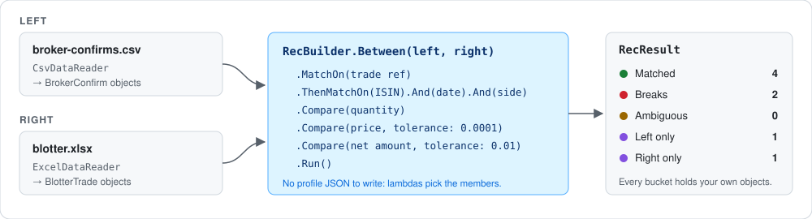
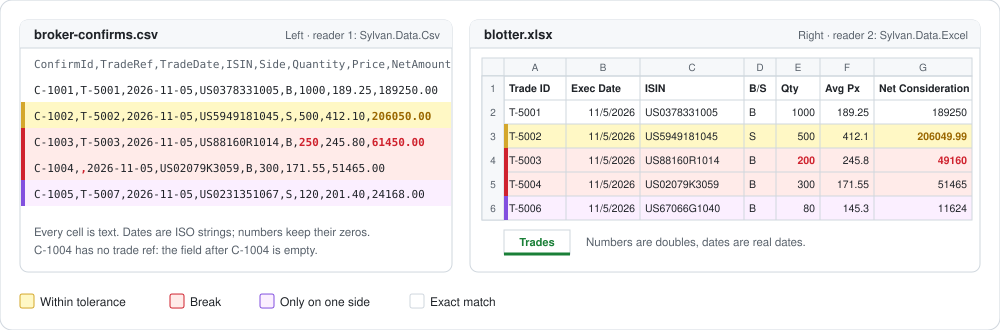

# Reconcile your own objects with `RecBuilder`

You have two lists that should agree: what the broker confirmed and what you booked, or what the carrier delivered and what the dock received. `RecBuilder` lines them up using lambdas over your own types. There's no profile JSON to write and no column mapping file.

You get your own objects back, sorted into **matched**, **breaks**, **ambiguous**, **left only** and **right only**.



Every output block on this page is real output from the [sample program](sample), not a mock-up.

## Contents

1. [The short version](#the-short-version)
2. [What each call does](#what-each-call-does)
3. [Finance: broker CSV vs trade blotter in Excel (two readers)](#finance-broker-csv-vs-trade-blotter-in-excel)
4. [Logistics: carrier deliveries vs dock receipts](#logistics-carrier-deliveries-vs-dock-receipts)
5. [Retail: POS sales vs card settlement](#retail-pos-sales-vs-card-settlement)
6. [Healthcare billing: claim lines vs payer remittance](#healthcare-billing-claim-lines-vs-payer-remittance)
7. [The printer the examples use](#the-printer-the-examples-use)
8. [Good to know](#good-to-know)
9. [Run the examples yourself](#run-the-examples-yourself)

## The short version

```csharp
using RecDiffy;

var result = RecBuilder.Between(ledger, statement)        // any two IEnumerable<T>
    .MatchOn(entry => entry.Ref, line => line.Reference)  // pass 1: equal references match
    .ThenMatchOn(entry => entry.Date, line => line.Posted) // pass 2: for what pass 1 left over...
        .And(entry => entry.Amount, line => line.Amount)  //   ...date and amount together
    .Compare(entry => entry.Amount, line => line.Amount, tolerance: 0.05m)
    .Run();

foreach (var match in result.Breaks)
    Console.WriteLine($"{match.Left[0]} disagrees with {match.Right[0]}");
foreach (var entry in result.LeftOnly)
    Console.WriteLine($"only in the ledger: {entry}");
```

## What each call does

| Call | What it does |
|---|---|
| `RecBuilder.Between(left, right)` | Starts a reconciliation of any two `IEnumerable<T>`. Both are read once, straight away. |
| `.MatchOn(l => …, r => …)` | The first matching pass. A left item and a right item match when these members are equal. |
| `.And(l => …, r => …)` | Adds another member to the latest pass, so that pass matches only when all its members are equal. |
| `.ThenMatchOn(l => …, r => …)` | The next pass. It only tries items that the earlier passes left unmatched. |
| `.Compare(l => …, r => …, tolerance)` | Compares a member pair on every matched pair. A number may differ by up to `tolerance`, inclusive. |
| `.Named(id, version)` | Names the profile the builder generates. Optional. |
| `.Run()` | Runs the reconciliation and returns a `RecResult<TLeft, TRight>`. |

And what you get back:

| `RecResult` member | What it holds |
|---|---|
| `Matched` | Every matched pair as a `RecMatch` (`Left`, `Right`, `Outcome`, `Diffs`), in the order of the left items |
| `Breaks` | The matched pairs where a compared member is outside its tolerance |
| `Ambiguous` | Items that could match more than one item on the other side, so none was chosen |
| `LeftOnly` / `RightOnly` | Your items that found no partner |
| `Profile` | The profile that ran. `result.Profile.ToJson()` saves it. |
| `Result` | The engine's full result, with explanations and diagnostics |

Each matched pair's `Outcome` is `Exact`, `WithinTolerance` or `Break`.

---

## Finance: broker CSV vs trade blotter in Excel

> **Two different readers, one reconciliation.**
>
> Every evening the broker emails a CSV of the trades it executed for you. Your order management system exports its blotter to Excel. Did the broker confirm exactly what you booked?



### Left: [`broker-confirms.csv`](data/broker-confirms.csv)

```csv
ConfirmId,TradeRef,TradeDate,ISIN,Side,Quantity,Price,NetAmount
C-1001,T-5001,2026-11-05,US0378331005,B,1000,189.25,189250.00
C-1002,T-5002,2026-11-05,US5949181045,S,500,412.10,206050.00
C-1003,T-5003,2026-11-05,US88160R1014,B,250,245.80,61450.00
C-1004,,2026-11-05,US02079K3059,B,300,171.55,51465.00
C-1005,T-5007,2026-11-05,US0231351067,S,120,201.40,24168.00
```

### Right: [`blotter.xlsx`](data/blotter.xlsx), sheet `Trades`

| Trade ID | Exec Date | ISIN | B/S | Qty | Avg Px | Net Consideration |
|---|---|---|---|--:|--:|--:|
| T-5001 | 11/5/2026 | US0378331005 | B | 1000 | 189.25 | 189250 |
| T-5002 | 11/5/2026 | US5949181045 | S | 500 | 412.1 | 206049.99 |
| T-5003 | 11/5/2026 | US88160R1014 | B | 200 | 245.8 | 49160 |
| T-5004 | 11/5/2026 | US02079K3059 | B | 300 | 171.55 | 51465 |
| T-5006 | 11/5/2026 | US67066G1040 | B | 80 | 145.3 | 11624 |

The two files don't line up on their own:
- **Column names differ:** `TradeRef` vs `Trade ID`, `Quantity` vs `Qty`.
- **Types differ:** every CSV cell is text, while Excel stores numbers and real dates.
- **The rows differ:** each file has a trade the other doesn't.

### 1. Your types

Each side gets its own record, shaped the way its source is shaped. They don't need to match each other.

```csharp
// What the broker says we traded. One CSV line per confirmation.
public sealed record BrokerConfirm(
    string ConfirmId, string? TradeRef, DateOnly TradeDate, string Isin, string Side,
    decimal Quantity, decimal Price, decimal NetAmount);

// What our order management system booked. One Excel row per trade.
public sealed record BlotterTrade(
    string TradeId, DateTime ExecutedOn, string Isin, string BuySell,
    long Qty, decimal AvgPrice, decimal NetConsideration);
```

### 2. Two readers

`RecBuilder` only sees objects, so use whichever readers you already have, such as CsvHelper, EPPlus, Dapper or EF Core. This example uses [Sylvan](https://github.com/MarkPflug/Sylvan) for both files:

```
dotnet add package Sylvan.Data.Csv
dotnet add package Sylvan.Data.Excel
```

```csharp
using System.Data;          // GetString("column") and friends
using System.Globalization;
using Sylvan.Data.Csv;
using Sylvan.Data.Excel;

// Reader 1: Sylvan.Data.Csv. Every CSV cell is text, so parse it with the invariant culture.
static IEnumerable<BrokerConfirm> ReadConfirms(string path)
{
    using var csv = CsvDataReader.Create(path);
    while (csv.Read())
        yield return new BrokerConfirm(
            ConfirmId: csv.GetString("ConfirmId"),
            TradeRef: csv.GetString("TradeRef") is { Length: > 0 } tradeRef ? tradeRef : null,
            TradeDate: DateOnly.ParseExact(csv.GetString("TradeDate"), "yyyy-MM-dd", CultureInfo.InvariantCulture),
            Isin: csv.GetString("ISIN"),
            Side: csv.GetString("Side"),
            Quantity: decimal.Parse(csv.GetString("Quantity"), CultureInfo.InvariantCulture),
            Price: decimal.Parse(csv.GetString("Price"), CultureInfo.InvariantCulture),
            NetAmount: decimal.Parse(csv.GetString("NetAmount"), CultureInfo.InvariantCulture));
}

// Reader 2: Sylvan.Data.Excel. Excel stores numbers as doubles and dates as dates.
static IEnumerable<BlotterTrade> ReadBlotter(string path)
{
    using var excel = ExcelDataReader.Create(path);
    while (excel.Read())
        yield return new BlotterTrade(
            TradeId: excel.GetString("Trade ID"),
            ExecutedOn: excel.GetDateTime("Exec Date"),
            Isin: excel.GetString("ISIN"),
            BuySell: excel.GetString("B/S"),
            Qty: (long)excel.GetDouble("Qty"),
            AvgPrice: (decimal)excel.GetDouble("Avg Px"),
            NetConsideration: (decimal)excel.GetDouble("Net Consideration"));
}
```

### 3. The mapping

This is the only RecDiffy code in the example:

```csharp
var confirms = ReadConfirms("broker-confirms.csv");
var blotter = ReadBlotter("blotter.xlsx");

var result = RecBuilder.Between(confirms, blotter)
    .Named("broker-vs-blotter", "1.0.0")
    .MatchOn(confirm => confirm.TradeRef, trade => trade.TradeId)
    .ThenMatchOn(confirm => confirm.Isin, trade => trade.Isin)
        .And(confirm => confirm.TradeDate, trade => trade.ExecutedOn)
        .And(confirm => confirm.Side, trade => trade.BuySell)
    .Compare(confirm => confirm.Quantity, trade => trade.Qty)
    .Compare(confirm => confirm.Price, trade => trade.AvgPrice, tolerance: 0.0001m)
    .Compare(confirm => confirm.NetAmount, trade => trade.NetConsideration, tolerance: 0.01m)
    .Run();

Report.Print(result, confirm => confirm.ConfirmId, trade => trade.TradeId);
```

Here's what each line says:

| Line | Meaning |
|---|---|
| `MatchOn(TradeRef ↔ TradeId)` | Pass 1. The broker quotes our trade ID, so match on it first. |
| `ThenMatchOn(Isin ↔ Isin)` `.And(TradeDate ↔ ExecutedOn)` `.And(Side ↔ BuySell)` | Pass 2, for confirms without a usable reference. Match on the same instrument, day and direction. `DateOnly` pairs with `DateTime` because both are dates. |
| `Compare(Quantity ↔ Qty)` | The quantity must be exactly equal. `decimal` pairs with `long` because both are numbers. |
| `Compare(Price ↔ AvgPrice, 0.0001)` | Price may differ by up to 0.0001. |
| `Compare(NetAmount ↔ NetConsideration, 0.01)` | Net amount may differ by up to a cent. |

### 4. The output

```text
Matched 4 (2 with breaks) | Ambiguous 0 | Left only 1 | Right only 1

  Exact             C-1001 ↔ T-5001
  Within tolerance  C-1002 ↔ T-5002
                      NetAmount: 206050.00 vs 206049.99
  Break             C-1003 ↔ T-5003
                      Quantity: 250 vs 200
                      NetAmount: 61450.00 vs 49160
  Break             C-1004 ↔ T-5004
                      TradeRef: (blank) vs T-5004
  Left only         C-1005
  Right only        T-5006
```

What each line means:

- **C-1001 ↔ T-5001: exact.** Every compared field agrees.
- **C-1002 ↔ T-5002: within tolerance.** The net amounts differ by one cent, which the 0.01 tolerance allows.
- **C-1003 ↔ T-5003: a break.** The broker filled 250 shares; we booked 200. The net amount differs as a result.
- **C-1004 ↔ T-5004: a break.** The confirm has no trade ref, so pass 1 couldn't match it. Pass 2 matched it on ISIN, date and side. Members used in a match are compared too, so the missing ref still shows as a break. That's useful: someone should ask the broker to fix its reference.
- **C-1005: left only.** The broker confirmed a trade we never booked.
- **T-5006: right only.** We booked a trade the broker hasn't confirmed.

<details>
<summary>The profile <code>RecBuilder</code> generated (<code>result.Profile.ToJson()</code>)</summary>

```json
{
  "formatVersion": 1,
  "profileId": "broker-vs-blotter",
  "version": "1.0.0",
  "rounding": {
    "midpoint": "ToEven"
  },
  "fields": [
    {
      "name": "TradeRef",
      "type": "Identifier",
      "role": "Key"
    },
    {
      "name": "Isin",
      "type": "Identifier",
      "role": "Key"
    },
    {
      "name": "TradeDate",
      "type": "Date",
      "role": "Key"
    },
    {
      "name": "Side",
      "type": "Identifier",
      "role": "Key"
    },
    {
      "name": "Quantity",
      "type": "Decimal",
      "role": "Economic",
      "scale": 28
    },
    {
      "name": "Price",
      "type": "Decimal",
      "role": "Economic",
      "scale": 28
    },
    {
      "name": "NetAmount",
      "type": "Decimal",
      "role": "Economic",
      "scale": 28
    }
  ],
  "normalization": {
    "left": {
      "identify": [
        {
          "rule": "identifier.map",
          "from": "TradeRef",
          "to": "TradeRef",
          "scheme": "TradeRef"
        },
        {
          "rule": "identifier.map",
          "from": "Isin",
          "to": "Isin",
          "scheme": "Isin"
        },
        {
          "rule": "identifier.map",
          "from": "Side",
          "to": "Side",
          "scheme": "Side"
        }
      ],
      "parse": [
        {
          "rule": "date.parse",
          "from": "TradeDate",
          "to": "TradeDate"
        },
        {
          "rule": "decimal.parse",
          "from": "Quantity",
          "to": "Quantity"
        },
        {
          "rule": "decimal.parse",
          "from": "Price",
          "to": "Price"
        },
        {
          "rule": "decimal.parse",
          "from": "NetAmount",
          "to": "NetAmount"
        }
      ]
    },
    "right": {
      "identify": [
        {
          "rule": "identifier.map",
          "from": "TradeId",
          "to": "TradeRef",
          "scheme": "TradeRef"
        },
        {
          "rule": "identifier.map",
          "from": "Isin",
          "to": "Isin",
          "scheme": "Isin"
        },
        {
          "rule": "identifier.map",
          "from": "BuySell",
          "to": "Side",
          "scheme": "Side"
        }
      ],
      "parse": [
        {
          "rule": "date.parse",
          "from": "ExecutedOn",
          "to": "TradeDate"
        },
        {
          "rule": "decimal.parse",
          "from": "Qty",
          "to": "Quantity"
        },
        {
          "rule": "decimal.parse",
          "from": "AvgPrice",
          "to": "Price"
        },
        {
          "rule": "decimal.parse",
          "from": "NetConsideration",
          "to": "NetAmount"
        }
      ]
    }
  },
  "paths": [
    {
      "id": "typed",
      "route": {
        "rule": "route.all"
      },
      "passes": [
        {
          "id": "P1",
          "pass": "match.naturalKey",
          "key": [
            "TradeRef"
          ]
        },
        {
          "id": "P2",
          "pass": "match.naturalKey",
          "key": [
            "Isin",
            "TradeDate",
            "Side"
          ]
        }
      ],
      "diff": {
        "fields": {
          "NetAmount": {
            "tolerance": {
              "absolute": 0.01
            }
          },
          "Price": {
            "tolerance": {
              "absolute": 0.0001
            }
          }
        }
      }
    }
  ],
  "limits": {
    "maxGroupSize": 8,
    "maxBlockItems": 24,
    "maxTargetsPerComponent": 8,
    "maxNodesPerTarget": 250000
  }
}
```

Save it to keep an exact record of what ran. Its column names are your member names (`TradeRef`, `Isin`, `TradeId`, …).

</details>

---

## Logistics: carrier deliveries vs dock receipts

> The carrier's API says what it delivered. Your warehouse system records what the dock actually received. Was anything short, damaged or lost?

In the tables, **bold** marks the values that will disagree.

**Left: `CarrierDelivery`**, from the carrier's tracking API (for example `JsonSerializer.Deserialize<CarrierDelivery[]>(json)`)

| TrackingNo | PoNumber | Sku | Cartons | WeightKg | DeliveredOn |
|---|---|---|--:|--:|---|
| 1Z999AA10123456784 | PO-7781 | CHAIR-01 | 12 | 240.0 | 2026-11-03 |
| 1Z999AA10123456785 | PO-7781 | DESK-02 | 8 | 410.0 | 2026-11-03 |
| 1Z999AA10123456786 | PO-7782 | LAMP-03 | 20 | 96.0 | 2026-11-04 |
| 1Z999AA10123456787 | PO-7783 | SHELF-04 | 5 | 150.0 | 2026-11-04 |
| 1Z999AA10123456788 | PO-7784 | RUG-05 | 3 | 45.0 | 2026-11-05 |

**Right: `DockReceipt`**, from the warehouse database (for example a Dapper or EF Core query)

| ReceiptNo | Tracking | Po | Sku | CartonsReceived | Kg | ReceivedAt |
|---|---|---|---|--:|--:|---|
| RCV-9001 | 1Z999AA10123456784 | PO-7781 | CHAIR-01 | 12 | 240.0 | 2026-11-03 14:10 |
| RCV-9002 | 1Z999AA10123456785 | PO-7781 | DESK-02 | 8 | **409.6** | 2026-11-03 14:25 |
| RCV-9003 | 1Z999AA10123456786 | PO-7782 | LAMP-03 | **18** | **86.4** | 2026-11-04 09:05 |
| RCV-9004 | **1Z999AA1012345678** | PO-7783 | SHELF-04 | 5 | 150.0 | 2026-11-04 11:40 |
| RCV-9006 | *(none)* | PO-7790 | CHAIR-01 | 4 | 80.0 | 2026-11-05 16:00 |

```csharp
public sealed record CarrierDelivery(string TrackingNo, string PoNumber, string Sku, int Cartons, decimal WeightKg, DateOnly DeliveredOn);
public sealed record DockReceipt(string ReceiptNo, string? Tracking, string Po, string Sku, int CartonsReceived, decimal Kg, DateTime ReceivedAt);

var result = RecBuilder.Between(deliveries, receipts)
    .MatchOn(delivery => delivery.TrackingNo, receipt => receipt.Tracking)
        .And(delivery => delivery.Sku, receipt => receipt.Sku)
    .ThenMatchOn(delivery => delivery.PoNumber, receipt => receipt.Po)
        .And(delivery => delivery.Sku, receipt => receipt.Sku)
    .Compare(delivery => delivery.Cartons, receipt => receipt.CartonsReceived)
    .Compare(delivery => delivery.WeightKg, receipt => receipt.Kg, tolerance: 0.5m)
    .Run();

Report.Print(result, delivery => $"{delivery.TrackingNo} {delivery.Sku}", receipt => receipt.ReceiptNo);
```

```text
Matched 4 (2 with breaks) | Ambiguous 0 | Left only 1 | Right only 1

  Exact             1Z999AA10123456784 CHAIR-01 ↔ RCV-9001
  Within tolerance  1Z999AA10123456785 DESK-02 ↔ RCV-9002
                      WeightKg: 410.0 vs 409.6
  Break             1Z999AA10123456786 LAMP-03 ↔ RCV-9003
                      Cartons: 20 vs 18
                      WeightKg: 96.0 vs 86.4
  Break             1Z999AA10123456787 SHELF-04 ↔ RCV-9004
                      TrackingNo: 1Z999AA10123456787 vs 1Z999AA1012345678
  Left only         1Z999AA10123456788 RUG-05
  Right only        RCV-9006
```

- **Pass 1 matches on tracking number and SKU.** A shipment can hold several SKUs, so the tracking number alone isn't enough.
- **Pass 2 falls back to PO and SKU.** It catches receipts where the dock mistyped the tracking number. RCV-9004 is one, and the mistyped number is reported so it can be corrected.
- **Weight is allowed half a kilo of scale noise** (DESK-02). A box of LAMP-03 is short: 2 cartons and 9.6 kg are missing.
- **The RUG-05 delivery was never received** (left only), so file a claim with the carrier. **RCV-9006 arrived without any carrier record** (right only).

---

## Retail: POS sales vs card settlement

> Your point-of-sale system records each card sale. The card processor pays out what it settled the next day. Did every sale get paid, and for the right amount?

**Left: `PosSale`**, from the POS database

| SaleId | AuthCode | CardLast4 | Amount | BusinessDate |
|---|---|---|--:|---|
| S-0001 | A1B2C3 | 4242 | 58.40 | 2026-11-05 |
| S-0002 | D4E5F6 | 1881 | 120.00 | 2026-11-05 |
| S-0003 | **G7H8I9** | **0005** | 19.99 | 2026-11-05 |
| S-0004 | **G7H8I9** | **0005** | 19.99 | 2026-11-05 |
| S-0005 | J1K2L3 | 7777 | 45.00 | 2026-11-05 |

**Right: `Settlement`**, from the processor's settlement report

| ProcessorRef | Auth | Last4 | Gross | Fee | SettledOn |
|---|---|---|--:|--:|---|
| STL-001 | A1B2C3 | 4242 | 58.40 | 1.69 | 2026-11-06 |
| STL-002 | D4E5F6 | 1881 | **132.00** | 3.83 | 2026-11-06 |
| STL-003 | G7H8I9 | 0005 | 19.99 | 0.58 | 2026-11-06 |
| STL-004 | M4N5O6 | 3005 | -60.00 | 0.00 | 2026-11-06 |

```csharp
public sealed record PosSale(string SaleId, string AuthCode, string CardLast4, decimal Amount, DateOnly BusinessDate);
public sealed record Settlement(string ProcessorRef, string Auth, string Last4, decimal Gross, decimal Fee, DateOnly SettledOn);

var result = RecBuilder.Between(sales, settlements)
    .MatchOn(sale => sale.AuthCode, settlement => settlement.Auth)
        .And(sale => sale.CardLast4, settlement => settlement.Last4)
    .Compare(sale => sale.Amount, settlement => settlement.Gross)
    .Run();

Report.Print(result, sale => sale.SaleId, settlement => settlement.ProcessorRef);
```

```text
Matched 2 (1 with breaks) | Ambiguous 1 | Left only 1 | Right only 1

  Exact             S-0001 ↔ STL-001
  Break             S-0002 ↔ STL-002
                      Amount: 120.00 vs 132.00
  Ambiguous         S-0003 + S-0004 ↔ STL-003
  Left only         S-0005
  Right only        STL-004
```

- **S-0002 settled for 12.00 more than the till rang up.** That's typically a tip added after the till closed.
- **S-0003 and S-0004 are a double swipe:** two POS rows with the same authorization, and only one settlement. `RecBuilder` doesn't guess which one was paid. It reports both as **ambiguous** so a person decides.
- **S-0005 was never settled** (left only), so chase it with the processor. **STL-004 is a refund** issued at the processor that the POS never recorded (right only).
- The settlement date isn't compared, because a settlement is always a day or more after the sale.

---

## Healthcare billing: claim lines vs payer remittance

> Your practice management system knows what you billed and what each payer's contract says you should be allowed. The payer's remittance says what it actually allowed. Were you underpaid?

All data here is made up. The procedure codes are ordinary CPT codes, and there's no patient information.

**Left: `ClaimLine`**, from the practice management system

| ClaimId | Cpt | ServiceDate | Billed | ExpectedAllowed |
|---|---|---|--:|--:|
| CLM-3001 | 99213 | 2026-10-14 | 180.00 | 92.50 |
| CLM-3001 | 85025 | 2026-10-14 | 45.00 | 10.80 |
| CLM-3002 | 99214 | 2026-10-15 | 250.00 | 130.00 |
| CLM-3003 | 93000 | 2026-10-16 | 95.00 | 17.20 |
| CLM-3004 | 99203 | 2026-10-20 | 210.00 | 110.00 |

**Right: `RemitLine`**, from the payer's remittance (an 835 file, parsed by your clearinghouse)

| PayerClaimRef | ProcedureCode | DateOfService | Allowed | Paid |
|---|---|---|--:|--:|
| CLM-3001 | 99213 | 2026-10-14 | 92.50 | 72.50 |
| CLM-3001 | 85025 | 2026-10-14 | 10.80 | 10.80 |
| CLM-3002 | 99214 | 2026-10-15 | **112.00** | 89.60 |
| CLM-3003 | 93000 | 2026-10-16 | **17.00** | 17.00 |
| CLM-2987 | 99212 | 2026-09-30 | 61.00 | 61.00 |

```csharp
public sealed record ClaimLine(string ClaimId, string Cpt, DateOnly ServiceDate, decimal Billed, decimal ExpectedAllowed);
public sealed record RemitLine(string PayerClaimRef, string ProcedureCode, DateOnly DateOfService, decimal Allowed, decimal Paid);

var result = RecBuilder.Between(claims, remittance)
    .MatchOn(claim => claim.ClaimId, remit => remit.PayerClaimRef)
        .And(claim => claim.Cpt, remit => remit.ProcedureCode)
    .Compare(claim => claim.ServiceDate, remit => remit.DateOfService)
    .Compare(claim => claim.ExpectedAllowed, remit => remit.Allowed, tolerance: 1.00m)
    .Run();

Report.Print(result, claim => $"{claim.ClaimId}/{claim.Cpt}", remit => $"{remit.PayerClaimRef}/{remit.ProcedureCode}");
```

```text
Matched 4 (1 with breaks) | Ambiguous 0 | Left only 1 | Right only 1

  Exact             CLM-3001/99213 ↔ CLM-3001/99213
  Exact             CLM-3001/85025 ↔ CLM-3001/85025
  Break             CLM-3002/99214 ↔ CLM-3002/99214
                      ExpectedAllowed: 130.00 vs 112.00
  Within tolerance  CLM-3003/93000 ↔ CLM-3003/93000
                      ExpectedAllowed: 17.20 vs 17.00
  Left only         CLM-3004/99203
  Right only        CLM-2987/99212
```

- **Match on claim and procedure code.** One claim has several lines, so the claim ID alone isn't enough (CLM-3001).
- **CLM-3002 was underpaid by 18.00,** so appeal it. **CLM-3003 is 0.20 under**, within the 1.00 you chose to ignore.
- **CLM-3004 has no remittance yet** (left only): it's still outstanding. **CLM-2987 is a remittance for an older claim** that isn't in this batch (right only).
- The service date is compared too. It agrees on every line, so no date break appears.

---

## The printer the examples use

The examples share one small helper. It isn't part of RecDiffy; copy it, or write your own over `RecResult`.

```csharp
using System.Globalization;
using RecDiffy;
using RecDiffy.Results;

public static class Report
{
    public static void Print<TLeft, TRight>(RecResult<TLeft, TRight> result, Func<TLeft, string> left, Func<TRight, string> right)
    {
        Console.WriteLine($"Matched {result.Matched.Count} ({result.Breaks.Count} with breaks) | Ambiguous {result.Ambiguous.Count} | Left only {result.LeftOnly.Count} | Right only {result.RightOnly.Count}");
        Console.WriteLine();
        foreach (var match in result.Matched)
        {
            Console.WriteLine($"  {Label(match.Outcome),-17} {left(match.Left[0])} ↔ {right(match.Right[0])}");
            foreach (var diff in match.Diffs.Where(diff => diff.Outcome is FieldOutcome.WithinTolerance or FieldOutcome.Break))
                Console.WriteLine($"  {"",-17}   {diff.Field}: {Show(diff.Left)} vs {Show(diff.Right)}");
        }

        foreach (var group in result.Ambiguous)
            Console.WriteLine($"  {"Ambiguous",-17} {string.Join(" + ", group.Left.Select(left))} ↔ {string.Join(" + ", group.Right.Select(right))}");
        foreach (var item in result.LeftOnly)
            Console.WriteLine($"  {"Left only",-17} {left(item)}");
        foreach (var item in result.RightOnly)
            Console.WriteLine($"  {"Right only",-17} {right(item)}");
    }

    private static string Label(FieldOutcome outcome) => outcome switch
    {
        FieldOutcome.WithinTolerance => "Within tolerance",
        _ => outcome.ToString(),
    };

    private static string Show(CanonicalValue value) => value switch
    {
        { IsNull: true } => "(blank)",
        { Type: FieldType.Decimal } => value.Number.ToString(CultureInfo.InvariantCulture),
        { Type: FieldType.Date } => value.Date.ToString("yyyy-MM-dd", CultureInfo.InvariantCulture),
        _ => value.Text ?? "",
    };
}
```

## Good to know

- **Pairs must be the same kind.**
  - `decimal`, `int` and `long` pair with each other.
  - `DateOnly` and `DateTime` pair with each other; the time of day is dropped.
  - `string` pairs with `string`.

  Pairing a number with a string throws an `ArgumentException` as soon as you call `MatchOn` or `Compare`.
- **Tolerances are for numbers.** They are absolute and inclusive: `tolerance: 0.01m` allows a difference of exactly 0.01.
- **Members you match on are compared too.** A pair found by a later pass reports how it differs on an earlier pass's members, like C-1004's blank trade ref.
- **Selectors pick a property or field,** such as `r => r.Amount` or `r => r.Header.Ref`. They can't be a calculation like `r => r.Amount * 100`. To normalize a value, for example `"BUY"` to `"B"`, do it when you build your objects.
- **A field is named after the left member,** and each left member pairs with exactly one right member.
- **Ambiguous means nothing was guessed.** When two items on one side share a key, none of them matches. Either add a member to the key with `.And(...)`, or resolve the duplicates by hand.
- **Both sequences are read once,** when you call `Between`. Later changes to the source don't affect the run.
- **Culture is your reader's job.** `RecBuilder` takes typed values, so it needs no culture: your reader decides how text becomes numbers and dates. Reader 1 parses with the invariant culture because that is how the file is written. A profile-based run declares culture in the profile instead; see [Declare how each file is read](../../README.md#declare-how-each-file-is-read).
- **No `float` or `double` members.** They are rejected, because any conversion to `decimal` is a choice only you can make. Convert in your reader, as Reader 2 does.

## Run the examples yourself

The [sample](sample) folder holds the program that produced every output on this page. It needs the .NET 10 SDK. Run it from the repository root:

```
dotnet run --project docs/typed-reconciliation/sample -- docs/typed-reconciliation/data
```

If the two finance files in [data](data) are missing, the program writes them first.
